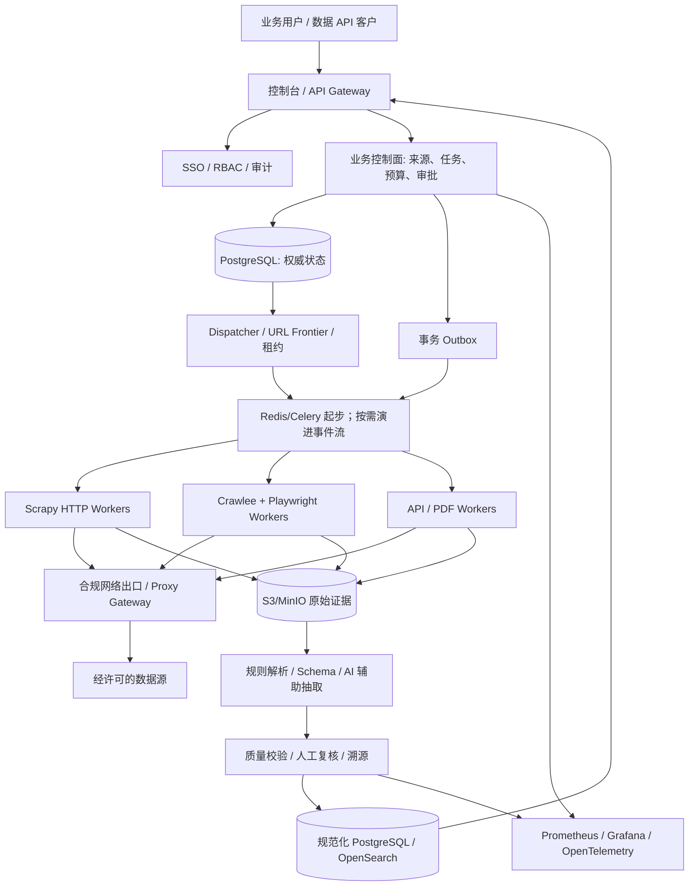
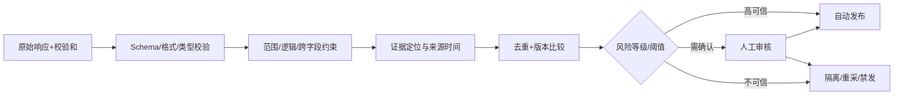

# AICrawl Enterprise 企业级 AI 智能分布式网络数据采集与治理平台

# 项目可行性研究报告（FSR V1.0）

> 文档编号：AICRAWL-FSR-2026-001  
> 版本：V1.0（立项评审稿）  
> 编制日期：2026-11-17  
> 文档密级：公司内部／受控  
> 关联文档：[PRD V2.0](./AICrawl_Enterprise_PRD_V2.0_详细版.md)、[SDD V1.0](./AICrawl_Enterprise_SDD_V1.0_详细系统设计.md)  
> 报告结论：**有条件立项；先验证、再建设、按门槛分期投资**。

---

## 0. 报告使用说明和结论边界

### 0.1 决策摘要

**建议批准 6～8 周的 PoC 验证阶段**，确认真实业务来源、合法访问范围、单位有效记录成本、字段质量、网络稳定性和数据交付价值后，再决定是否投入约 20～24 周的 MVP/生产化建设。此处工期为拟议规划，并非承诺完成时间。

本项目技术可行性较高：可以组合成熟采集引擎、任务调度、浏览器自动化、AI 辅助抽取和云原生运维组件。但“工具能够请求网页”**不等于**“企业可合法、稳定、经济地取得目标数据”，也不等于可获得客户付费。

**本报告的预算、容量、性能、收益均是场景化估算，不代表供应商正式报价或已经验证的经营数据。** 待公司提供首批站点、授权清单、地区、采购报价和客户需求后，升级至 V1.1 形成签字版投资测算。

### 0.2 可行性结论表

| 维度 | 判断 | 主要依据 | 未解决约束 | 下一步 |
|---|---|---|---|---|
| 技术成熟度 | 较高 | Scrapy、Crawlee、Playwright、PostgreSQL 等生态成熟 | 不同站点模板差异大 | 站点级 PoC |
| 系统集成 | 中高可行 | 标准 API、消息队列、容器部署可实现 | 状态一致性、异构引擎适配 | 调度故障注入 |
| 海外访问 | 有条件可行 | 企业出口/合规代理服务可以提供合法地域路由 | 网站授权、地域限制、供应商条款和成本 | 合规及合同核验 |
| 采集稳定性 | 有条件可行 | 限速、租约、重试、监控可以降低工程故障 | 站点变化、封锁、版权与条款限制 | 真实样本连续运行 |
| 数据准确性 | 有条件可行 | 规则抽取＋证据追溯＋金标评估可量化 | AI 幻觉、字段歧义、原站错误 | 盲测和人工复核 |
| 安全合规 | 中高风险、可治理 | 访问许可门禁、数据最小化、审计、DLP | 跨境个人数据、知识产权、站点限制 | 法务逐源审批 |
| 财务可行性 | 待验证 | 可建立使用量成本模型 | 代理/浏览器/人工维护成本波动 | 获取正式报价 |
| 商业可行性 | 待验证 | 招聘、电商、政策和资讯存在数据需求 | 数据授权、付费意愿、竞争和获客 | 锚点客户试点 |
| 组织可行性 | 有条件可行 | 可采用 6～8 人跨职能团队 | 站点维护、运维与合规承担者 | 明确岗位与责任 |

### 0.3 当前缺失的关键输入（不得擅自视为已确定）

1. 首批目标网站、国家、域名、访问授权/条款和预计站点数量。
2. 业务目标：内部降本，还是对外销售 API/数据产品，或两者兼有。
3. 每日采集 URL、数据量、动态页面占比、数据保留期、地域比例、更新频率。
4. 首批客户数、每月付费金额或内部节省工时、替代工具和机会成本。
5. 云资源部署地点、数据驻留要求、网络安全基线、采购与财务口径。
6. 代理供应商真实报价、出口可用地区、日志留存和数据处理条款。
7. 每类核心字段的金标定义、可接受漏检率及错误成本。

---

## 1. 项目背景、建设必要性与战略适配

### 1.1 现状与问题

分散式脚本常见痛点：任务无统一状态；一个域名改版影响大量脚本；人工确认数据错误成本高；浏览器与代理费用不透明；跨境出口无审计；无法按租户与客户解释数据来源；缺少断点续跑和质量证据。对于一次性任务，这些问题可由脚本解决；对于多个团队长期复用、对外提供付费服务，则需要平台化能力。

### 1.2 业务驱动和受益对象

| 业务 | 需求 | 期望数据产品 | 价值验证方式 |
|---|---|---|---|
| 海外招聘 | 岗位、技能、薪酬趋势 | 标准化岗位数据、趋势看板 | 人工成本减少、岗位覆盖与准确性 |
| 跨境电商 | 公开价格、库存和营销情报 | SKU 快照、波动告警 | 更新时效、误报率、客单价值 |
| 行业新闻 | 新闻、公告、公开报告 | 实体聚合、摘要、RAG 证据 | 信息提前量、重复率、引用质量 |
| 企业政策 | 公告、法规、招标文档 | 可检索文库、版本变更 | 重要文件召回率、引用正确性 |

**价值判别式**：只有在合法获取、质量达到使用阈值、维护成本低于收益、数据交付有稳定需求时，平台才产生真实商业价值。

### 1.3 边界与非目标

首期仅覆盖批准来源的公开或获得授权的数据；不承诺“任何网站都能抓取”；不绕过登录、支付墙、CAPTCHA 或网站技术访问控制；不采购来源不明代理；不将未审核的个人信息及敏感数据交由外部模型服务；不在没有数据使用权的情况下对外再分发。未获得许可的源可改用授权 API、正式数据合作或直接排除。

### 1.4 与现有 PRD/SDD 的一致性

以 PRD V2.0 的 IAM/SRC/JOB/NET/FET/EXT/DQ/AGT/OPS/BILL 为功能边界；以 SDD V1.0 的 PostgreSQL 任务真值、事务 Outbox、URL Frontier、异构 Worker、租约与幂等、规则优先 AI 辅助为设计约束。此报告不自行改变已有架构决议，只决定“值不值得做、什么条件下做、怎样分期验证”。

---

## 2. 备选方案比较（Build / Buy / Hybrid）

### 2.1 评估方案

| 选项 | 组成 | 优点 | 不足 | 合适条件 |
|---|---|---|---|---|
| A：继续脚本化 | Scrapy/Playwright＋少量 Cron | 初始投入最低 | 权限、质量、观测与多租户不足 | 站点少、低频、无对外交付 |
| B：采购 SaaS | 商业采集/API/托管服务 | 启动快，基础运维少 | 用量费用、数据驻留和定制约束 | 场景标准、可接受第三方处理 |
| C：完全自研 | 自建全部控制与采集系统 | 最灵活，可深度控制 | 工期长、技术风险高、维护成本大 | 特殊需求且长期规模大 |
| D：混合平台（推荐） | 自研控制/质量/权限＋开源内核＋按需采购代理/API | 核心资产可控，标准能力复用 | 多组件集成、需清晰责任边界 | 多站点、长期数据治理、多业务复用 |

### 2.2 决策评分框架

评分范围 1～5，权重示例仅用于架构研讨，不作为已完成采购评标。实际评审需让采购、财务、法务、研发分别打分并保存证据。

| 标准 | 权重 | A 脚本 | B SaaS | C 自研 | D 混合 |
|---|---:|---:|---:|---:|---:|
| 首期交付速度 | 15% | 4 | 5 | 1 | 3 |
| 定制和扩展 | 20% | 2 | 2 | 5 | 4 |
| 数据主权与审计 | 20% | 2 | 2 | 5 | 5 |
| 长期成本弹性 | 15% | 3 | 2 | 3 | 4 |
| 生产可维护性 | 15% | 2 | 4 | 3 | 4 |
| 供应商锁定风险 | 10% | 4 | 1 | 5 | 4 |
| 技术与组织风险 | 5% | 3 | 4 | 2 | 3 |
| **加权评分（示例）** | **100%** | **2.70** | **2.75** | **3.65** | **4.00** |

> 评分是初始判断而非用户实证；表内 A/B/C/D 数值必须由公司实际约束重新评定。D 的领先不意味着在所有业务量下都优于 SaaS。

### 2.3 为什么不把所有工具都作为核心

- Scrapy：高吞吐 HTTP、解析和中间件成熟；适合 Python 采集业务。
- Crawlee/Playwright：动态站点和浏览器执行；浏览器资源成本需单独控制。
- Crawl4AI：Markdown 化和结构化内容处理的候选，不保证业务字段天然准确。
- Crawlab：已存在爬虫的管理适配器；若另建主调度平台，应明确任务所有权，避免双主状态。
- Firecrawl、商业代理、托管 API：用于合规准入和成本更优时的可替换适配器。
- StormCrawler/Crawlo/Scrapling：不作为首期强依赖，先证明其对具体场景的增益。

#### 采购优先/自研优先的判定

若年需求少、站点稳定、数据主权要求一般，优先购买；若多个业务重复使用统一质量治理、复杂接口及长期可追溯，自研控制面更合理；若仅某批次外网站点昂贵，采用商业 API 单点接入，而不是为少数站点自建浏览器与代理体系。

---

## 3. 技术可行性研究

### 3.1 目标系统拓扑



### 3.2 控制面与数据面可实现性

**可实现，风险可控**：控制面包含任务配置、访问许可、租户配额、审批、预算、状态和审计；数据面由隔离 Worker 运行真实采集与解析。所有状态转换以 PostgreSQL 为准，消息通知允许至少一次投递，用租约 token、幂等键、Outbox/Inbox 与补偿扫描避免误认为“消息队列保证业务只执行一次”。

最小闭环：来源登记 → 法务/安全审批 → 抽取模板 → 任务创建 → 预检 → 队列派发 → HTTP/浏览器执行 → 原始证据 → 结构化字段 → 质量闸门 → 发布/复核 → API 交付。每一步记录 tenant_id、source_id、job_id、run_id、request_id、policy_version、extractor_version。

### 3.3 核心难点与解决方案

| 难点 | 可行技术路径 | 验证手段 | 退出条件 |
|---|---|---|---|
| Worker 崩溃后丢任务 | PG 租约＋心跳＋超时回收＋Outbox | Kill Pod、网络分区、重复消息 | 不丢任务、无不受控重复发布 |
| 动态页面资源贵 | HTTP 优先，浏览器按需分流 | CPU/内存/平均单页成本压测 | 成本超过上限则缩减覆盖 |
| DOM 改版解析失败 | 提取模板版本＋样本回放＋漂移报警 | 每类页面故意变更 DOM | 自动检测并阻断低质发布 |
| 境外网络不稳定 | 经许可出口＋供应商健康与熔断 | 多地区连续 14 天可用性试验 | 不可达源转授权 API 或下线 |
| 代理路由不可解释 | 策略版本、地域/供应商决策日志 | 抽样审计真实流量 | 不能解释线路则停用 |
| 重复/错误字段 | 业务主键、字段证据、金标集 | 盲测及跨批次一致性 | 关键字段不足阈值不发布 |
| AI 输出不稳定 | Schema 约束、规则优先、低置信复核 | Prompt/模型版本冻结回归 | 无来源证据字段不进入高可信区 |
| 第三方存储泄密 | DLP、加密、脱敏、访问控制 | 权限穿透及数据外传演练 | 高危发现未闭环不上线 |

### 3.4 可用性与容量初步判断

PoC 不能用“每秒发起多少 HTTP 请求”替代真实有效产出。真正产能应以**合法可执行请求数、有效业务记录数、质量通过数**计量。

**容量样例（纯假设）**：每日 100,000 个 URL；其中 HTTP 85%、浏览器 15%；HTTP 平均 2 秒，浏览器平均 12 秒；可用采集时段 12 小时。理想并行槽位约为 HTTP 3.9、浏览器 4.2（未计失败、域名限速、峰值、排队及浏览器资源冗余）。工程容量不能直接按此数字采购，应按真实网站限制、内存峰值和重试系数测算。

**参考计算**：`并行槽位 ≈ URL 数 × 平均占用秒数 / 允许执行秒数`；还需设置单站点令牌桶、全局租户配额和代理提供商资源上限，取各限制的交集。

### 3.5 性能与非功能要求（建议验收目标）

| 指标 | MVP 建议门槛 | 生产化建议门槛 | 测量口径 |
|---|---:|---:|---|
| 核心控制台 API p95 | ≤ 800 ms | ≤ 500 ms | 不含大导出与第三方延迟 |
| 任务状态最终收敛 | ≤ 5 min | ≤ 2 min | 崩溃/重试后的最终一致 |
| 调度器故障恢复 | ≤ 10 min | ≤ 5 min | 故障注入场景 |
| 采集成功率 | 分站点制定 | 分站点制定 | **仅统计许可请求**；区分 2xx 与有效数据 |
| 关键字段准确率 | 按业务定义，建议 ≥ 95% | 建议 ≥ 98% | 盲测金标、精确匹配/业务容差 |
| 关键字段漏检率 | ≤ 5%（建议） | ≤ 2%（建议） | 金标中真实存在的字段作分母 |
| 原始证据留存覆盖 | ≥ 99% | ≥ 99.9% | 成功抓取且应留存的请求 |
| 授权越权泄漏 | 0 起 | 0 起 | 负向安全自动化测试 |
| RPO/RTO | 由业务决策 | 经灾备演练签署 | 关键元数据与原件分别设定 |

注意：**95%/98% 是候选投资门槛，不是已有实测结果**。字段错误成本高的业务（例如政策生效日期或金额）应采用更严格逐字段标准与人工复核。

---

## 4. 海外网络、代理与访问治理可行性

### 4.1 正确认识“自动代理抓外网”

代理网络只是网络出口方式。企业要获得可持续能力，必须满足：来源获准、目标路径可访问、地域出口合法、供应商具有明确授权、个人数据处理合规、成本在预算内、质量可达标。**不能把代理轮换或浏览器仿真视为绕过站点拒绝访问的许可。**

### 4.2 三类海外接入路线

| 路线 | 适用 | 前置条件 | 成本结构 | 风险 |
|---|---|---|---|---|
| 企业自有境外出口 | 公开来源、稳定批量访问 | 合法网络架构与目标允许 | 固定线路+云带宽 | IP 限制、跨境数据合规 |
| 合规商业代理 | 允许代理获取的公开来源 | 供应商资质/来源/条款审计 | GB、请求、时长、地区 | 波动、高单价、日志留存 |
| 官方 API / 数据许可 | 有 API/商业合作的来源 | 合同授权/配额 | 按调用/订阅 | 条款限制与供应商依赖 |

### 4.3 路由决策硬门槛

路由必须先校验 `(source许可, country/region许可, data_class, contract, DNS/IP安全, 日/月预算, provider状态)`，任何硬门槛不满足直接拒绝派发。通过后再以可用性、延迟、单位成功记录成本等评分排序。出现 HTTP 401/403/429 或 CAPTCHA，应记录原因、遵从限制、暂停或走官方授权路径，不能自动扩大访问尝试。

### 4.4 代理单位成本模型

`总代理成本 = 流量 GB × 单价/GB + 请求计费 + 额外国家/会话费用 + 服务费`。

需要同时计算：**每千次请求成本**、**每千条有效记录成本**和**每千条通过质检的记录成本**。最后一个指标最能反映业务价值。

样例：如果日 100,000 URL，平均经代理传输 0.6 MB/URL，则理论月流量约 1,800 GB（30 天、十进制单位），未包括重试、页面子资源、压缩与缓存差异；若均由浏览器下载多种资源，费用可能明显不同。不得把 0.6 MB 当作真实测量值。

### 4.5 必要的供应商尽调清单

- 出口 IP 与网络来源合法性、地区覆盖、授权与责任归属。
- 支持哪些目标站点或内容类型；是否明确禁止特定用途。
- 流量/请求/会话收费口径、失败请求是否收费、超额与退款规则。
- 数据保护协议、日志保留、分包商、处理地域、删除协助。
- 出口可用率、响应延迟、并发上限、供应商故障通知与 SLA。
- 账号鉴权、IP 白名单、密钥轮换、账单导出和供应商替换能力。

**Go/No-Go 条件**：任何单一关键业务来源无法取得合法访问依据、或经 2 家候选供应商及授权 API 替代方式仍无法满足成本/可靠性要求，则不应把该来源纳入承诺范围。

---

## 5. 数据质量可行性与验证方法

### 5.1 “抓取成功”与“业务正确”分离

四层指标分别统计：网络请求成功、页面内容取得、字段抽取成功、业务记录通过质量校验。不能只依据 HTTP 200 判定成功，也不能将 LLM 自评置信度等同真实准确率。

### 5.2 数据质量分级链路



### 5.3 推荐检查规则

| 质量维度 | 核查方法 | 失败处理 |
|---|---|---|
| 完整性 | 必填字段、记录覆盖、预期数量基线 | 阻断发布、回采或复核 |
| 格式正确 | JSON Schema、日期币种单位解析 | 规则纠错或隔离 |
| 语义准确 | 字段证据定位＋人工标注金标 | 低置信不自动发布 |
| 一致性 | 薪酬上下界、币种周期、发布时间 | 标异常并复核 |
| 时效性 | 来源时间、采集时间、更新间隔 | 标过期/重新调度 |
| 唯一性 | 规范化 URL、站点ID、业务实体 ID | 合并/保留历史版本 |
| 可追溯 | 原始快照 URI/hash、模板和模型版本 | 禁止成为高可信数据 |
| 跨源核验 | 已获许可的官方数据、独立来源对照 | 冲突标注、不盲目覆盖 |

### 5.4 金标集设计

每个首期业务至少选 3～5 个不同页面模板、不同国家/语言以及正常/异常样本。建议 PoC 每业务建立 ≥ 300 条人工标注记录，其中 20% 以上保留为独立盲测集；仅作为启动建议，最终样本数应按所需置信区间和字段分布计算。由 2 名标注人员独立标注分歧样本，业务专家仲裁。尤其记录空值/不可判定及原站错误，避免把合法缺失错误算成抽取失败。

指标定义：

- 精确率 Precision = 正确提取的正例 / 提取为正例的全部候选。
- 召回率 Recall = 正确提取的正例 / 金标实际存在的正例。
- 字段准确率 = 与金标一致的字段数 / 纳入评估的字段数；数值字段应另设容差和标准化规则。
- 发布准确率 = 通过质检后发布的数据中，经独立抽样核对正确的比例。
- 有效交付率 = 通过质检并实际被业务接受的记录 / 所有采集候选。

应按**源、模板、字段、语言、国家、模型版本**分层统计，不用单个全局平均值掩盖弱点。

### 5.5 AI 是否值得引入

分三组 A/B 对比：A 纯规则抽取；B 规则＋LLM 兜底；C 全 LLM。比较字段准确率、人工审核量、平均耗时、单千条成本、错误类型。只有当 B 相较 A 的质量增益或维护成本减少可覆盖模型成本，并满足安全要求时，才在对应模板启用。**首期不建议 LLM 全量处理所有页面。**

---

## 6. 法律、知识产权、安全和跨境数据可行性

> 这一章是产品和工程风险框架，非针对具体国家或网站的法律意见。生产采集前必须由法务针对来源和接收地区逐项出具意见。

### 6.1 数据源分级

| 等级 | 数据源示例 | 默认动作 |
|---|---|---|
| L0 官方开放 API / 明确开放授权 | 数据开放门户、授权接口 | 在许可范围内优先接入 |
| L1 普通公开页面 | 官网新闻、公开政策 | 审查条款/robots/知识产权/负载后批准 |
| L2 涉个人信息或限制用途 | 个人简介、招聘联系人 | 数据最小化、法律依据及保留审查 |
| L3 登录、订阅或技术访问限制 | 付费服务、限制入口 | 未获授权不得执行 |
| L4 明示禁止或高敏感 | 禁止采集/敏感个人数据 | 默认拒绝，专项授权或排除 |

### 6.2 必须建设的合规措施

- `source_registry` 记录准入依据、允许路径、访问频率、适用地区、授权期限、审批人、条款快照、复核日期。
- 每次调度读取 `policy_version`，许可失效或无法确认时 fail-closed。
- 对含个人信息的数据做识别、分类、最小化、目的限制、访问审批、删除与留存策略。
- 对外提供内容时审核原站许可、版权和再分发权；引用原网页并不能替代取得必要授权。
- 跨境传输需核实数据主体、处理方、落地国家、合同、技术保障以及当地适用法规（例如适用时的 GDPR 第五章要求）。
- 独立处理 DSAR/数据主体请求、删除传播、审计和安全事件响应。

### 6.3 安全关键控制

1. SSRF 防护：所有 Worker 禁止访问内网、元数据服务、loopback、link-local，DNS 重绑定检查，允许列表控制。
2. 爬虫容器沙箱：只读根文件系统、最小权限、seccomp、网络 egress 策略、资源/时间/文件大小上限。
3. 凭据管理：Vault/KMS 密钥、动态下发、轮换、禁止明文日志与截图泄密。
4. 多租户隔离：tenant_id 强制过滤、RLS 或等价策略、跨租户自动化攻击测试。
5. 模型风险：提示词注入视为不可信网页输入；LLM 无权改变来源许可或触发高危操作。
6. 操作审计：来源准入、网络出口切换、原件导出、模型调用、敏感数据访问均留痕。

### 6.4 合规停机红线

没有授权依据、代理来源不明、需要破解技术限制、涉及未经批准个人数据处理、禁止再分发却计划售卖数据、严重影响目标站点服务、出现重大安全事件时必须停止相应数据源或工作负载。

---

## 7. 经济可行性与投入产出分析

### 7.1 财务模型口径

- 金额单位：**人民币万元（含税/未税尚未统一；本稿仅以内部规划口径展示）**。
- 时间范围：假设 12 个月，包含建设期和初期运营期。
- 下列单价和人力成本是**示例假设**，不是市场报价，更不是公司现有工资。
- 人力成本按全成本 3.5 万元/人/月、平均 6 FTE × 12 个月计，共 252 万元。实际可调整为现有人员机会成本或增量招聘成本，但不得混用两种口径。

### 7.2 年度成本情景

| 成本项 | 低成本情景 | 基准情景 | 高成本情景 | 估算依据/待确认 |
|---|---:|---:|---:|---|
| 研发及运维人力 | 252 | 252 | 252 | 6 FTE×3.5万元×12月 |
| 云资源/存储/监控 | 36 | 60 | 90 | 容量与多可用区需求 |
| 代理/网络/API | 24 | 60 | 120 | 目标地区与流量单价 |
| LLM/OCR | 6 | 18 | 36 | 调用比例与 Token 价格 |
| 安全/审计/测试/采购 | 10 | 20 | 30 | 安全评估、工具与外采 |
| **直接成本小计** | **328** | **410** | **528** | 前述项目之和 |
| 风险准备金（15%） | 49.2 | 61.5 | 79.2 | 以直接成本为基数 |
| **第一年总预算估算** | **377.2** | **471.5** | **607.2** | 非正式报价 |

> 以上对“6 人全职持续 12 个月”作保守成本测算；若 6～8 周 PoC 后终止，实际花费显著低于全年预算。全年投入必须采取分阶段审批，不能因为表内出现 471.5 万元就一次性锁定该预算。

### 7.3 初期分阶段拨款建议

- **阶段 0：准备（2 周）**：现有团队完成站点授权和数据需求确认，优先利用存量预算。
- **阶段 1：PoC（6～8 周）**：上限预算由财务另行审定；建议从专项验证资金拨付，交付金标结果、网络报告、成本账单、客户试点报告。
- **阶段 2：MVP（8～12 周）**：PoC Go 后批准，优先完成 P0 场景和质量闭环。
- **阶段 3：生产化（8～12 周）**：MVP 达标后批准，完成隔离、灾备、收费、运行手册与 SLO。
- **阶段 4：扩展（后续）**：根据已签客户订单和单位经济模型扩容。

阶段时间可存在重叠，**总建设周期需以关键路径重新排期**，不得简单相加得出固定承诺。

### 7.4 单位经济模型

定义：

```
单千URL成本 = （网络 + 云计算 + 存储 + 模型 + 可归集运维） / URL数 × 1000
单千有效记录成本 = 可归集成本 / 有效记录数 × 1000
单千质检通过记录成本 = 可归集成本 / 发布合格记录数 × 1000
客户毛利率 = （净收入 - 可归集直接交付成本） / 净收入
```

必须拆分**平台固定研发费用**和**可随业务增量变化的直接交付费用**，避免把初期研发摊销误认为未来边际成本，同时防止漏算持续适配成本。

### 7.5 商业模式假设和收入验证

| 模式 | 计价对象 | 关键约束 | 验证方法 |
|---|---|---|---|
| 内部降本 | 减少人工采集、清洗与审核工时 | 要有可核实基线工时 | 对照组工时与错误成本 |
| SaaS 席位/租户 | 管理员席位、任务数、数据源数 | 售后与稳定性要求 | 付费试点、留存 |
| 数据 API | 调用量、套餐、刷新频率 | 许可覆盖数据再分发 | 合同、付费调用、退款率 |
| 定制部署 | 实施费+维护费 | 可复制性和毛利空间 | 已签订单、交付工时 |
| 行业专题报告 | 周期订阅/项目交付 | 数据使用权和成果版权 | 复购、报告使用价值 |

**不可用“行业市场规模很大”代替签约收入预测。**

### 7.6 收支平衡与情景分析

以第一年基准总成本 471.5 万元为例：

- 若只考虑年度收入覆盖总成本，至少需要年收入 471.5 万元；这并不意味着会达到净利润盈亏平衡（未单列税费、融资费用和可能的销售成本）。
- 若假设可归集交付毛利率为 60%，且把第一年总预算暂当作需要毛利覆盖的固定负担，粗略所需收入为 `471.5/0.6≈785.8 万元`。**这是偏保守、存在成本口径简化的压力测试，而非正式财务盈亏平衡点**；若变量成本已经包含在预算内，还需避免重复计算。
- 如果主要是内部平台，应使用“被替代工时成本 + 错误损失减少 + 业务增量价值”进行 ROI，不应虚构外部合同。

### 7.7 敏感性分析与财务预警

优先跟踪五个敏感变量：浏览器页面占比、代理 GB 单价、有效记录率、人工维护工时、客户留存/付费单价。建议触发线：单位有效记录成本连续 2 周超过目标 25%、代理预算消耗预测超月上限、质检率跌破阈值、单客户贡献毛利为负时冻结扩容并复核。

---

## 8. 市场与商业可行性

### 8.1 不同客户群的采购决策因素

| 客群 | 买点 | 拒绝原因 | 首期建议 |
|---|---|---|---|
| 企业情报/市场研究 | 全球来源、时效、审计 | 数据重复、使用权不明 | 以专题报表切入 |
| HR/招聘分析 | 岗位/技能结构化 | 采集政策限制、岗位失效 | 以获许可岗位数据源切入 |
| 跨境零售企业 | 价格和竞品动态 | SKU 对齐错误、刷新慢 | 聚焦有限类目 |
| 金融/专业数据团队 | 来源、可追溯、稳定性 | 数据可靠性和法律风险 | 不作为最先规模化客群 |

### 8.2 竞争与差异化

商业采集工具通常在易上手、托管、代理资源方面占优；通用开源项目在深度开发和控制方面占优。本项目更可行的差异化不是“全网都能爬”，而是**可审计来源准入、跨引擎统一采集、字段级证据、质量保障、可控单位成本和可私有化交付**。这些能力能否变成付费优势，仍需客户证实。

### 8.3 客户验证里程碑

- 访谈不少于 8～12 位目标客户或业务负责人；记录数据类型、时效、允许来源、现有方案成本。
- 争取 2～3 家锚点客户或内部实际使用部门参与试点。
- 至少一家提供明确付款意向或内部预算归属；没有商业证据时仅以内部基础设施定位投资。
- 每个试点签署数据源许可、交付指标、责任边界和验收文件。

---

## 9. 组织、人员与项目管理可行性

### 9.1 最小跨职能团队配置

| 角色 | FTE 建议 | 主要职责 | 可兼岗情况 |
|---|---:|---|---|
| 技术负责人/架构师 | 1 | SDD 落地、ADR、核心设计评审 | 不应缺席 |
| 后端/调度工程师 | 1～2 | 控制面、任务可靠性、API | 可合并权限模块 |
| 采集工程师 | 1～2 | 来源适配、Scrapy/Playwright、代理 | 最好双人互备 |
| 数据/AI 工程师 | 1 | Schema、金标评测、质量、模型网关 | 可先减小 AI 范围 |
| 前端工程师 | 0.5～1 | 管理后台、审查工作台 | MVP 可用轻量方案 |
| SRE/安全/QA | 1～1.5 共享 | 部署、监控、压测、渗透测试 | 安全与 QA 必须有独立验收人 |
| 产品/业务专家 | 0.5～1 共享 | 需求、指标、用户验收 | 需明确业务 Owner |
| 法务/采购/财务 | 按需共享 | 数据准入、采购、预算 | 为硬性审批职能 |

预算章节为平均 6 FTE 的测算基准，以上岗位可通过兼职共享资源覆盖，但须确认实际工时，不能同时把 8～10 人的满负荷工作计入 6 FTE。

### 9.2 RACI 样例

| 决策/活动 | 业务负责人 | 产品 | 架构 | 采集/数据 | 安全法务 | 财务 |
|---|---|---|---|---|---|---|
| 目标市场与数据产品 | A | R | C | C | C | C |
| 数据源合法准入 | C | R | C | C | A | I |
| 平台架构与核心选型 | C | C | A/R | R | C | I |
| 金标质量标准 | A | R | C | R | C | I |
| 供应商合约 | C | I | C | C | A/C | A/R |
| 生产发布 | A | C | R | R | A（安全门禁） | I |

> R=负责执行；A=最终负责；C=协商；I=知会。涉及双审批的事项按公司治理分别设置业务与安全批准，不强求单一 A。

### 9.3 研发纪律

采用 ADR 架构决策、需求 ID→设计 ID→测试 ID 可追溯矩阵、Git 分支保护、代码审查、单元/契约/集成测试、IaC、安全扫描、版本化抽取模板和每日成本看板。上线前必须签署生产就绪检查清单与数据来源清单。

---

## 10. 研发实施路径和阶段门禁

### 10.1 分阶段交付计划

| 阶段 | 周期建议 | 核心交付 | 过门标准 |
|---|---|---|---|
| G0 立项准备 | 2 周 | 目标站点、许可矩阵、指标、客户需求和预算上限 | 有明确业务 Owner 和审核人 |
| G1 PoC | 6～8 周 | 3 类采集引擎样本、代理实测、金标、故障注入、成本分析 | 满足表 10.2 的核心标准 |
| G2 MVP | 8～12 周 | 多租户、来源准入、任务中心、采集+质检+API、基础运维 | 端到端真实试点验收 |
| G3 生产化 | 8～12 周 | 灾备、审计、安全、持续监控、供应商治理、SLO | 完成安全和恢复演练 |
| G4 商业扩展 | 依据订单 | API 套餐、账单、更多国家、更多模板 | 单位经济与合规持续达标 |

注：G0/G1/G2/G3 可局部并行，总工期不是简单累加；涉及许可与安全的前置门禁不可跳过。

### 10.2 PoC 必测清单与建议退出门槛

| 编号 | 验证项 | 实验 | 建议 Go 条件 | 不达标处理 |
|---|---|---|---|---|
| POC-01 | 数据源许可 | 逐源法务评估 | 所有进入 PoC 的来源批准 | 排除来源 |
| POC-02 | 静态页面 | 公开 HTML 样本 | 获取、证据、抽取可复现 | 改规则/换数据源 |
| POC-03 | 动态页面 | 合法 SPA 样本 | 浏览器可执行且成本在上限内 | 使用 API 或放弃 |
| POC-04 | 海外访问 | 两种允许网络路线 | 14 天连续稳定监测，满足业务时效 | 调整路线/缩范围 |
| POC-05 | 抽取准确性 | 冻结盲测集 | 关键字段达到业务阈值 | 人工复核或延期 |
| POC-06 | 任务可靠性 | Kill Worker/重复消息/断网 | 可恢复、幂等发布、不越权 | 修复后复测 |
| POC-07 | 安全 | SSRF/RBAC/密钥扫描 | 无未关闭高危问题 | 不准上线 |
| POC-08 | 成本 | 收集真实供应商账单 | 单千合格记录成本满足业务目标 | 调整模型/范围 |
| POC-09 | 业务交付 | API/报表给真实用户 | 试用方书面确认质量及时效 | 不扩大投资 |
| POC-10 | 运营能力 | 断链/页面改版演练 | 告警、隔离、回放和修复可操作 | 补运维机制 |

### 10.3 PoC 数据采样方案

建议选择 12～20 个**经许可**的来源：静态 HTML 4～6 个、动态网页 3～5 个、官方 API 2～4 个、PDF/公告 3～5 个；覆盖至少两个不同地区。为每个来源登记页面模板、字段、限速、期望更新时间、许可证明、可用代理、金标样本及维护责任人。数量可根据实际合法来源调整，不应为了凑数量触及未经许可网站。

### 10.4 关键路径

`来源可行性与客户需求确认 → 许可/采购 → 金标集 → 基础采集与代理 → 数据质量 → API/应用试点 → 生产安全和灾备`。其中许可、金标和数据产品价值三个环节常比代码开发更决定是否按时上线。

---

## 11. 风险登记册与应对预案

采用概率 P（1～5）、影响 I（1～5）、风险分 `P×I` 的示例评估；评分须由项目委员会重新审议。

| 编号 | 风险 | P | I | 分数 | 早期信号 | 缓释/应急 | Owner |
|---|---|---:|---:|---:|---|---|---|
| R01 | 数据源授权/条款不满足 | 4 | 5 | 20 | 法务否决/403 | 官方 API、正式许可、停源 | 法务/业务 |
| R02 | 海外代理不可用或费用过高 | 4 | 4 | 16 | 成功率降、单价涨 | 多供应商评估、预算熔断 | SRE/采购 |
| R03 | 网站模板频繁变化 | 5 | 3 | 15 | 字段缺失率上升 | 漂移检测、回放、审核 | 采集团队 |
| R04 | AI 幻觉导致错误决策 | 3 | 5 | 15 | 证据不一致 | 规则优先、证据和盲测 | 数据团队 |
| R05 | 个人信息/数据跨境违规 | 3 | 5 | 15 | 未分类传出 | DLP、批准地域、停传 | 安全法务 |
| R06 | 商业需求不足 | 4 | 5 | 20 | 无试点预算 | 缩成内部工具、停扩展 | 业务负责人 |
| R07 | 系统复杂度超出团队能力 | 4 | 4 | 16 | 交付延误 | 模块化、减少基础组件 | 架构负责人 |
| R08 | 消息重复/丢任务 | 3 | 4 | 12 | 假完成、状态卡住 | 租约、Outbox、幂等 | 后端负责人 |
| R09 | 浏览器 CPU/内存失控 | 4 | 3 | 12 | OOM、账单突增 | 资源池、超时、上限 | SRE |
| R10 | 平台安全漏洞 | 3 | 5 | 15 | 高危扫描/异常外连 | 隔离、最小权限、演练 | 安全负责人 |
| R11 | 数据存储成本膨胀 | 4 | 3 | 12 | 原件量超预测 | TTL、分层归档、预算 | 数据/SRE |
| R12 | 供应商锁定 | 3 | 3 | 9 | 无法迁移 | Adapter 契约与替代演练 | 架构/采购 |

高风险处理：分数 ≥15 必须给出责任人、期限、缓解措施和阶段门槛；任何法律/安全红线优先于打分机制。

### 11.1 最坏场景与停止损失

如 PoC 发现合法可用目标不足、合格数据单价远超客户愿付价格、业务字段准确率长期不达标，则停止平台扩容，将已开发的通用任务和质量组件保留用于内部数据集成；不要继续通过购买更贵的代理维持原目标。

### 11.2 业务连续性

针对单供应商中断、站点政策变化、数据库不可用、对象存储丢失、模型 API 中断分别设计降级：暂停相关来源、采用非 AI 规则抽取、继续缓存待审数据、从原件回放、恢复后校验幂等，不允许以绕过安全门禁换取连续采集。

---

## 12. 验证性实验详细设计

### 12.1 实验一：成本—覆盖—质量前沿

同一批已授权 URL，针对 HTTP、浏览器、托管 API 三类路线，按统一 schema 输出；分别统计合法可访问率、有效解析率、关键字段 Precision/Recall、平均资源消耗、单位质检记录成本。重复运行至少两个采集周期并计算波动区间。选择在业务质量门槛内成本最低且可运维的路线。

### 12.2 实验二：代理链路稳定性

按国家/站点/出口分别配置已批准请求的固定小样本，连续运行 14 天，记录请求成功、业务内容一致性、p50/p95 延迟、超时和成本。与直连/官方 API 做对照；遇到访问限制即停止或申请授权，不做无限重试。

### 12.3 实验三：页面结构变动

在自建测试页面或获许可环境主动变更 CSS class、DOM 层级、日期格式、分页方式和渲染时序；记录解析器的错误检测率、错误漏发率、人工恢复时间及版本回放成功率。

### 12.4 实验四：队列可靠性与灾难恢复

强制注入队列重复投递、PG 短时不可用、Worker 被杀、租约到期、对象存储超时；检查状态闭环、最终发布幂等、原件 hash、缺失补偿、预算计量及告警，不以“恢复后没有报错”代替验收。

### 12.5 实验五：AI 性价比与安全

使用同一冻结金标比较规则、规则+LLM、纯 LLM 三组；模拟网页内嵌提示词注入并验证工具白名单与数据外发限制；结果按类型、语言、页面长度和费用拆分评估。

---

## 13. 投资决策、停止条件与项目优先级

### 13.1 立项决策建议

**批准项目方向与 G0/G1 阶段，不立即批准全量生产研发预算。** 在合规合法数据源、真实付费需求和单千合格记录成本三项获得证据后，批准 MVP 资金；在核心 SLO、系统安全、恢复测试、质量盲测通过后再进入正式生产。

### 13.2 Go / Conditional Go / No-Go 规则

| 结果 | 条件 | 处置 |
|---|---|---|
| GO | 合规源可用、金标达标、成本低于目标、试点认可、关键安全项通过 | 批准下一阶段预算 |
| CONDITIONAL GO | 存在可定位且有期限的非红线问题 | 缩小范围，规定改进期限复测 |
| NO-GO | 访问不合法、核心安全高危未解决、无商业价值、质量持续失败或成本不可承受 | 终止/转向授权数据服务 |

### 13.3 阶段性验收签字

- 业务负责人：需求优先级、数据价值与客户验证。
- 法务/安全：站点准入、数据处理、跨境和安全红线。
- 架构/研发：故障恢复、可维护性、测试和性能。
- 财务/采购：预算、供应商合同、费用透明及敏感性分析。
- 运维负责人：运行手册、SLO、告警、备份和恢复。

### 13.4 优先级选择

P0：来源许可、任务状态可靠性、HTTP/浏览器采集、原始证据、规则抽取、质量闸门、可观测性、预算限制、租户鉴权；P1：LLM 辅助、多个代理供应商、复杂可视化、商业账单；P2：Agent 自主规划、多区域活跃活跃、超大规模归档和高级语义知识图谱。优先级如与 PRD 冲突，以评审冻结后的需求基线为准。

---

## 14. 对董事会/管理层的最终建议

### 14.1 推荐决定

1. **同意有条件立项**：平台有技术与长期复用价值，但没有证据支持一次性建设“全网任意站点”的无边界目标。
2. **先做有限业务 PoC**：建议首期选择海外招聘＋政策公告两个结构差异较大的业务，再根据许可情况增加电商样本。
3. **采取混合架构**：自研任务控制、数据质量、权限审计；复用 Scrapy/Crawlee/Playwright；商业代理和托管 API 按价值采购。
4. **坚持合规作为前置条件**：任何代理或 AI Agent 不能越过来源权限和数据分类门禁。
5. **建立真实单位经济模型**：以“合格数据成本”和“客户确认的业务价值”而非“页面抓取数量”作为投资标准。
6. **采用分期预算与止损机制**：每个阶段必须提供量化证据和责任人签字才能进入下一阶段。

### 14.2 批准后 30 天必须拿到的文件

- 《首批站点与授权清单》：域名/URL 模式、地区、合同/条款、使用目的、审批结果。
- 《PoC 实验计划》：样本、金标、实验日期、成本上限和验收人。
- 《供应商询价与数据处理协议对比》：网络、代理、模型、对象存储。
- 《架构 ADR 冻结表》：控制面/数据面、任务状态、日志和数据驻留。
- 《客户/内部用户价值验证记录》：具体使用场景、替代方案、需求价值、付款/预算意向。
- 《风险登记册与停止条件》：红线、Owner、应急预案与管理层复核日期。

### 14.3 最终结论

> **可行，但仅在明确合法来源、可接受的质量与成本、真实业务需求及可执行的组织责任后可行。** 建议通过有限 PoC 和分期投资，先把“合法可采、稳定可用、数据可信、成本可解释”做实，再逐步建设企业级通用采集平台。

---

## 15. 参考资料、验证来源与使用局限

以下为截至本报告编制时核验的官方技术/法规资料入口，引用用于确认能力边界，不代表供应商 SLA、商务定价或对特定站点合法性的保证：

1. [Scrapy Architecture — Official Documentation](https://docs.scrapy.org/en/master/topics/architecture.html)：Downloader、Scheduler、Pipelines 的职责。
2. [Crawlee PlaywrightCrawler — Official API](https://crawlee.dev/js/api/3.14/playwright-crawler/class/PlaywrightCrawler)：请求队列、浏览器池与自动并发相关能力。
3. [Kubernetes Horizontal Pod Autoscaling — Official Docs](https://kubernetes.io/docs/concepts/workloads/autoscaling/horizontal-pod-autoscale/)：基于指标的 Pod 弹性扩缩容及运行条件。
4. [European Commission — Rules on International Data Transfers](https://commission.europa.eu/law/law-topic/data-protection/international-dimension-data-protection/rules-international-data-transfers_en)：适用 GDPR 时的国际个人数据传输保障框架。
5. [EDPB — International Data Transfers](https://www.edpb.europa.eu/sme/be-compliant/international-data-transfers_en)：对跨境个人数据处理的进一步说明。
6. 《AICrawl Enterprise PRD V2.0》：本项目需求基线。
7. 《AICrawl Enterprise SDD V1.0》：本项目架构与实施设计基线。

**局限声明**：本研究未取得公司实际采购报价、许可清单、正式财务数据、真实用户订单，未执行生产目标站点实测；故市场收入、完成周期、SLO 和投资回收期尚无法作出确定预测。所有场景预算与验收阈值须后续实测并正式审批。

---

## 附录 A. 立项审批检查表

- [ ] 已明确业务 Owner 和最优先两个业务用例。
- [ ] 已批准首批站点与访问许可边界。
- [ ] 已选择架构与混合采购原则。
- [ ] 已确认 PoC 资金上限、周期与交付名单。
- [ ] 已定义金标数据集与准确率门槛。
- [ ] 已设定代理、模型、云资源预算硬上限。
- [ ] 已确定生产数据存储区域、留存与删除要求。
- [ ] 已指定质量、安全、运维和采购审批人。
- [ ] 已建立 No-Go 和止损规则。
- [ ] 已建立真实客户/内部业务验收机制。

## 附录 B. 核心指标计算模板

```text
请求成功率 = 满足预定义网络成功条件的许可请求数 / 所有实际发出的许可请求数
业务抽取成功率 = 能生成候选记录的已抓取页面数 / 已抓取且应包含业务记录的页面数
字段准确率 = 与人工金标一致字段数 / 纳入评估的字段数
合格记录产出率 = 发布的质检合格记录数 / 所有采集候选记录数
单位合格记录成本 = 已归集直接成本 / 质检合格发布记录数
任务可靠恢复率 = 故障注入后满足恢复验收的任务数 / 全部故障注入任务数
年度现金 ROI = (已验证收益 - 实际现金支出) / 实际现金支出
净现值 NPV = Σ(第t期净现金流 / (1+折现率)^t) - 初始投资
```

> ROI 与 NPV 仅提供公式，不在缺少收入/回款/折现率数据时给出伪精确结果。

## 附录 C. 财务模型可替换参数

```yaml
scenario: baseline_assumption_only
currency: CNY
horizon_months: 12
team:
  average_fte: 6
  fully_loaded_monthly_cost_cny: 35000
usage:
  target_urls_per_day: 100000
  browser_share: 0.15
  estimated_proxy_mb_per_url: 0.6
  days_per_month: 30
budget_wan_cny:
  people: 252
  cloud_and_storage: 60
  proxy_network_api: 60
  llm_ocr: 18
  security_qa_procurement: 20
  contingency_rate: 0.15
constraints:
  no_unapproved_sources: true
  enforce_hard_budget: true
  evidence_required_before_publication: true
  no_bypass_of_access_controls: true
```

## 附录 D. 文档修订历史

| 版本 | 日期 | 说明 | 状态 |
|---|---|---|---|
| V1.0 | 2026-11-17 | 依据 PRD V2.0、SDD V1.0 建立立项可行性、路线对比、合规、成本、质量、实验与决策门槛 | 待评审 |
