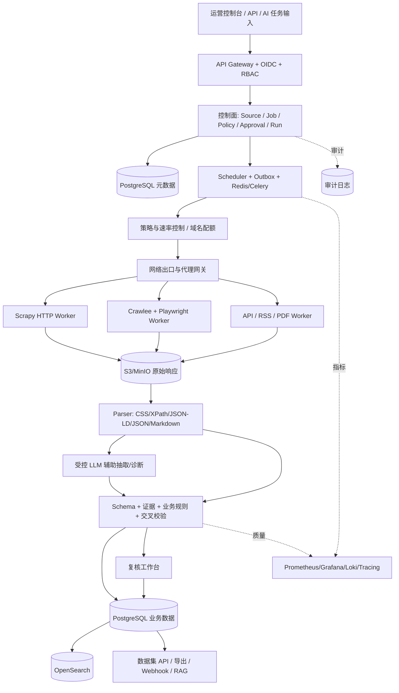
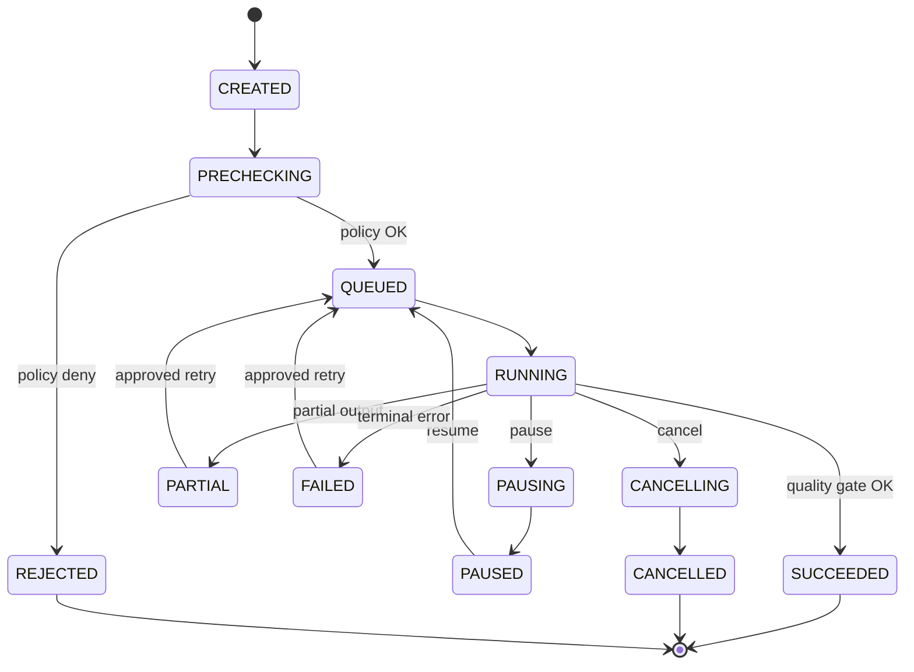

# AICrawl Enterprise 企业级 AI 智能分布式网络数据采集与治理平台

> **产品需求规格说明书 PRD V2.0（企业实施版）**  
> 文档日期：2026-11-17  
> 状态：供立项与架构评审（Draft for Review）  
> 适用对象：产品、架构、研发、算法、数据、测试、SRE、安全合规、采购与业务负责人  
> 部署模式：私有化 / 专有云优先；可扩展多租户 SaaS  
> 适用范围：经授权的 API、公开网页、公开文档、合规跨境网络出口采集  
> **文档边界：** 这是一份可以拆分研发任务的详细基线，不等同于完成了采购评估、站点访问授权或生产压测。所有容量、指标和预算均为**初始规划值**，须在 PoC 和合同评审后固化。

---

## 0. 文档控制、决策与术语

### 0.1 文档版本

| 版本 | 日期 | 关键变更 | 状态 |
|---|---|---|---|
| 1.0 | 2026-11 | 初步定位、技术组合、建设方向 | 已替代 |
| 2.0 | 2026-11-17 | 新增完整功能需求、用户操作流程、系统边界、组件责任、数据模型、接口契约、代理架构、质量校验、容灾、压测、验收标准与实施排期 | 待评审 |

### 0.2 应在立项会上确定的决策（不得默认为已确认）

| 决策项 | 当前建议 | 决策人 |
|---|---|---|
| 首期业务 | 海外招聘、跨境商品、新闻、政策公告（先选其中两个做标杆） | 业务负责人 |
| 部署形式 | 单地域 Kubernetes，环境分离；按需增设合规跨境出口 | 技术/安全负责人 |
| 控制面 | 自研任务中心 + PostgreSQL 状态机 | 架构负责人 |
| 异步执行 | Redis + Celery 起步；高吞吐后引入 Kafka | 架构负责人 |
| 采集引擎 | Scrapy + Crawlee(Node.js)/Playwright，Crawl4AI 做内容处理 | 爬虫负责人 |
| 身份认证 | 接入公司 IdP（OIDC/SAML 视存量系统） | 安全负责人 |
| 数据保存期限 | 原始网页30–90天为建议，按合同/地区逐源决定 | 法务/数据负责人 |
| 模型选型 | 可替换模型网关，优先可控脱敏与成本 | AI 负责人 |
| 代理来源 | 合法合约授权的企业代理/自有合规出口，禁用来源不明代理 | 安全/采购负责人 |

### 0.3 术语

- **Source（数据源）**：域名、API、文件源及对应使用许可、频控和所有者信息。
- **Collection Job（采集任务）**：用户配置的可重复执行业务目标。
- **Run（运行批次）**：一个 Job 在某时刻的一次执行实例。
- **Fetch Attempt（请求尝试）**：单个 URL 请求的某一次网络尝试。
- **Record（业务记录）**：商品、岗位、文章、公告等结构化结果。
- **Evidence（证据）**：字段在原始响应或截图中的可定位依据。
- **Quality Gate（质量门禁）**：入库/发布前的数据有效性判定。
- **Agent（智能体）**：受工具白名单、预算及审批约束的规划或分析工作流；**不拥有绕过安全策略的权限**。
- **P0/P1/P2**：本期必须/一期后续/增强能力；与故障严重级别不同。

---

## 1. 业务背景与目标

### 1.1 当前业务问题

1. 不同团队用临时脚本采集，站点配置、日志、账号、代理与存储分散。
2. 动态网页和多语言网站使采集成功率不稳定，失败难以复现。
3. 只记录“有数据”，无法证明数据在原网页上的位置及采集时刻。
4. 页面模板变更导致数据静默为空，业务侧收到错误报表。
5. 境外出口不稳定、代理来源不可审计、地域选择与成本失控。
6. 各站点许可条件不同，缺少 robots、访问条款与权限审批记录。
7. AI 抽取存在幻觉、字段混淆与单位错误，缺少确定性校验。
8. 重复记录、历史版本、增量变化和删除行为未形成统一规则。
9. 告警不完整，无法区分网络问题、阻断、模板漂移、存储故障或模型问题。
10. 缺少租户隔离、数据生命周期、费用归集和可验证的 SLA/SLO。

### 1.2 产品目标

构建以**安全合规、可扩展、准确、可追溯、可运营**为主的统一采集平台，提供：

- 一个平台创建与管理多个业务域、数据源、任务、解析模板和发布数据集。
- 接入授权 API、普通 HTML、JavaScript 渲染页面、PDF/Office 公告与 RSS/Sitemap。
- 可审计的海外访问策略：企业网络出口、地理位置、地域允许范围、合法代理供应商、预算、熔断。
- 非确定性 AI 的能力严格封装为辅助规划/解析/质量诊断，最终发布有证据和规则约束。
- 每条可发布记录关联来源、采集批次、字段证据、规则版本、校验结果和时间戳。
- 运营大盘、审计报表、业务 API、Webhook、导出与 RAG 数据通道。

### 1.3 非目标（首期不做）

- 不承诺“全网任意网站都能抓取”。
- 不自动破解验证码、不绕过登录授权或付费墙、不规避明确的访问限制。
- 不通过身份伪造、隐蔽代理或高并发冲击来规避网站的反自动化政策。
- 不提供自动批量收集敏感个人信息、非法访问账户或违反网站许可的抓取。
- 不承诺实时覆盖所有社交媒体与短视频平台；优先官方 API/授权供应商。
- 不在第一期同时自研大规模浏览器集群、通用低代码编排器、完整商业代理网络。

### 1.4 用户角色与权限边界

| 角色 | 核心权利 | 禁止/约束 |
|---|---|---|
| 平台超管 | 环境与租户管理、全局审计、停机开关 | 关键操作双人审批；默认不查看业务秘密 |
| 租户管理员 | 租户成员、配额、租户凭据授权、租户报表 | 不可访问其他租户 |
| 数据源管理员 | 申请源、维护规则、频率、访问许可 | 不可越过合规门禁 |
| 采集开发者 | 维护采集器、模板、测试与版本发布 | 生产部署需审批与 CI/CD |
| 数据质量专员 | 审核低置信度记录、回放与纠错 | 不可修改原始证据 |
| 业务分析师 | 查询授权数据、订阅报表、导出 | 受行列权限和脱敏约束 |
| SRE/运维 | 观察队列、节点、网络质量、告警 | 生产密钥不可明文导出 |
| 安全/法务审计 | 查看许可、合规日志、异常事件 | 按最小权限访问业务数据 |
| API 服务账户 | 按范围读取或订阅数据 | 不可访问控制面管理能力 |

---

## 2. 典型业务场景与业务验收

### 2.1 场景 A：海外招聘市场监测（P0）

- 输入：国家/语言、岗位词、公司、城市、技能标签、更新周期、合法来源清单。
- 输出：`job_id/company/title/location/salary_min/salary_max/currency/pay_period/skills/published_at/source_url`。
- 核心难点：相同岗位多站重复、薪酬单位不一、职位撤销、发布日期混淆、职位页面更新。
- 验收：在标注金标集上对标题、公司、地区等关键字段进行精确匹配；薪酬正则与币种/周期标准化；每条记录保留证据链接。

### 2.2 场景 B：跨境电商商品监测（P0）

- 输入：SKU/商品词、站点、地域、目标货币、采集时间、可用商家授权。
- 输出：SKU、标题、规格、销售价、标价、币种、库存状态、促销、采集国家、来源。
- 难点：页面 A/B 实验、地域定价、变体 SKU、促销叠加、运费和税费区别。
- 验收：价格必须携带币种及价格类型，不得将原价标作成交价；异常涨跌进入复核。

### 2.3 场景 C：全球行业资讯与 RAG（P1）

- 输入：域名白名单、关键词、RSS/Sitemap、语言、正文保留策略。
- 输出：标题、作者（如可合法获取）、发布时间、正文 Markdown、标签、原文引用与指纹。
- 难点：导航污染、重复转载、时间识别、正文缺失、PDF 转换噪声。
- 验收：正文质量与去重准确度通过人工标注样本验证；RAG 入库保留版本和引用映射。

### 2.4 场景 D：企业公告/政策资料（P1）

- 输入：官方公告 URL、政府开放接口、Sitemap、文件列表。
- 输出：主体、文号、发布时间、生效时间、附件、业务类别、原件 SHA-256。
- 难点：扫描 PDF、旧文件替换、附件缺失、公告与解释稿混杂。
- 验收：原件可回溯，文件校验和固定，发布/生效日期分离。

---

## 3. 总体逻辑架构与组件边界



### 3.1 控制面与数据面隔离

- **控制面**：管理站点许可、任务配置、身份权限、模型提示词版本、规则版本、运行状态、预算与审计。数据库事务为状态真实来源。
- **数据面**：获取内容、原始落盘、解析、校验、索引、发布；Worker 无权直接放宽源策略。
- **执行隔离**：浏览器类 Worker 与普通 HTTP Worker 使用不同资源池、Node 选择器、网络策略、内存限额和自动扩缩容指标。
- **扩展边界**：每个采集引擎实现统一 `fetch(request_context)->FetchResult` 契约；同一任务允许选择引擎，但不允许两个调度器同时拥有相同 Run。
- **管理兼容**：Crawlab 可作为存量脚本接入层，由本平台单向派发，回传结果与状态；不让它与统一任务中心同时管理主任务生命周期。

### 3.2 选型与取舍

| 子系统 | 首选 | 可替换/替代 | 不采用的理由或限制 |
|---|---|---|---|
| Web 控制台 | React + TypeScript + Ant Design | Vue3 + Element Plus | 统一公司技术栈，不能两套前端混用 |
| BFF/API | FastAPI | Go | Python 团队与 AI/数据处理一致，性能瓶颈可独立拆出 |
| 任务状态库 | PostgreSQL | MySQL | 关系事务、JSONB、审计友好 |
| 队列执行 | Celery + Redis | Temporal / Kafka 事件架构 | 初期简单；长流程若复杂可迁移工作流引擎 |
| HTTP 获取 | Scrapy | Crawlee Python / httpx | 适合高吞吐结构化抓取 |
| 动态页面 | Crawlee JS + Playwright | 原生 Playwright Worker | 浏览器自动化能力，资源成本较高 |
| 内容处理 | Crawl4AI / 自研解析模块 | Firecrawl API | 非所有数据都需要 LLM；避免成本扩大 |
| 文件解析 | PyMuPDF、Apache Tika；按需求引入 OCR | 专业文档服务 | 扫描件识别质量依赖语言/排版 |
| 原始存储 | S3 兼容对象存储 | 云对象存储 | 原始内容与结构化记录分离 |
| 全文检索 | OpenSearch | Elasticsearch | 检索与索引，不做状态真相源 |
| 指标监控 | Prometheus / Grafana | 云监控 | 统一指标、告警及容量规划 |
| 日志链路 | Loki/ELK + OpenTelemetry | 云日志 | 统一 `trace_id/run_id` |
| 密钥 | Vault / 云 KMS | 企业现有秘密管理服务 | 不在数据库明文储存 |

**技术事实边界：** Crawlee、Scrapy、Crawl4AI 是不同层级的工具；不能假设它们自身提供完整的跨租户权限、审计、数据质量与财务配额。Scrapy 的 AutoThrottle 需与站点频率策略结合；Crawlee 的并发调节不等同于跨集群全局限流；浏览器隔离需按 Context 与 Pod 两层实现。

---

## 4. 功能范围总览（功能需求矩阵）

| 模块 | 编号 | 核心能力 | 优先级 | 验收责任 |
|---|---|---|---|---|
| 租户与用户 | IAM-001~006 | 登录、RBAC、资源隔离、审计 | P0 | 安全/测试 |
| 数据源中心 | SRC-001~009 | 来源登记、许可、robots、白名单、审批、巡检 | P0 | 产品/法务 |
| 任务中心 | JOB-001~012 | 向导配置、调度、状态、重试、暂停恢复、回放 | P0 | 研发/测试 |
| 网络与代理 | NET-001~012 | 合规出口、地域路由、健康、预算、审计、熔断 | P0 | SRE/安全 |
| 采集引擎 | FET-001~014 | HTTP、动态页面、API、附件、增量、快照 | P0/P1 | 爬虫团队 |
| 模板解析 | EXT-001~012 | 规则、版本、预览、AI 生成、字段证据 | P0 | 数据团队 |
| 数据质量 | DQ-001~016 | Schema、逻辑、一致性、抽样、复核、发布门禁 | P0 | 数据质量 |
| 数据资产 | DATA-001~011 | 血缘、版本、生命周期、去重、搜索、导出 | P0 | 数据团队 |
| 智能体 | AGT-001~010 | 规划、策略建议、诊断、审批、预算 | P1 | AI 团队 |
| 运维监控 | OPS-001~014 | 指标、告警、SLO、成本、应急开关 | P0 | SRE |
| 开放平台 | API-001~010 | API Keys/OAuth、分页、增量订阅、Webhook | P1 | 后端 |
| 商业化 | BILL-001~006 | 租户配额、成本分摊、用量报表 | P1 | 产品/财务 |

---

## 5. 需求详述：租户、权限、安全审计

### 5.1 IAM-001 单点登录

- **输入**：企业 IdP 的 OIDC 登录；本地超级管理员仅做应急账户并受双因素认证保护。
- **处理**：验证签名、颁发平台短期 Access Token、维护有效会话、退出撤销；密码不落地平台。
- **输出**：用户 ID、租户 ID、角色与权限声明。
- **异常**：IdP 故障时禁止静默降级为免密访问；应急账号使用必须产生高危审计事件。
- **验收**：匿名访问所有管理接口返回 401；跨租户对象访问返回 403 或隐藏资源存在性。

### 5.2 IAM-002~006 权限矩阵

- 资源级 RBAC：`tenant/source/job/run/dataset/credential/proxy_pool/template`。
- 数据级 ABAC：数据集标签、地区、敏感级别、审批状态；细粒度导出权限。
- 生产变更双人审批：源策略放宽、批量导出、删除原始证据、密钥权限修改。
- 不可篡改审计：`who/when/tenant/object/action/before_hash/after_hash/ip/request_id/decision`。
- 用户可在 UI 查看自己的操作历史；审计日志普通管理员不可删除。
- 验收：组织 2 个租户、至少 5 类角色的越权自动化测试；审计事件与请求 ID 可串联。

---

## 6. 需求详述：数据源管理与访问许可门禁

### 6.1 SRC-001 数据源登记表单

**字段**：`name`、`base_domain`、`source_type`（API/HTML/RSS/Sitemap/File）、`owner_team`、`business_purpose`、`jurisdiction`、`allowed_paths`、`disallowed_paths`、`auth_mode`、`robots_policy`、`terms_review_url`、`license_evidence_uri`、`data_classification`、`retention_days`、`requests_per_minute`、`concurrency_limit`、`approval_expires_at`。

**默认状态**：`DRAFT`。未审批不得执行生产采集。

### 6.2 SRC-002~009 规则

1. URL 规范化，按注册域名与路径匹配**显式允许列表**。
2. 检查 robots.txt，并保留抓取时间、HTTP 状态与解析结果；遵循 RFC 9309，法律条款与合同约束优先。
3. 若源要求授权，必须上传授权证据、账号归属、有效期和允许操作范围。
4. 目标站点明确禁止自动访问、出现访问禁止或限制提示时暂停并发起人工复核，不自动换出口继续尝试。
5. 对 API Key、会话凭据采用 Vault 引用及最小权限，不在任务 JSON 保存明文。
6. 记录数据源的用途、个人数据处理合法性、跨境处理评估和删除要求。
7. 数据源授权到期前自动提醒，到期后新请求拦截。
8. 定期检查 robots/条款是否变化；如变化触发审批或策略冻结。
9. 明确源站联系、投诉和紧急停止入口。

### 6.3 数据源审批流程

`DRAFT → SUBMITTED → SECURITY_REVIEW → LEGAL_REVIEW(按风险触发) → APPROVED → ACTIVE`。任意节点可 `REJECTED`；过期进入 `EXPIRED`；重大投诉进入 `SUSPENDED`。只有 `ACTIVE` 可进入执行队列。对自有站点可走预授权快速流程，仍需留痕。

### 6.4 页面可抓取性矩阵

| 情况 | 系统动作 |
|---|---|
| 授权 API 可用 | 优先 API，避免不必要页面渲染 |
| 公开网页、访问许可允许 | 遵守限流/robots 并抓取 |
| 需要公司授权登录 | 使用获准账号与隔离密钥；按许可范围操作 |
| 验证码/访问阻断 | 标记 BLOCKED，停止自动重试，通知审核 |
| 付费内容/禁止自动访问 | 不抓取，申请许可或购买官方数据 |
| 403/429 | 降速/暂停；查看授权与站点政策，不通过代理反复绕过 |
| 内容含个人敏感信息 | 按字段最小化、脱敏、法律依据与存储限制处理 |

---

## 7. 需求详述：任务创建、调度与状态机

### 7.1 JOB-001 创建任务向导（页面交互）

**步骤1 选择来源**：选择已批准 Source、任务类型、业务负责人。  
**步骤2 设置目标**：种子 URL、允许路径、关键词、地区、语言、最大深度、最大页面数。  
**步骤3 设置获取**：AUTO/HTTP/BROWSER/API、浏览器等待条件、超时、附件规则。  
**步骤4 设置输出**：选择业务 Schema、解析模板、去重主键、发布数据集。  
**步骤5 设置计划**：手动/周期 cron/事件触发、时区、重叠策略、并发与预算。  
**步骤6 质量和合规预检**：抽样测试、解析预览、检查 source policy、估算费用。  
**步骤7 提交审批/发布**：保存草稿、申请批准或激活。

**示例任务配置（示意，正式部署使用 JSON Schema 验证）**：

```yaml
job_code: job_global_jobs_001
tenant_id: tenant_demo
source_id: source_approved_jobs
name: overseas_job_monitor
schedule:
  cron: "0 */6 * * *"
  timezone: Asia/Shanghai
  overlap_policy: skip
scope:
  seed_urls: ["https://example.org/jobs"]
  allowed_hosts: ["example.org"]
  max_depth: 2
  max_pages_per_run: 2000
fetch:
  engine: auto
  timeout_seconds: 30
  retry_max: 2
  browser_fallback: true
  geo_policy: approved_region_only
rate_limit:
  rps_per_domain: 0.5
  max_concurrent_per_domain: 2
quality:
  schema: job_posting_v1
  critical_fields: [title, company, source_url]
  minimum_publish_score: 0.90
budget:
  max_requests_per_run: 3000
  max_proxy_gb_per_run: 2
  max_llm_tokens_per_run: 150000
output:
  dataset_id: ds_overseas_jobs
  retain_raw_days: 60
```

说明：`example.org` 仅为示例域名；所有阈值都是可调整初始值，不能解释为对特定目标站点已获授权。

### 7.2 JOB-002 调度能力

- 支持 cron（带时区）、立即执行、按事件执行和手动补采。
- 支持优先级和租户公平调度，单租户不能挤占所有 Worker。
- 禁止相同 Job 同时运行可配置：`skip/queue/cancel_previous`。
- 优先做跨实例一致性：调度器 leader election 或数据库排他锁。
- 任务派发通过 **Transactional Outbox** 保证 PostgreSQL 提交与消息分发最终一致；消费者幂等。
- 任务消费至少一次（at-least-once）；通过 `run_id + request_fingerprint + stage` 幂等键减少重复处理。

### 7.3 JOB-003 任务运行状态机



**状态语义**： `SUCCEEDED` 代表已完成数据质量门禁，而非只下载成功；`PARTIAL` 需输出页数、记录数、缺失范围、原因与补采建议。

### 7.4 JOB-004~012 执行规则

- 每个 Run 保存启动人、模板版本、源策略版本、镜像版本、模型版本、运行参数快照。
- 任务暂停：不再派发新请求，进行中的请求在宽限期内完成或安全取消。
- 任务取消：发送可感知取消信号，避免孤儿浏览器进程。
- 错误分类：`NETWORK_TIMEOUT/DNS/TLS/HTTP_429/HTTP_403/ROBOTS_DENY/PARSER_EMPTY/SCHEMA_INVALID/LLM_ERROR/STORAGE_ERROR/BUDGET_EXCEEDED`。
- 重试策略：仅对瞬时可恢复错误指数退避+抖动；403/robots/许可限制不重试；重试次数可审计。
- 死信队列：超额失败送 DLQ，可按 Run/URL 过滤并审批重放。
- 断点续跑：使用持久化 URL Frontier、游标和已完成指纹，而不是仅依赖进程内存。
- 幂等：每批次唯一 `run_id`；发布层以业务主键+版本 UPSERT，避免重复推送。
- 进度展示：`planned/discovered/fetched/parsed/validated/published/failed/skipped` 与估算剩余数；无可靠总数时显示“不确定”。
- 预算触顶：停止排队并进入 `PAUSED_BUDGET` 子原因；管理员确认后恢复。
- 手动补采：明确数据时间范围、源和失败原因，只重新采缺失分区。
- 任务版本：配置变更生成新版本，不追改历史 Run 的参数快照。

---

## 8. 海外网络出口与代理服务（关键专项）

### 8.1 设计原则

海外访问能力用于**合规的地域访问、网络稳定性和性能调度**，而非规避目标站点的访问限制。所有代理提供商必须经过采购合规审查，签订合法来源、地域、日志和数据保护条款。

### 8.2 NET-001 统一代理网关接口

内部接口：`POST /internal/network/lease`。输入：`tenant_id/source_id/region/network_class/estimated_bytes/request_id`。输出：`lease_id/egress_id/region/expires_at/secret_ref/limits`，**不在日志返回代理密码**。

- `DIRECT`：自有合规网络出口，默认首选。
- `DATACENTER_APPROVED`：合同允许的数据中心代理。
- `RESIDENTIAL_APPROVED`：仅在合法来源证明、合同许可、法务批准和业务必要性存在时启用；默认关闭。
- `REGION_LOCKED`：特定地理区域；若无法获得批准地域的出口则失败关闭，不改用其他地区冒充地域数据。

### 8.3 NET-002~012 业务规则

1. 凭据统一存 Vault/KMS；按租户、源、地域、供应商做可审计授权。
2. 出口实例健康探针检测 DNS、TCP/TLS、延迟、公开出口 IP 与地域信息；探针使用**授权测试端点**。
3. 每个供应商维护可用率、错误率、95分位延迟、剩余额度、成本/GB、地域可用性。
4. 调度优先级：许可满足 > 数据地域准确 > 预算约束 > 健康分 > 延迟；不可为提高成功率牺牲合规条件。
5. 出现 403、429 或网站限制指示时，执行域名级熔断/降速/审批，不进行无界轮换试探。
6. 出口会话绑定：同一获准会话请求使用稳定、可追溯的出口；不同租户隔离。
7. 不同域名的请求/并发配额在全局限流器统一核算，而非仅在每个 Worker 本地计算。
8. 成本预算：每租户、任务、代理供应商、地域分别设日/月阈值与硬上限。
9. 供应商故障切换：仅限同一许可范围和同等地区的已批准备用出口。
10. 阻止代理连接内网/元数据地址；实施 DNS 解析后的目标 IP 校验与 egress 网络策略，防 SSRF。
11. DNS 泄漏、TLS 验证失败、认证错误单独告警；默认不关闭证书校验。
12. 出口操作审计字段：谁、哪一租户、哪个 Job/Run、什么目标域名、出口地域、供应商、开始结束时间、耗流量和决策理由。

### 8.4 代理健康模型（可配置，不等同真实业务成功率）

定义健康分初值：

`H = 0.45 × availability_1h + 0.25 × (1 - transport_error_rate_1h) + 0.20 × latency_score + 0.10 × capacity_score`

- 各分量归一化到 0~1；使用 EWMA 平滑短时抖动。
- 当探针样本少于阈值时状态为 `UNKNOWN`，禁止直接当作健康。
- `H < 0.45` 且样本量足够时标记 `DEGRADED`，停止新租约；恢复须连续 N 次成功。
- **禁止把 403 直接归类为“换代理能解决的问题”**；先进行权限/访问政策检查。

### 8.5 跨境链路失败处理

| 事件 | 自动动作 | 人工动作 |
|---|---|---|
| 代理握手失败 | 限次重试其他已授权同区域出口 | 检查供应商状态 |
| IP 地理位置与要求不符 | 拒绝本次租约 | 核实供应商与地域库 |
| 网络超时 | 小次数退避；计入链路指标 | 检查链路容量 |
| 目标返回 429 | 延长域名冷却并遵守 Retry-After | 检查限流配置 |
| 目标返回 403/验证页 | 暂停目标源相关自动访问 | 核查条款、许可与官方接口 |
| 月度预算超限 | 熔断高成本任务 | 财务/租户管理员审批 |
| 供应商合同到期 | 禁用新租约 | 采购续签或移除 |

### 8.6 海外采集需要的运维前提

- 供应商服务地区、跨境流量费用、数据出境规则、敏感信息处理、业务出口地国家的相关法律审查。
- 源站时区、货币、语言和当地页面版本明确保存，避免误把地区差异当爬取错误。
- 对出口、请求、原始页面、日志、模型输入分别配置跨境数据处理和保留规则。

---

## 9. 采集引擎与站点适配

### 9.1 FET-001 引擎自动选择（可解释、可覆盖）

```text
1. 授权官方 API/RSS/Sitemap 可用？→ 优先 API/RSS/Sitemap
2. 已知静态 HTML 且规则可用？→ Scrapy/HTTP Worker
3. 必须执行客户端 JavaScript 且获准？→ Crawlee + Playwright
4. 页面是 PDF/附件？→ 文件获取 + 对应解析器
5. 内容复杂但页面已获取？→ Crawl4AI/LLM 进行内容抽取
6. 不确定？→ 小样本探测，保存响应与判断依据；不可无限升档
```

**成本护栏**：每个 Run 的动态浏览器回退比例设上限；例如初值 20%，高于阈值标记需站点规则审查。此数字为建议，不是通用最佳实践。

### 9.2 FET-002 HTTP 采集

- 管理 User-Agent 标识、HTTP 超时、重定向上限、内容长度上限、Content-Type 白名单、压缩/编码。
- 支持 ETag/If-None-Match、Last-Modified/If-Modified-Since 来减少不必要下载。
- URL 规范化：scheme、host、fragment、跟踪参数、Unicode 域名、相对链接；保留规范化前原始 URL。
- 去重：URL 指纹 + 内容 SHA-256 + 业务主键；不能只用 URL 判断相同业务记录。
- 避免自动进入无限日历、会话 ID 递增、循环分页和自引用导航。

### 9.3 FET-003 浏览器执行

- 使用隔离 Browser Context；设置最大页面生命周期、页面内存、总运行时间、截图/HTML 保存上限。
- 支持 DOM ready、特定元素可见、网络请求完成等可配置等待条件；禁止仅固定 sleep。
- 使用授权账户登录时，密钥短租约，Cookie/session 按租户与任务隔离，结束后清理。
- 允许截屏作为质量证据；截图按脱敏策略存储，禁止在日志泄露身份标识。
- 下载附件时做 Content-Type、文件大小、恶意内容扫描。

### 9.4 FET-004 文档解析

- HTML、JSON、XML、RSS、CSV、PDF（文本层）作为 P0；扫描 PDF OCR 作为 P1，先对 100 份样本验证效果。
- 附件 `sha256/mime/byte_size/source_url/download_at` 必需，解析失败仍保存原件与错误。
- PDF 可提取时区分文档页码与业务页码，任何文本页引用都携带原始文件和页号。

### 9.5 FET-005~014 其他能力

- Sitemap 增量、分页策略、API 游标、变更检测、域名限深、附件递归最大深度。
- 模板匹配优先：域名+页面路径+DOM 特征；低置信匹配进入人工审核。
- 原始响应落盘采用不可变对象 Key，记录 hash、headers（过滤敏感项）、status、时间和 source policy 版本。
- URL Frontier 支持按 host fairness 调度、已见集合与停机恢复。
- 发现空列表时不能默认“网站无内容”，必须跑零结果报警和历史基线对比。

---

## 10. 解析配置、AI 抽取与字段证据

### 10.1 EXT-001 Schema 驱动的解析器

每类数据集定义 JSON Schema；字段包含名称、数据类型、是否必填、单位、枚举、正则、证据是否必须、可为空原因。

**提取优先级**：授权官方 API/JSON-LD > 稳定 CSS/XPath/JSONPath > 正文正则/规则 > LLM 辅助。原因：可解释、低成本、可复现的方法优先。

### 10.2 EXT-002 提取模板管理

- 模板包含 `template_id/version/site_pattern/page_signature/field_rules/test_cases/author/approved_at`。
- UI 支持输入测试 URL、展示原始 DOM 节点、选择字段路径、实时预览、保存为草稿。
- 提交时自动跑回归样本集；生产生效需通过审核；旧版可随时回滚。
- 页面结构漂移检测：关键元素缺失率、提取空值率、字段长度分布、DOM 特征向量/规则匹配率。

### 10.3 EXT-003 LLM 辅助提取（有控制的 Agent）

- AI 输入必须包含清理后文本、目标 Schema、字段说明、允许输出格式。
- 每个字段必须尽量返回 `value/confidence/evidence_quote/evidence_locator/normalization`，无证据则 `null`。
- 提示词不得允许“猜测”价格、发布日期和公司名称。
- 输出必须通过 JSON Schema 校验；不合格一次受控修复，仍不合格入隔离区。
- 提示词、模型、参数、token、执行耗时、原始输入 Hash 与输出 Hash 必须可追溯。
- 页面内文本视为**不可信数据**，不得执行页面提示（Prompt Injection），不得让页面内容改变 Agent 的授权、工具或外发行为。
- LLM 不直接修改 Source Policy，也不直接操作凭据、网络、生产发布权限。

### 10.4 EXT-004 字段证据结构

```json
{
  "record_id": "rec_01JEXAMPLE",
  "field_name": "salary_min",
  "raw_value": "$75k",
  "normalized_value": 75000,
  "unit": "USD/year",
  "extraction_method": "css_rule",
  "template_version": "jobs_v4",
  "source_snapshot_id": "snap_001",
  "evidence": {
    "type": "css_selector",
    "locator": ".salary-range",
    "text_excerpt": "$75k–$110k / year"
  },
  "confidence": 0.98
}
```

此处 `confidence` 是内部校准后的可信度指标，**不能把模型自报的分数直接当概率**。

---

## 11. 数据质量、准确率与校验闭环（核心）

### 11.1 质量维度

| 维度 | 定义 | 评价方法 |
|---|---|---|
| 完整性 | 应有关键字段是否存在 | 关键字段非空率 |
| 有效性 | 类型、枚举、时间、金额格式合法 | Schema/规则通过率 |
| 准确性 | 值是否与来源真实内容一致 | 金标样本字段级 Precision/Recall/Exact Match |
| 一致性 | 同记录字段之间是否矛盾 | 跨字段业务规则 |
| 唯一性 | 同一实体是否重复 | 业务键+近似去重评估 |
| 新鲜度 | 与业务允许的最近更新时间差 | `now - last_verified_at` |
| 可追溯性 | 是否存在可恢复原件和字段证据 | 证据覆盖率/抽查复现率 |
| 稳定性 | 数据量、空值、分布是否发生异常变化 | PSI/分位/历史区间 |

### 11.2 DQ-001~016 处理阶段

**G0 源许可**：Source ACTIVE、访问范围允许、预算足够。未通过不请求。  
**G1 获取完整性**：HTTP 状态、内容长度、content hash、非验证码页、非错误提示页面。  
**G2 解析可用性**：业务页类型正确、模板匹配成功、非空字段比例达标。  
**G3 字段格式**：JSON Schema、类型、正则、枚举、货币/日期/电话等格式。  
**G4 业务逻辑**：`salary_min <= salary_max`、`sale_price <= list_price`（仅业务适用时）、发布日期不晚于合理容差。  
**G5 证据核对**：关键字段能够回定位到快照文本/DOM/文件页，Hash 一致。  
**G6 多源验证**：对允许来源进行同实体匹配，标注冲突；不能多数投票代替权威来源。  
**G7 历史异常**：突变价格、异常任务产量、突然大量空值/字段长度变化；触发审核。  
**G8 人工复核**：高风险/低可信度/冲突样本按队列审核，记载复核人和判决。  
**G9 发布门禁**：合格入 Gold，存疑进 Quarantine，违规源结果不发布。

### 11.3 质量评分参考（初始，需使用金标校准）

`Q = 0.20*C + 0.20*V + 0.25*E + 0.15*K + 0.10*F + 0.10*S`

- `C` 完整性、`V` 规则有效性、`E` 证据匹配、`K` 逻辑一致性、`F` 新鲜度、`S` 来源可信等级，均在 0~1。
- **硬门槛先于评分**：关键字段缺失、无来源证据、源违规、越权采集、恶意内容检测失败时，无论 Q 多高都不发布。
- 建议策略：`Q≥0.90` 且硬门槛通过可自动发布；`0.70≤Q<0.90` 需复核；`Q<0.70` 隔离。具体阈值必须经真实金标集与业务风险分析调优。

### 11.4 金标集和准确率统计设计

1. 为每类业务选择至少 5 个不同结构的来源，先收集不少于 500 条人工标注记录作为 PoC 起点；正式样本量按置信区间与类别分布扩展。
2. 人工双人盲标关键字段，对分歧做仲裁并记录标注准则。
3. 训练/调参样本与验收样本分离；锁定验收集，禁止验收时修改答案。
4. 区分“抓取成功率”和“字段抽取准确率”：仅成功抓取的样本可能产生幸存者偏差。
5. 指标分站点、字段、语言、获取模式、地域、模板版本统计，并计算置信区间。
6. 数据纠错后保留原始值与更正原因，不覆盖原始证据。

**指标示例**：

- 字段精确率 = 正确提取的字段值数 / 所有非空提取字段值数。
- 字段召回率 = 正确提取的字段值数 / 金标中应该提取的字段值数。
- 完整正确记录率 = 所有关键字段均正确的记录数 / 金标记录数。
- 证据覆盖率 = 可定位证据的已发布关键字段数 / 已发布关键字段总数。

### 11.5 DQ 质量异常处置

| 异常 | 检测方式 | 自动动作 | 负责人 |
|---|---|---|---|
| 价格变动 > 40% | 同商品最近值比较 | 复查币种、变体、区域；进入复核 | 数据质量 |
| 关键字段空值暴增 | 历史基线和阈值 | 阻止发布、模板漂移告警 | 解析研发 |
| 标题与正文不符 | 规则/AI 检测 | 标记页面类型或抽取错误 | 数据质量 |
| 多来源日期冲突 | 实体匹配 | 保留各源值及优先级，不静默覆盖 | 业务人员 |
| 短时间内容 100% 相同 | 内容 Hash | 判断缓存/阻断/站点静态内容 | 爬虫研发 |
| 低置信度 AI 值 | 校准模型与证据不匹配 | 隔离与人工复核 | AI 团队 |

---

## 12. 数据治理、数据模型与存储

### 12.1 分层架构

- **Bronze 原始层**：HTTP 响应、DOM、截图、下载文件、Content Hash 与请求元数据，写对象存储，不变更。
- **Silver 标准层**：抽取结果、来源、字段证据、标准化单位、初步去重及校验输出。
- **Gold 发布层**：满足发布门禁、去重后的业务数据集及业务版本历史。
- **Search/Serving**：OpenSearch 索引可重建，不作为最终事实来源。

### 12.2 核心关系模型

```text
tenants 1---n users
       1---n sources 1---n source_policies
       1---n jobs 1---n job_versions 1---n runs
runs 1---n fetch_attempts 1---1 raw_snapshots
raw_snapshots 1---n extracted_records 1---n field_evidences
extracted_records 1---n quality_checks
extracted_records 1---n review_decisions
extracted_records n---1 datasets
runs 1---n network_leases
runs 1---n usage_events
```

### 12.3 关键表（建议字段，不是最终迁移脚本）

| 表 | 关键字段 | 约束/索引 |
|---|---|---|
| `tenants` | id, name, status, quotas_json, created_at | id 主键 |
| `sources` | id, tenant_id, canonical_host, status, legal_basis, policy_version, owner | tenant+host 索引 |
| `source_policies` | id, source_id, version, allowed_paths, max_rpm, regions, reviewed_by, expires_at | source+version 唯一 |
| `jobs` | id, tenant_id, source_id, name, active_version_id, status | tenant+source 索引 |
| `job_versions` | id, job_id, version, config_json, config_hash, approved_by | job+version 唯一 |
| `runs` | id, job_id, version_id, state, started_at, ended_at, counters_json, error_code | job+created_at 索引 |
| `frontier_urls` | run_id, url_fingerprint, normalized_url, depth, state, next_attempt_at | run+fingerprint 唯一 |
| `fetch_attempts` | id, run_id, fingerprint, attempt_no, status, http_code, latency_ms, network_lease_id | run+fingerprint+attempt 唯一 |
| `raw_snapshots` | id, fetch_attempt_id, object_uri, sha256, mime, bytes, captured_at | sha256/uri 索引 |
| `extracted_records` | id, dataset_id, run_id, business_key, payload_json, quality_state, version | dataset+business_key+version 唯一 |
| `field_evidences` | record_id, field_path, locator, excerpt, snapshot_id, confidence | record+field 索引 |
| `quality_checks` | record_id, gate_code, result, severity, details_json, checked_at | record+gate 索引 |
| `review_decisions` | record_id, reviewer_id, action, reason, before_after_diff | 审核日志只追加 |
| `network_leases` | id, run_id, provider, region, egress_id, bytes, cost, policy_decision | 供应商/时间索引 |
| `usage_events` | tenant_id, job_id, type, quantity, unit_cost, occurred_at | tenant+日期索引 |
| `audit_events` | actor_id, tenant_id, action, subject_id, decision, hash_chain | 分区/只追加 |
| `outbox_events` | id, aggregate_id, type, payload, dispatched_at | 未派发索引 |

### 12.4 业务记录数据结构示例

```json
{
  "record_id": "rec_01JEXAMPLE",
  "dataset_id": "ds_overseas_jobs",
  "business_key": "sourceX:job-123",
  "entity_type": "job_posting",
  "data": {
    "title": "Data Engineer",
    "company": "Example Co",
    "country": "US",
    "salary_min": 75000,
    "salary_max": 110000,
    "currency": "USD",
    "salary_period": "year"
  },
  "provenance": {
    "source_id": "src_001",
    "source_url": "https://example.org/jobs/123",
    "snapshot_id": "snap_001",
    "run_id": "run_001",
    "captured_at": "2026-11-17T10:00:00Z",
    "template_version": "jobs_v4"
  },
  "quality": {
    "state": "PUBLISHED",
    "score": 0.95,
    "checks_passed": ["schema", "evidence", "range"]
  },
  "version": 3
}
```

### 12.5 去重、增量与版本规则

- **同 URL 去重**：规范 URL + query 白名单；记录 URL 别名。
- **同内容去重**：SHA-256；文本内容用 SimHash/MinHash 辅助发现近似重复，但不能自动合并不同事实。
- **同业务实体匹配**：职位 `source+native_job_id` 优先；商品 SKU + 商家 + 规格 + 地域；文章 canonical URL/标题与正文指纹。
- **版本变更**：价格、库存、职位状态、新附件等改变形成新版本与 `valid_from/valid_to`。
- **删除/撤稿**：存“来源不可用/撤稿”的状态事实；是否物理删除遵守数据权利请求和保留规则。
- **时间字段**：区分 `published_at`, `source_updated_at`, `captured_at`, `processed_at`, `verified_at`，统一存 UTC 并保留原始时区。

### 12.6 保留、备份与恢复

- 原始快照按 Source Policy 单独设置保留期、对象生命周期和访问审计。
- PostgreSQL 启用 PITR（WAL 归档）、每日备份、周期恢复演练；对象存储版本化/备份与生命周期规则分离。
- 删除请求需覆盖 Gold、Silver、对象存储、索引、缓存与备份例外处理，保留合规完成记录。
- 重要记录保存 Hash 与可复验原件，但 Hash 不能替代合法保存许可。

---

## 13. AI Agent 的工作流与边界

### 13.1 Agent 角色分工

| Agent | 输入 | 可执行能力 | 输出 | 人工门禁 |
|---|---|---|---|---|
| 任务规划 Agent | 自然语言业务需求 | 构造草稿 Job、Schema 草稿 | 采集计划/风险提示 | 激活前必须审批 |
| 站点分析 Agent | 已允许的样本快照 | 识别页面类型、规则建议 | CSS/XPath/字段映射草稿 | 发布模板需审核 |
| 采集诊断 Agent | 指标、错误、DOM diff | 生成原因排序及处理建议 | 诊断报告 | 不得自行放宽限流/更换地区 |
| 质量复核 Agent | 字段值和证据 | 发现矛盾、建议更正 | 复核候选 | 关键字段人审/规则通过 |
| 数据交付 Agent | 已发布数据集 | 查询、汇总、生成报表 | API/报表草稿 | 受行列权限控制 |

### 13.2 工具调用白名单

`inspect_source_policy`, `preview_fetch_on_approved_source`, `suggest_schema`, `test_extraction`, `read_run_metrics`, `compare_snapshots`, `create_draft_job`, `submit_for_approval`。

禁止工具：未经授权目标网络请求、隐式代理切换、批量账户登录、读取其他租户凭据、跳过 DQ 门禁、直接修改 Production Policy。

### 13.3 Agent 行为审计

每次工具调用记录 `agent_run_id/model_version/prompt_hash/tool_name/arguments_redacted/approval_id/result_hash/cost`；设置最大轮次、Token、调用次数、用量、截止时间和故障停止策略。AI 生成内容不应被误称为已验证事实。

### 13.4 典型自然语言需求变成任务

用户输入：“每6小时获取已批准的海外招聘来源中数据工程相关岗位，统一年薪币种，按国家统计技能变化。”

系统步骤：解析目标 → 匹配已批准来源 → 建立 Schema → 生成 Job 草稿 → 估算代理与浏览器成本 → 样本试运行 → 显示字段证据 → 人工审批 → 发布任务 → 数据质量闸门 → 输出结构化数据和仪表盘。

---

## 14. API 契约与集成

### 14.1 API 规范

- 路径：`/api/v1`；REST + OpenAPI 3.1；JSON UTF-8。
- 鉴权：OIDC User Token 或 OAuth2 Client Credentials；机器凭据可独立撤销。
- 每个请求有 `X-Request-ID`；写接口支持 `Idempotency-Key`。
- 列表分页为 `cursor+limit`，上限可配置；所有时间 ISO-8601 UTC。
- 写操作做 RBAC/ABAC 和审计；查询输出受字段脱敏与租户过滤控制。
- 错误统一：`{code, message, request_id, details, retryable}`，禁止泄露密钥、SQL、完整栈。

### 14.2 核心 API 清单

| 方法 | 路径 | 说明 | 权限 |
|---|---|---|---|
| POST | `/sources` | 创建来源草稿 | source:write |
| POST | `/sources/{id}/submit` | 提交合规审批 | source:submit |
| POST | `/sources/{id}/approve` | 审批数据源 | source:approve |
| GET | `/sources/{id}/policy` | 查看当前源策略 | source:read |
| POST | `/jobs` | 创建任务草稿 | job:write |
| POST | `/jobs/{id}/validate` | 预检配置和预算 | job:write |
| POST | `/jobs/{id}/publish` | 发布任务版本 | job:publish |
| POST | `/jobs/{id}/runs` | 手动执行 | run:execute |
| GET | `/runs/{id}` | 获取状态与计数 | run:read |
| POST | `/runs/{id}/pause` | 暂停运行 | run:control |
| POST | `/runs/{id}/resume` | 恢复运行 | run:control |
| POST | `/runs/{id}/cancel` | 取消运行 | run:control |
| GET | `/runs/{id}/failures` | 查询失败请求与原因 | run:read |
| POST | `/runs/{id}/replay` | 审批后重放失败范围 | run:replay |
| POST | `/templates/{id}/test` | 解析样本预览 | template:test |
| POST | `/templates/{id}/publish` | 模板版本发布 | template:publish |
| GET | `/datasets/{id}/records` | 按游标查询发布数据 | dataset:read |
| GET | `/records/{id}/evidence` | 获取字段证据（脱敏） | evidence:read |
| POST | `/quality/reviews/{id}/decision` | 人工复核判定 | review:write |
| GET | `/usage` | 任务、代理、模型用量 | billing:read |
| POST | `/webhooks` | 创建数据变更订阅 | webhook:write |

### 14.3 创建运行请求示例

```http
POST /api/v1/jobs/job_global_jobs_001/runs
Authorization: Bearer <token>
Idempotency-Key: run-20261117-manual-001
Content-Type: application/json

{"reason":"manual_backfill","parameters":{"max_pages":100}}
```

```json
{
  "run_id": "run_01JEXAMPLE",
  "job_id": "job_global_jobs_001",
  "state": "PRECHECKING",
  "created_at": "2026-11-17T10:30:00Z"
}
```

### 14.4 Webhook 交付

- 事件：`dataset.record.created`, `dataset.record.updated`, `run.completed`, `run.failed`, `quality.review.required`。
- 签名：`X-AICrawl-Signature`，基于时间戳+body HMAC；防重放时间窗。
- 至少一次交付、指数退避、死信；业务消费者按 `event_id` 去重。
- Webhook URL 需域名 allowlist、DNS/IP 检查、防 SSRF，不允许指向内网服务。

---

## 15. 页面与交互设计清单（供前端拆分）

| 页面 | 主要功能 | 必须展示/交互 | 异常/空态 |
|---|---|---|---|
| 首页总览 | 多租户/项目 KPI | 活跃源、运行数、成功率、质量、成本、告警 | 无数据引导创建来源 |
| 来源中心 | 来源列表、审批 | 状态、owner、地域、许可有效期、robots 版本 | 已过期醒目禁用 |
| 来源详情 | 规则与访问证明 | Allowlist、速率、条款、审计日志、历史版本 | 未审批不可执行 |
| 任务中心 | 列表、创建、复制 | 类型、计划、状态、Owner、最近运行 | 无有效源时阻止新建 |
| 任务向导 | 七步配置 | 样本测试、预算估算、Schema 选择 | 字段校验定位具体错误 |
| 运行详情 | 进度/日志/耗费 | Run 状态机、分阶段计数、失败分类 | 追踪无数据原因 |
| 失败请求 | 诊断与回放 | URL 脱敏、错误、attempt、trace、可否重试 | 禁止重试的错误给理由 |
| 代理出口 | 地域/供应商/租约 | 健康、出口地、额度、用量、合同状态 | 无授权出口不回退 |
| 模板编辑器 | 提取规则 | DOM/字段映射、实时预览、版本差异 | 无法定位显示原文区域 |
| 质量工作台 | 审核与校验 | 新旧值、证据定位、风险、通过/拒绝/更正 | 审核人和更正原因必填 |
| 数据集 | 查询/导出 | 过滤、字段权限、版本、刷新时间 | 导出超额需审批 |
| 费用控制 | 成本归因 | 代理 GB、浏览器分钟、Token、存储、预算 | 超额红色告警 |
| 告警与事件 | 告警闭环 | 告警级别、静默、确认、事件回顾 | 无告警显示最近检查时刻 |
| 审计中心 | 安全合规 | 谁在何时做什么、审批链、导出 | 权限不足拒绝 |

交互细节：所有危险动作需要确认并说明影响；任务运行列表支持时间范围和多条件过滤；跨页分页保留筛选条件；日志默认脱敏；大批量导出异步生成、带有效期下载地址。

---

## 16. 非功能需求 NFR 与生产 SLO

以下为**建议一期目标，不是当前达成值**；按站点许可限制和业务类型分类验收。

| ID | 维度 | 一期建议指标 | 测量方法 |
|---|---|---|---|
| NFR-001 | 控制面可用性 | 月可用性 ≥99.9%，不含提前公告维护 | 黑盒探针/错误预算 |
| NFR-002 | API 性能 | 元数据查询 p95 <500ms（指定压测负载） | OpenTelemetry + 压测 |
| NFR-003 | 调度延迟 | 非拥塞下 p95 <60s | run queued→started |
| NFR-004 | 数据追溯 | 已发布关键字段证据覆盖 ≥99%（可适用场景） | 数据质量报表 |
| NFR-005 | 规则准确性 | 关键字段精确率 ≥98% **仅限首批规则化标杆源** | 锁定金标集 |
| NFR-006 | AI 辅助 | 在金标集上按字段分别设置阈值，不承诺统一 98% | 标注与混淆矩阵 |
| NFR-007 | 幂等 | 相同事件重复投递不产生重复发布版本 | 故障注入 |
| NFR-008 | 数据安全 | 传输 TLS、静态加密、敏感字段脱敏 | 安全扫描/审计 |
| NFR-009 | RPO | 元数据恢复点目标 ≤15min | PITR 演练 |
| NFR-010 | RTO | 控制面恢复时间目标 ≤4h | 容灾演练 |
| NFR-011 | 多租户 | 高风险跨租户访问测试全部阻断 | 自动化越权测试 |
| NFR-012 | 可观测 | 生产核心运行异常有告警且能定位 Run/Source | 演练与追踪 |
| NFR-013 | 成本控制 | 预算硬上限生效；高成本调用可归属租户/任务 | 账单核对 |
| NFR-014 | 依赖安全 | 漏洞分级处置、SBOM、镜像签名 | CI/CD 检查 |

**重要说明**：采集“成功率”无法跨所有站点给出统一 SLA，必须定义分母（符合许可且被调度的目标页）、排除项（源站停机、已禁止访问、业务侧错误 URL）与样本地域。不得用“请求 200 比例”冒充数据可用率。

---

## 17. 监控指标、告警与事故处理

### 17.1 指标分类

**调度**：`queue_depth`, `queue_oldest_age`, `run_duration`, `run_state`, `retry_count`, `dead_letter_count`。  
**采集**：`fetch_success_rate`, `http_status_distribution`, `fetch_latency_p95`, `bytes_downloaded`, `browser_crash_rate`, `robots_denied_total`。  
**质量**：`parse_empty_rate`, `schema_failure_rate`, `evidence_coverage`, `review_backlog`, `published_record_rate`, `field_null_rate`。  
**网络**：`egress_availability`, `proxy_cost`, `proxy_bytes`, `geo_mismatch_rate`, `domain_throttle_events`。  
**业务**：`source_freshness_lag`, `dataset_last_update`, `price_anomaly_count`, `job_posting_delta`。  
**基础设施**：CPU、RSS、OOM、Pod 重启、Redis 内存/延迟、Postgres 连接/复制/磁盘、对象存储错误、OpenSearch 集群。

### 17.2 建议告警规则

| 级别 | 触发示例（初始） | 首要响应 |
|---|---|---|
| SEV1 | 全平台不能调度或租户数据隔离异常 | 立即停止相关写入，启动事件指挥 |
| SEV2 | 核心数据集连续 2 次未刷新或队列积压 >30min | 当班 SRE 与负责人介入 |
| SEV2 | 数据源被限制访问且仍有继续请求 | 立即域名熔断并审计 |
| SEV3 | 单源空值率上升超过基线 20 个百分点 | 模板维护工单 |
| SEV3 | 代理用量达到预算 80% | 费用预警；90% 降速，100% 硬停 |
| SEV3 | 人工审核队列超过服务阈值 | 调整优先级和人力 |

所有告警必须带 `tenant_id/source_id/job_id/run_id`（如适用）、仪表盘链接、Runbook 链接、负责团队、告警去重键。

### 17.3 Runbook 示例：页面解析突然全为空

1. 检查是否 Source Policy 变化或访问被阻断。
2. 查看最近 10 次运行：HTTP 状态、快照 Hash、DOM 结构、浏览器截图。
3. 对比最后成功模板和当前页面特征，识别跳转、错误页面、模板漂移。
4. 暂停错误数据发布，保留原始响应。
5. 在沙箱构建规则修复，跑金标回归与负向样本。
6. 审核模板版本、灰度到 5% 样本、观察指标，然后全量。
7. 回放遗漏时间区间并记录事件复盘。

### 17.4 安全应急停止

全局、租户、数据源、站点域名、单任务五层 Kill Switch，支持即时拒绝新请求并在宽限期内中止已有请求。对于授权撤销与敏感数据风险，优先暂停而不是只告警。

---

## 18. 生产基础设施、部署与 DevSecOps

### 18.1 环境与集群

- `dev` / `test` / `staging` / `prod` 独立命名空间与密钥；生产数据不得随意复制到测试。
- `api`、`scheduler`、`worker-http`、`worker-browser`、`worker-parser`、`worker-quality` 分别部署。
- 生产节点池隔离：浏览器 Pod 高内存、限制副本与网络权限；API/Scheduler 高可用；Worker 使用 HPA/KEDA 依据队列长度扩缩容。
- Pod 配置 requests/limits、readiness/liveness、PDB、优雅终止与容器非 root。
- 生产入站经 WAF/Ingress；出站经 Egress Gateway/代理网关集中审计。
- 默认拒绝网络策略、服务间 mTLS（或同等控制）；镜像来源白名单。

### 18.2 初始容量规划（仅 PoC 测量起点）

| 组件 | 起始资源建议 | 扩展方式 |
|---|---|---|
| API | 2副本，每副本 1–2 vCPU/2–4GiB | QPS + p95 |
| Scheduler | 2副本，单活/租约 | 防重复调度 |
| HTTP Worker | 4副本，每副本 2vCPU/4GiB | 队列积压和站点限流上限 |
| Browser Worker | 2副本，每副本 4vCPU/8–16GiB | 浏览器会话及内存观测 |
| Parser/Quality | 各2副本，每副本 2vCPU/4GiB | 吞吐和 CPU |
| PostgreSQL | 托管 HA 或主备，PITR | 按容量和连接数评估 |
| Redis | HA + 持久化/故障转移 | 消息丢失策略验证 |
| 对象存储 | S3/MinIO，容量按原始页估算 | 生命周期/分层存储 |
| OpenSearch | 生产不少于符合 HA 的冗余节点方案 | 索引量、查询及保留期 |

上述配置不是正式报价；同一页面的原始体积、JS 执行成本和内容保留率不同，资源需求可能相差一个数量级。

### 18.3 交付流水线

代码提交 → 单元测试与格式检查 → SAST/依赖漏洞/SBOM → 容器镜像构建与签名 → API 契约测试 → 解析金标回归 → 集成测试 → Staging 压测 → 安全审批 → Canary 发布 → 指标对比 → 完成/回滚。

- 数据库迁移采用向后兼容 Expand–Migrate–Contract。
- 解析模板、Prompt、网络策略全部有版本号，可灰度和回滚。
- 不在 CI 日志打印爬虫凭据、完整 Cookie、敏感响应正文。

---

## 19. 成本核算与商业化

### 19.1 计费与归集维度

- 请求数（HTTP/API）、成功页面数、页面下载字节、浏览器分钟、代理 GB、LLM Token、OCR 页数、对象存储 GB-月、检索容量与导出流量。
- 支持按 `tenant/project/source/job/run` 聚合。
- 供应商账单与内部计量日对账，形成差异预警。

### 19.2 估算公式

`总月成本 = 计算资源 + 代理流量 + 商业采集 API + LLM + OCR + 数据存储 + 日志检索 + 网络出口 + 人力运维`

`单条合格记录成本 = 同口径全部采集处理成本 / 通过质量门禁的唯一业务记录数`

**不建议只看“每百万请求多少钱”**；真正的成本评估应基于合格记录、更新时效和维护工时。

### 19.3 成本控制规则

- 模型先规则后 LLM，LLM 按页面类型采样；对相同内容 Hash 使用缓存。
- 动态浏览器只在有必要且被允许时启动；不为普通静态页面支付浏览器成本。
- 相同来源不同任务可共享获准原始快照，但要满足租户隔离和许可，不默认跨租户共享。
- 检查失败页面的成本占比，失败过多时熔断，防止代理费用失控。

---

## 20. 测试计划与正式验收用例

### 20.1 测试层级

1. 单元测试：URL 规范化、robots 解析、限流、状态转换、去重键、Schema 和金额/时间标准化。
2. 合约测试：各 Worker 的 FetchResult 协议、API/OpenAPI、Webhook 幂等、Outbox 消费。
3. 集成测试：PostgreSQL、Redis、MinIO、OpenSearch、Vault、代理网关和模型网关。
4. E2E：任务向导→合规审批→运行→原始落盘→抽取→质量审核→发布→API 查询。
5. 故障注入：DNS/TLS 超时、Redis 断连、数据库主从切换、Worker OOM、浏览器崩溃、对象存储不可用。
6. 安全测试：SSRF、越权、Prompt Injection、凭据泄露、恶意附件、WebHook 回调地址、审计完整性。
7. 质量回归：多语言、多模板、多地区、异常值、空字段、A/B 页面、时间与货币混用。
8. 压测：在**授权测试域名/模拟服务**上做峰值、持续和恢复测试，绝不对未经授权第三方网站压测。

### 20.2 可执行验收场景（核心样例）

| 用例 ID | 条件/输入 | 预期结果 |
|---|---|---|
| AT-001 | 创建未审批数据源并执行 | 拒绝执行；无目标网络请求；有审计 |
| AT-002 | 目标 URL 不在 allowlist | PRECHECK REJECTED；记录决策原因 |
| AT-003 | robots 禁止路径 | 请求不发送；可见状态为策略跳过 |
| AT-004 | 同一 Idempotency-Key 连续提交运行 | 返回同一 Run，不重复执行 |
| AT-005 | Scheduler 重启/重复消费消息 | 无重复最终记录，Run 状态一致 |
| AT-006 | 返回 429 + Retry-After | 域名冷却，不换代理持续请求 |
| AT-007 | 返回 403/验证码页 | 标 BLOCKED、暂停自动访问、人工审核 |
| AT-008 | 出口 IP 地域不合规 | 拒绝租约，不隐式切换地域 |
| AT-009 | HTTP 成功但页面是错误页 | G1/G2 不通过，不发布 |
| AT-010 | 页面字段缺失 | 隔离并告警，历史已发布值不被空值覆盖 |
| AT-011 | LLM 输出无证据的金额 | 硬门禁阻止发布 |
| AT-012 | 商品价格币种缺失 | 校验失败并进入复核 |
| AT-013 | 与上次相同记录 | 不生成重复业务版本 |
| AT-014 | 只有价格变化 | 新增变更版本并触发订阅事件 |
| AT-015 | Webhook 失败重复投递 | 发送方重试；消费者可按 event_id 去重 |
| AT-016 | 删除租户 A 后查询租户 B | A 的权限不可触达 B 数据 |
| AT-017 | 作业触发费用硬上限 | 停止新请求，记录已消耗费用 |
| AT-018 | 停止开关触发 | 新请求拒绝，运行安全终止 |
| AT-019 | 模板新版本错误升高 | 自动停止灰度或手动回滚版本 |
| AT-020 | PostgreSQL 故障并恢复 | 按 RPO/RTO 目标演练并生成报告 |
| AT-021 | Agent 遇页面内恶意指令 | 不执行超权限工具，不改变策略 |
| AT-022 | 高危批量导出无二次审批 | 拒绝操作并触发审计 |

### 20.3 首次上线准入检查

- 至少两个标杆业务场景经过完整 E2E。
- 每个场景具备批准的数据源、可复验金标集、关键指标报告及责任人。
- 关键安全测试和所有 P0 验收用例通过。
- SRE 完成最少一次恢复演练、熔断演练、代理故障演练。
- 关键链路日志、指标、Trace 和告警均可由 `run_id` 追踪。
- 审批、密钥、许可、数据保留期限、删除流程和采购合同获负责部门签字。
- 生产发布、回滚及事故响应有明确值班人员。

---

## 21. 研发拆分、里程碑、人员配置

### 21.1 推荐实施期（建议 20–24 周，非承诺工期）

| 阶段 | 周期 | 交付物 | Go/No-Go 门槛 |
|---|---|---|---|
| M0 需求/PoC | W1–W3 | 2个标杆源、样本、技术 PoC、许可评审、成本基线 | 源授权与目标指标定义完成 |
| M1 平台底座 | W4–W7 | IAM、Source、Job、Outbox、Redis/Celery、对象存储 | 未审批源不能执行、状态可追溯 |
| M2 采集网络 | W8–W11 | Scrapy/Crawlee Worker、合规代理网关、限流与浏览器隔离 | 稳定抓取授权样本，成本可计量 |
| M3 数据治理 | W12–W15 | 模板、Schema、Gold/Silver/Bronze、证据、质量门禁 | 金标指标达到 PoC 设定门槛 |
| M4 运营交付 | W16–W19 | UI、数据集 API、告警、审计、预算、SRE Runbook | E2E、权限与灾备演练通过 |
| M5 灰度上线 | W20–W24 | 灰度、负载测试、运营交接、生产验收、复盘 | P0用例全部通过、签署验收 |

关键路径：Source 合规审批 → 采集请求执行 → 原始证据完整 → 抽取/校验 → 发布；任一前置阶段失败都不应通过增加 AI 功能来掩盖。

### 21.2 人员配置（建议）

| 岗位 | 人数建议 | 责任 |
|---|---|---|
| 产品负责人/业务分析 | 1–2 | PRD、范围、验收、业务优先级 |
| 技术架构师 | 1 | 系统边界、组件选型、容量、安全架构 |
| 后端/平台研发 | 2–3 | 控制面、API、调度、权限、审计 |
| 爬虫研发 | 2–3 | 采集引擎、模板、代理适配、回放 |
| 数据工程/质量 | 1–2 | Schema、溯源、质量规则、数据模型 |
| AI 工程师 | 1 | Agent、模型网关、抽取与评测 |
| 前端研发 | 1–2 | 控制台、向导、质量工作台 |
| 测试工程师 | 1–2 | 自动化、E2E、可靠性和安全验收 |
| DevOps/SRE | 1 | 环境、CI/CD、监控、容灾 |
| 安全/法务/采购 | 按需兼职 | 授权、跨境与供应商合规审批 |

人数是范围估计，可能由部分岗位兼任；须根据已有公司基础设施调整。

### 21.3 研发 Epic 到 Story 的样例

- `EPIC-SOURCE`：数据源登记、许可审核、robots 解析、策略版本、过期冻结。
- `EPIC-JOBS`：任务向导、配置 JSON Schema、调度、Run 状态机、Outbox、补采与 DLQ。
- `EPIC-NETWORK`：出口租约、健康探针、区域校验、全局限流、供应商费用与熔断。
- `EPIC-FETCH`：Scrapy Worker、Playwright Worker、文件下载、快照落盘、会话隔离。
- `EPIC-EXTRACT`：模板编辑、选择器、HTML/PDF 解析、Markdown 转换、LLM 提取。
- `EPIC-DQ`：规则引擎、Evidence、金标评测、复核队列、数据发布门禁。
- `EPIC-DELIVERY`：业务模型、版本变更、API、OpenSearch、Webhook、导出。
- `EPIC-OPERATIONS`：观测、告警、Kill Switch、预算、备份、恢复与权限审计。

每个 Story 必须包含：用户价值、接口/数据契约、异常路径、权限策略、测试用例、指标和发布回滚说明。

---

## 22. 关键风险、现实问题与治理措施

| 风险 | 可能后果 | 应对方案 | 责任人 |
|---|---|---|---|
| 网站政策变化 | 访问不被允许 | 定期复核、Source Gate、官方接口替代 | 法务/源负责人 |
| 代理来源不透明 | 法务与隐私风险 | 采购证明、供应商审计、合同约束 | 安全/采购 |
| 大规模 JS 页面 | 浏览器资源成本激增 | HTTP 优先、限制浏览器回退、资源上限 | 架构/SRE |
| 反自动化限制 | 失败与封禁 | 降速、停止、申请授权，不自动规避 | 源负责人 |
| AI 幻觉 | 不真实数据发布 | 硬性证据、Schema、规则、审核和金标评测 | AI/质量 |
| 数据地域/时区歧义 | 价格、职位地区错误 | 保存出口地域、页面语言、币种、时区 | 数据团队 |
| 重复/版本混乱 | 统计偏差 | 业务键、内容 Hash、版本时间轴、幂等 | 数据团队 |
| 大规模原始存储 | 成本、数据泄露面 | 分级保留、加密、审计、按源生命周期 | SRE/安全 |
| 多调度器争抢 | 任务重复执行 | 单一控制权、事务 Outbox、幂等消费者 | 架构 |
| 开源依赖升级 | 兼容/安全问题 | 版本锁定、SBOM、回归验证、替代预案 | 平台研发 |
| 跨境数据处理 | 合规障碍 | 逐地区法律评估、最小化采集和访问 | 法务/隐私 |
| 产品范围失控 | 延期 | 两个标杆场景先交付，P1/P2 后移 | 产品负责人 |

### 22.1 首期最容易低估的工程问题

1. **采集协议不等于业务语义**：HTTP 200 不能代表拿到正确商品或岗位信息。
2. **代理切换不等于故障修复**：403、429 可能反映明确的源站政策和限流，必须先判定合法性。
3. **浏览器资源不是“无限扩容”**：内存、字体、JS、视频/广告资源会显著增加成本和稳定性问题。
4. **准确率要分字段评估**：标题字段 99% 与薪资字段 75% 在同一整体准确率下会被掩盖。
5. **字段证据比 LLM 自信分重要**：数值无法定位到原文就不应自动发布。
6. **增量是业务特征不是简单 URL 差异**：同一 URL 可代表不同商品地域价或职位状态。
7. **失败样本需要保存**：否则定位不出是网页变了还是代理/网络/解析器出了问题。
8. **控制面稳定是产品交付前提**：没有可重复执行、审计和费用控制的 Agent 只是演示系统。

---

## 23. 项目完成定义（Definition of Done）

本项目首期被认定为“企业级可上线”必须同时满足：

1. 可登录、可授权、跨租户不可越权。
2. 业务人员能从 UI 完成数据源申请、任务配置、预检、执行、查看运行和导出。
3. 任意生产请求都可追踪到批准数据源与策略版本。
4. 合规海外网络出口可配置、健康可视化、地域可验证、预算可阻断。
5. 支持至少 HTTP 与 JS 浏览器两类采集 Worker，并按策略选择。
6. 任务支持分布式运行、失败可分类、断点可恢复、重复消费可幂等。
7. 原始内容与业务字段存在可检验溯源关联。
8. 质量门禁阻止错误/无证据/不合规数据进入发布数据集。
9. 具备异常告警、事件处理、备份恢复、Kill Switch 与审计。
10. 在两类真实授权业务的金标集和约定容量下达成签署的验收指标。
11. CI/CD、生产发布、回滚、SRE Runbook 和操作手册已交接。
12. 法务/安全/业务/技术共同完成生产准入签字。

---

## 24. 待确认问题及需求冻结清单

**这些是正式立项前需要填充的企业现场信息，不阻碍当前基线方案开发，但会影响预算和架构最终规格：**

| 编号 | 问题 | 影响 |
|---|---|---|
| O-01 | 公司首期最重要的 2 个业务场景和 10 个目标源？ | 数据 Schema、样本、验收 |
| O-02 | 目标源是否有正式 API 或合同授权？ | 抓取方式与合法性 |
| O-03 | 每日 URL 数、可接受延迟、运行频次？ | 队列、资源、SLO |
| O-04 | 动态页面比例、附件数量和平均网页体积？ | 浏览器、存储与预算 |
| O-05 | 首期部署国家/云厂商、是否已有 K8s/Vault/IdP？ | 安全、网络与实施成本 |
| O-06 | 海外数据源所在国家及合法出口要求？ | 代理采购和跨境数据处理 |
| O-07 | 是否需要存个人信息？若需要，处理依据和保留期？ | 法务、脱敏与删除能力 |
| O-08 | 各业务字段的错误容忍度与优先级？ | DQ 金标集与门禁阈值 |
| O-09 | 预计租户数、内部与外部用户数？ | 多租户隔离、限额、商业化 |
| O-10 | 月度预算与预计首期上线期限？ | 供应商选择、里程碑 |

---

## 25. 参考依据及技术事实核对（2026-11-17）

以下是技术方案决策的参考文档；功能仍须通过指定版本 PoC，不能仅依据营销材料认定生产可用。

1. [Scrapy 官方文档](https://docs.scrapy.org/en/latest/)：采集框架、调度、Feed exports、AutoThrottle 与并发控制。
2. [Scrapy AutoThrottle](https://docs.scrapy.org/en/master/topics/autothrottle.html)：自适应下载延迟；仍应结合源策略控制。
3. [Crawlee JavaScript API](https://crawlee.dev/js/api/basic-crawler/interface/BasicCrawlerOptions)：请求队列、自动并发、会话和代理配置。
4. [Crawlee Python Scaling](https://crawlee.dev/python/docs/concepts/scaling-crawlers)：Python 分支的自动并发控制；与 JS 功能集合分别验收。
5. [Crawl4AI 文档](https://docs.crawl4ai.com/core/markdown-generation/)：HTML 转 Markdown、结构化提取的组件能力。
6. [Playwright Browser Contexts](https://playwright.dev/docs/browser-contexts)：浏览器上下文隔离能力。
7. [Playwright Network](https://playwright.dev/docs/network)：网络路由与请求处理能力。
8. [RFC 9309 Robots Exclusion Protocol](https://www.rfc-editor.org/rfc/rfc9309.html)：robots.txt 协议规范。
9. [Crawlab 架构资料](https://tikazyq.github.io/crawlab-docs/Architecture/Architecture.html)：典型主节点/工作节点架构参考；版本差异需现场核对。

> **结论：** 推荐以「来源许可与策略门禁 → 统一调度控制面 → 合规网络与采集 Worker → 原始证据 → 多策略抽取 → 质量门禁与人工复核 → 数据版本与开放交付」作为企业首期唯一主链路。先保证可追溯、可运营、可审计的两类标杆业务，再拓展 Agent 自动化和商业 SaaS。
