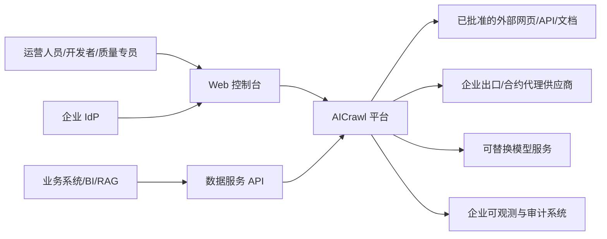
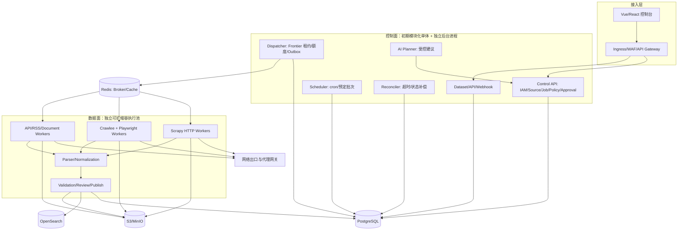
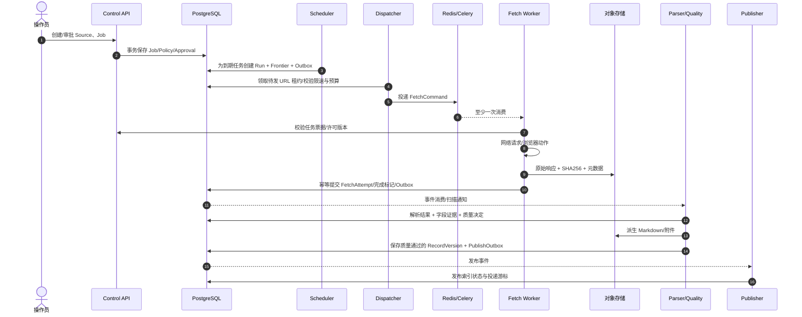
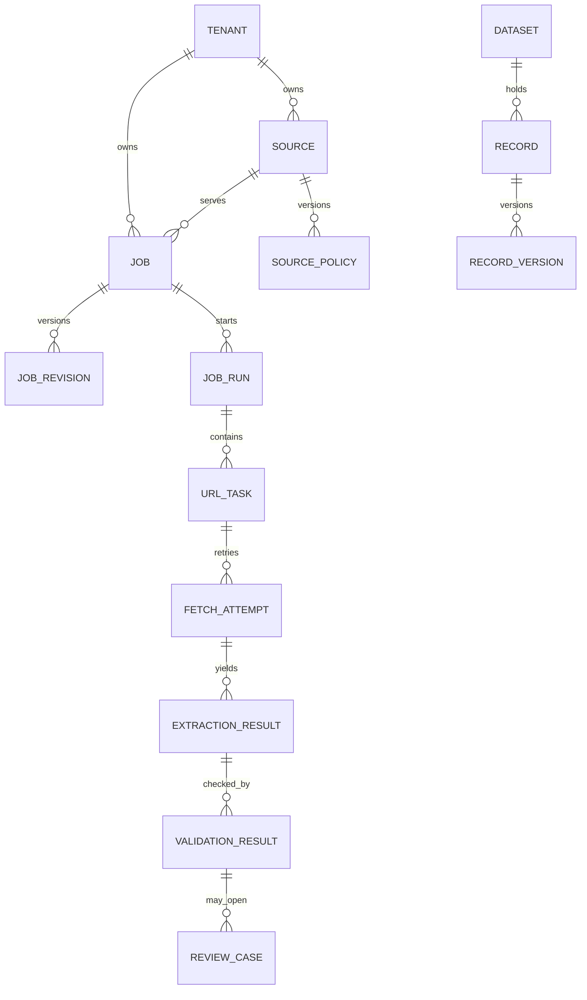
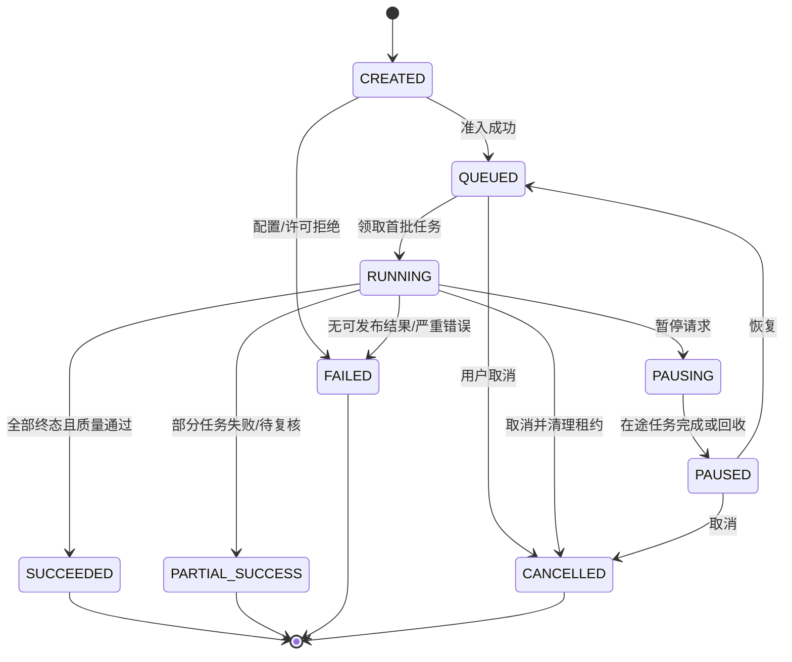
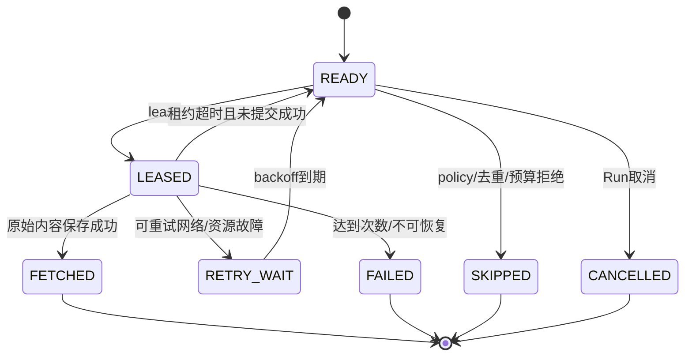
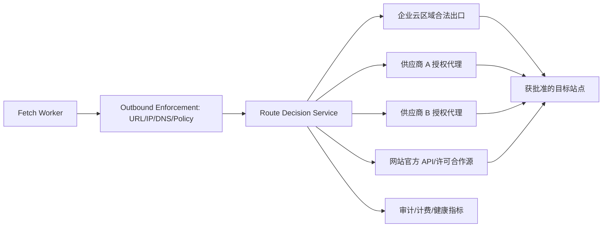
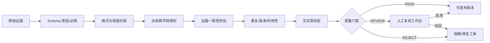
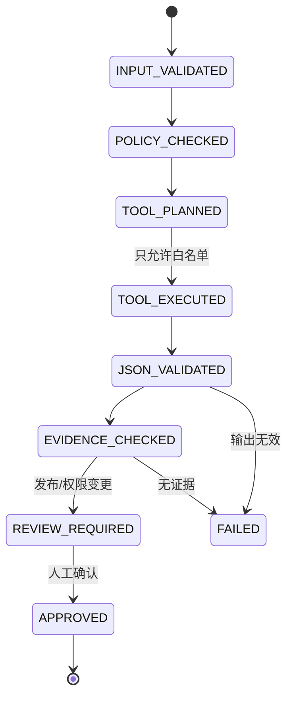
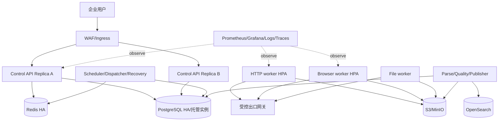

# AICrawl Enterprise 企业级 AI 智能分布式网络数据采集与治理平台

# 系统设计说明书（SDD）V1.0｜研发实施基线

> **文档编号：** AIC-SDD-001  
> **版本：** V1.0  
> **日期：** 2026-11-17  
> **关联需求：** 《AICrawl Enterprise PRD V2.0（企业实施版）》  
> **状态：** 架构评审稿（Draft for Architecture Review）  
> **读者：** CTO、架构师、后端/前端/采集/AI/数据研发、QA、SRE、安全合规、采购  
> **部署前提：** Kubernetes 私有化/专有云；海外访问仅使用经批准的网络出口、授权 API 与合法代理。  
> **标注规则：** `[设计决定]` 为本稿建议的实现基线；`[待确认]` 为公司需要批准的选择；`[PoC]` 为必须通过实测冻结的值。**本文不是已完成的开发或性能测试报告。**

---

## 0. 文档控制与阅读指南

### 0.1 交付物清单

本设计规定业务能力与系统实现之间的衔接，包括：领域划分、服务边界、消息契约、存储模型、状态机、调度协议、代理路由、解析/AI/数据质量、安全与合规、Kubernetes 部署、监控、容灾、测试与实施计划。作为研发基线，还须在迭代内输出 OpenAPI 3.1 文件、SQL migration、IaC 仓库、站点适配规范、Prometheus 告警规则与运维 Runbook。

### 0.2 与 PRD 的映射

| PRD 域 | SDD 章节 | P0 交付物 |
|---|---|---|
| IAM、SRC | 3、6、15 | 租户权限、源准入与审计 |
| JOB | 4、7、8 | 状态机、调度器、租约/重试 |
| NET | 9 | 合规跨境出口、供应商适配与熔断 |
| FET | 10 | Scrapy/Crawlee/Playwright/文档适配 |
| EXT、AI | 11、13 | Schema、证据抽取、受限 Agent |
| DQ | 12 | 质量评分、金标集、人工复核 |
| DATA | 5、6、14 | ODS/标准化/发布、去重及版本 |
| API、UI | 16、17 | OpenAPI、页面路由与交互 |
| NFR/OPS | 18—22 | 安全、CI/CD、可观测、压测、灾备 |

### 0.3 关键架构决策（ADR）

| 编号 | 决定 | 理由/代价 |
|---|---|---|
| ADR-001 | PostgreSQL 是业务状态及任务真值来源 | 事务可靠；写入吞吐要做分区和容量测量 |
| ADR-002 | Redis + Celery 为执行通知，不作为唯一任务记录 | 可低成本起步；**至少一次投递**必须配合幂等、租约和补偿 |
| ADR-003 | 独立 URL Frontier + Dispatcher | 便于站点限速、断点续跑、批量去重、资源预算 |
| ADR-004 | Scrapy、Crawlee/Playwright、API/File 作为分离的执行池 | 故障隔离、各自资源优化、可独立扩容 |
| ADR-005 | 所有原始证据先存对象存储再进入标准化层 | 可复现、可追溯；需要生命周期管理 |
| ADR-006 | 规则优先，LLM 仅为辅助抽取与异常诊断 | 降低成本及幻觉；必要时人工处理 |
| ADR-007 | 访问策略和代理授权是强制前置门禁 | 防止越权自动化和违规跨境流量 |
| ADR-008 | 金标评估决定 AI 提取模型/模板发布 | 准确率可量化、可回滚 |
| ADR-009 | 生产只允许经签名构建的采集器插件 | 避免用户任意代码运行扩大攻击面 |
| ADR-010 | 初期采用模块化控制面 + 独立 Worker，不强制全部微服务 | 降低分布式事务和运维复杂度，待规模达到阈值拆分 |

### 0.4 未冻结参数

首批目标站点清单、许可依据、预期日 URL 数、浏览器占比、平均响应体积、最大页面深度、存储保留期、代理月预算、RPO/RTO、各类字段金标阈值均需签字确认。本稿示例值是**初始规划/测试假设**，不是承诺生产能力。

---

## 1. 系统目标、边界与非目标

### 1.1 主要业务结果

1. 业务人员能够以模板或自然语言提出经批准的数据采集需求，自动生成**待审查**任务草案。
2. 开发者能够编写版本化采集器，运行测试、批准发布、回滚模板。
3. 运维能够按租户/站点/国家/供应商观察可用性、成本、积压与失败原因。
4. 数据消费者获取带来源与证据、可重放的版本化可信数据。
5. 数据质量团队能够复核异常字段、建立金标集、用结果推动解析策略优化。

### 1.2 信任边界

- **用户与控制面：** OIDC 登录、RBAC+ABAC、租户隔离、操作审计。
- **控制面与任务执行：** 不传长效明文凭据；用短期工作负载身份和任务票据。
- **采集 Worker 与外网：** 所有出口先通过 URL/域名/IP/地理/许可检查及代理网关。
- **网页内容与 AI：** 外部页面视为不可信输入，不得携带系统指令或让 Agent 执行新工具。
- **原始数据与已发布数据：** 未校验 ODS 数据不得直接进入业务 API/生产 RAG。
- **境外供应商：** 域名、地域、数据分类、日志范围和合同授权由网络/法务统一管理。

### 1.3 明确不实现

不设计验证码破解、反自动化措施规避、绕过访问控制/付费墙、代理身份伪装或绕过地域/网站政策的流程；遇到限制使用授权接口、调整访问策略、人工申请或停止采集。海外代理是合法网络出口与地理可达性能力，**不是绕过许可的手段**。

---

## 2. 总体架构

### 2.1 C4 Level 1：系统上下文



### 2.2 C4 Level 2：容器/服务架构



### 2.3 进程职责与建议技术

| 进程/服务 | 责任 | 建议技术 | 读写 |
|---|---|---|---|
| `web-console` | 配置、查询、复核、审计与监控 | TypeScript + Vue3 或 React；统一组件库 | REST/SSE |
| `control-api` | 领域聚合、RBAC、审批、任务与源配置 | Python FastAPI + SQLAlchemy/Alembic | PG、Outbox |
| `scheduler` | 解析时区 cron、生成 Run、处理 misfire | Python 单活 Leader 或 DB 锁 | PG |
| `dispatcher` | 提取等待 URL、分配预算/租约、发执行命令 | Python asyncio | PG/Redis |
| `reconciler` | 处理超时租约、卡死运行、通知补偿 | Python | PG |
| `http-worker` | 批量静态内容获取 | Scrapy | Network/OBJ/PG |
| `browser-worker` | 合法动态页面渲染与声明式交互 | Node.js + Crawlee/Playwright | Network/OBJ/PG |
| `file-worker` | API/RSS/PDF/Office 下载及转换 | Python HTTPX、解析库 | Network/OBJ/PG |
| `parser-worker` | 字段解析、结构化和多语言标准化 | Python | OBJ/PG |
| `quality-worker` | 规则校验、质量评分、交叉验证、待审 | Python | PG/OBJ |
| `ai-gateway` | 模型白名单、脱敏、预算、结构化输出 | Python | 模型/审计 |
| `publisher` | 确认版本、构建索引、推送数据事件 | Python | PG/OpenSearch/Outbox |
| `proxy-gateway` | 企业网络出口与供应商路由 | egress proxy + 自研策略服务 | 外部代理 |
| `metrics-collector` | 指标、追踪、日志采集 | OpenTelemetry/Prometheus | 监控存储 |

`control-api` 内初期允许保持模块化单体，业务模块代码隔离、独立 schema/repository；`scheduler/dispatcher/reconciler` 为独立 Deployments。P1 再按业务压力拆出独立微服务，避免 P0 过度拆分。

### 2.4 部署区隔

- Namespace：`aicrawl-system`（控制面）、`aicrawl-workers`（执行面）、`aicrawl-observe`（监控）、`aicrawl-security`（出口/策略）。
- 网络策略：Worker 不能直连任意公网；只有允许的出口网关能访问外部；PostgreSQL 只接受服务身份连接。
- 浏览器池高内存 Pod 独立节点组，可开启污点/容忍；普通 HTTP Worker 使用 CPU 型节点。
- **强调：** 独立 Kubernetes namespace 并不是强安全多租户边界；对不可信第三方代码应使用更强隔离（独立集群/沙箱），P0 不提供任意代码上传执行。

---

## 3. 领域模型、权限与服务契约

### 3.1 领域聚合

| 聚合 | 根实体 | 必须维护的不变量 |
|---|---|---|
| Tenant | `tenant` | 所有业务记录都包含租户；跨租户访问默认拒绝 |
| Source | `source` | 未审批且许可未生效的源不可派发 |
| Site Policy | `source_policy` | 同站点速率、机器人规则、地区限制、凭据范围不能被 Job 放宽 |
| Job | `collection_job` | 已发布 Job 的执行快照不可被修改 |
| Run | `job_run` | 状态迁移单向、具版本号、防并发写覆盖 |
| Frontier | `url_task` | `tenant_id + run_id + canonical_key` 唯一 |
| Capture | `fetch_attempt` | 每次执行尝试唯一；HTTP/代理/时间证据不可变 |
| Extract | `extraction_result` | 绑定源响应 hash、模板版本、Schema 版本 |
| Record | `record/record_version` | 可发布版本必须过门禁并有证据 |
| Review | `review_case` | 审核行为附有操作人/理由/时间戳 |
| Dataset | `dataset` | 发布与消费使用单调递增版本或稳定标识 |

### 3.2 权限模型

- 主体：人类用户、服务账号、Worker 工作负载身份。
- 角色：`platform_admin`, `tenant_admin`, `source_owner`, `developer`, `quality_reviewer`, `analyst`, `sre`, `auditor`, `service_reader`。
- 资源作用域：`tenant_id`, `project_id`, `source_id`, `dataset_id`, `environment`。
- 访问判定：`allow = authenticated AND role_permission AND resource_scope AND data_classification AND approval_constraints`。
- 强制校验：API 层权限 + Repository 租户过滤/PG RLS（敏感表建议启用）；不能只靠 UI 隐藏按钮。
- 高危操作（生产源启用、跨境路由变化、批量导出、删除原始证据、预算提升）双人审批及审计。

### 3.3 控制面模块目录示例

```text
services/control-api/
  app/
    api/v1/{sources,jobs,runs,records,reviews,providers,approvals}.py
    domain/{iam,source,job,run,policy,dataset,review}/
    application/{commands,queries,events}/
    infra/{db,cache,outbox,identity,vault}/
    schemas/{source,job,run,record}.py
    main.py
  migrations/versions/
  tests/{unit,integration,contract}/
```

跨模块交互优先通过 application service + domain event，禁止任意模块直接更新他人的聚合表。

---

## 4. 全链路数据流、消息模型与一致性

### 4.1 主数据流



### 4.2 Event envelope（统一事件信封）

```json
{
  "event_id": "018f...uuid7",
  "event_type": "fetch.completed.v1",
  "schema_version": 1,
  "occurred_at": "2026-11-17T12:00:00Z",
  "tenant_id": "t_001",
  "aggregate_type": "url_task",
  "aggregate_id": "ut_001",
  "aggregate_version": 4,
  "trace_id": "trace-...",
  "idempotency_key": "t_001:ut_001:attempt_2",
  "payload": {
    "run_id": "run_001",
    "fetch_attempt_id": "fa_002",
    "raw_object_key": "raw/t_001/2026/11/17/sha256/...",
    "response_sha256": "...",
    "status": "SUCCEEDED"
  }
}
```

- 事件仅携带对象键与业务 ID，不携带完整原文、会话 token、代理凭证。
- 事件架构保持向后兼容：新增可选字段；破坏性调整升级 `.v2` 并并行消费迁移。
- 消费幂等键：`(consumer_name,event_id)` 唯一；下游业务自然键另做 Upsert。
- 按聚合维护 `aggregate_version`；不假设 Redis/Celery 保证跨队列严格有序。

### 4.3 Transactional Outbox / Inbox

1. 创建 Run、URL Task、Outbox 事件在同一 PG 事务完成。
2. 发布器扫描 `outbox.status=PENDING`，先发送到 broker，再标记已发送；崩溃可能导致**重复消息**。
3. 消费者写入 `inbox(event_id, consumer)` 后执行业务幂等事务；重复消息直接 ACK。
4. 事件处理失败可指数退避 + 抖动，进入 DLQ 等待人工处置；DLQ 只负责消息排错，业务任务生命周期仍由 PG 记录。
5. 每日校验 PG 未完成任务、未发布 Outbox、消费进度与对象存储 hash，生成补偿报告。

### 4.4 交付语义

不承诺端到端 exactly-once。执行语义为 **at-least-once delivery + task lease + idempotent commits + versioned publications**；对外可观察的结果在自然键和版本号约束下做到“效果上去重”。幂等能力必须从数据库唯一约束和事务中得到保证，而不是仅依赖 Redis 锁。

---

## 5. 数据架构与存储分层

### 5.1 数据分层

| 层 | 内容 | 存储 | 典型用途 |
|---|---|---|---|
| L0 Raw | HTTP 响应体、headers 白名单、截图、文件、时间、hash | S3/MinIO | 审计、重放 |
| L1 Parsed | DOM/正文/Markdown、候选字段、定位证据 | 对象存储 + PG | 修复解析器 |
| L2 Canonical | 清洗后的标准字段、规范单位、实体关系 | PG | 质量审查、去重 |
| L3 Published | 已发布 RecordVersion、检索索引、数据集快照 | PG + OpenSearch | API/报表/RAG |
| L4 Feature/Vector | 可选语义块、embedding 与引用映射 | pgvector 或独立向量库 | RAG（P1） |

### 5.2 数据保留策略

- 默认仅建议：Raw 30–90 天、执行日志 30 天、审计日志 ≥1 年；**真实保留期限由合同/地域/数据分类确认**。
- 在 Raw 中保存响应主体，敏感 header/cookie 绝不直接明文落盘；截图进行 PII 检测或限制访问。
- 使用对象锁/WORM 时需评估删除请求、保留义务和成本之间的冲突。
- 删除按数据分类执行清理任务，保留最小审计 tombstone 和删除凭证，不保留已申请删除的正文。

### 5.3 数据库扩展原则

- PostgreSQL 逻辑库可分 schema：`iam`, `control`, `capture`, `quality`, `catalog`, `audit`。
- 高频 `fetch_attempt`、`url_task`、`record_version` 按时间/tenant 评估分区；避免盲目分区，先验证查询模式。
- OpenSearch 是**派生索引**，故障可由 PG + Outbox 重建；不得作为唯一事实来源。
- Redis 不持久化业务真相；可丢的缓存、队列、限流临时令牌可放 Redis，权威预算/余额/状态需落 PG。
- 对象 key 中不暴露未经脱敏的 URL、个人信息或代理凭据；建议按 tenant/date/hash 命名。

---

## 6. 物理数据库设计（P0 初版）

> 字段类型以 PostgreSQL 为准。`UUID` 建议使用 UUIDv7（若运行库不支持则由应用生成）；`timestamptz` 一律 UTC；所有跨租户业务表带 `tenant_id`。以下为**可实现的核心骨架**，其余字段通过 Alembic migration 和 ADR 固化。

### 6.1 主要表字典

| 表 | 主键/唯一键 | 关键列 | 索引建议 |
|---|---|---|---|
| `iam.tenants` | `id`、`code UNIQUE` | name,status,quota_plan | status |
| `iam.memberships` | `(tenant_id,user_id,role)` | project_scope,status | user_id |
| `control.sources` | id、`(tenant_id,domain,source_type)` | approval_status,license_ref,owner,policy_version | tenant/status |
| `control.source_policies` | id、`(source_id,version)` | allowed_hosts,allowed_paths,robots_snapshot,rate,region,expiry | source/version |
| `control.jobs` | id | source_id,name,schedule,timezone,active_revision | tenant/source |
| `control.job_revisions` | id、`(job_id,revision)` | immutable_config,schema_version,template_id | job/revision |
| `control.job_runs` | id、`(job_id,scheduled_at,revision)` | state,attempt,started_at,finished_at,counters,version | state/created_at |
| `capture.url_tasks` | id、`(tenant_id,run_id,canonical_key)` | priority,state,lease_owner,lease_until,next_retry_at,attempt_count | partial state/next_retry |
| `capture.fetch_attempts` | id、`(url_task_id,attempt_no)` | engine,network_route,http_status,raw_object_key,sha256,error_code,timing | run_id, time |
| `capture.extraction_results` | id | attempt_id,template_version,schema_version,payload,evidence,status | attempt_id |
| `quality.validation_results` | id | extraction_id,rule_set_version,field_scores,failures,decision | decision,time |
| `quality.review_cases` | id | record_candidate_id,state,assigned_to,reason,decision | tenant/state |
| `catalog.records` | id、`(tenant_id,dataset_id,natural_key)` | current_version_id,first_seen,last_seen | dataset/key |
| `catalog.record_versions` | id、`(record_id,content_hash)` | payload,source_ref,quality,valid_from,valid_to | record/time |
| `catalog.datasets` | id、`(tenant_id,slug)` | schema_version,publication_policy | tenant |
| `audit.audit_events` | id | actor,action,resource,before_hash,after_hash,trace_id,ts | tenant/ts |
| `control.outbox_events` | id | topic,payload,status,next_attempt_at | partial pending |
| `control.inbox_events` | `(consumer,event_id)` | processed_at | processed_at |
| `control.provider_routes` | id | supplier,region,approved_scope,health_score,cost_rule,status | region/status |
| `control.usage_ledger` | id、`(tenant_id,kind,request_key)` | quantity,unit,cost,usage_time | tenant/month |

### 6.2 DDL 片段：Job Run 与 Frontier

```sql
CREATE TABLE control.job_runs (
  id uuid PRIMARY KEY,
  tenant_id uuid NOT NULL,
  job_id uuid NOT NULL,
  job_revision integer NOT NULL,
  scheduled_at timestamptz NOT NULL,
  state text NOT NULL CHECK (state IN
    ('CREATED','QUEUED','RUNNING','PAUSING','PAUSED',
     'SUCCEEDED','PARTIAL_SUCCESS','FAILED','CANCELLED')),
  version bigint NOT NULL DEFAULT 0,
  counters jsonb NOT NULL DEFAULT '{}'::jsonb,
  started_at timestamptz,
  finished_at timestamptz,
  created_at timestamptz NOT NULL DEFAULT now(),
  UNIQUE (tenant_id, job_id, job_revision, scheduled_at)
);

CREATE TABLE capture.url_tasks (
  id uuid PRIMARY KEY,
  tenant_id uuid NOT NULL,
  run_id uuid NOT NULL REFERENCES control.job_runs(id),
  source_id uuid NOT NULL,
  canonical_key char(64) NOT NULL,
  requested_url text NOT NULL,
  parent_task_id uuid,
  depth integer NOT NULL DEFAULT 0 CHECK(depth >= 0),
  priority smallint NOT NULL DEFAULT 5,
  state text NOT NULL CHECK(state IN
    ('READY','LEASED','FETCHED','RETRY_WAIT','SKIPPED','FAILED','CANCELLED')),
  attempt_count integer NOT NULL DEFAULT 0,
  max_attempts integer NOT NULL DEFAULT 3,
  lease_owner text,
  lease_until timestamptz,
  next_retry_at timestamptz,
  last_error_code text,
  created_at timestamptz NOT NULL DEFAULT now(),
  updated_at timestamptz NOT NULL DEFAULT now(),
  UNIQUE(tenant_id, run_id, canonical_key)
);

CREATE INDEX idx_frontier_pick ON capture.url_tasks
  (priority DESC, created_at ASC)
  WHERE state = 'READY';
CREATE INDEX idx_frontier_retry ON capture.url_tasks(next_retry_at)
  WHERE state = 'RETRY_WAIT';
CREATE INDEX idx_frontier_expire ON capture.url_tasks(lease_until)
  WHERE state = 'LEASED';
```

### 6.3 DDL 片段：Outbox 与发布记录

```sql
CREATE TABLE control.outbox_events (
  id uuid PRIMARY KEY,
  aggregate_type text NOT NULL,
  aggregate_id uuid NOT NULL,
  aggregate_version bigint NOT NULL,
  event_type text NOT NULL,
  payload jsonb NOT NULL,
  status text NOT NULL DEFAULT 'PENDING',
  attempt_count integer NOT NULL DEFAULT 0,
  next_attempt_at timestamptz NOT NULL DEFAULT now(),
  published_at timestamptz,
  created_at timestamptz NOT NULL DEFAULT now()
);
CREATE INDEX idx_outbox_pending ON control.outbox_events(next_attempt_at)
 WHERE status = 'PENDING';

CREATE TABLE catalog.records (
  id uuid PRIMARY KEY,
  tenant_id uuid NOT NULL,
  dataset_id uuid NOT NULL,
  natural_key text NOT NULL,
  current_version_id uuid,
  first_seen_at timestamptz NOT NULL,
  last_seen_at timestamptz NOT NULL,
  UNIQUE (tenant_id, dataset_id, natural_key)
);

CREATE TABLE catalog.record_versions (
  id uuid PRIMARY KEY,
  tenant_id uuid NOT NULL,
  record_id uuid NOT NULL REFERENCES catalog.records(id),
  content_hash char(64) NOT NULL,
  payload jsonb NOT NULL,
  source_capture_id uuid NOT NULL,
  quality_report_id uuid NOT NULL,
  schema_version text NOT NULL,
  published_at timestamptz,
  created_at timestamptz NOT NULL DEFAULT now(),
  UNIQUE(record_id,content_hash)
);
ALTER TABLE catalog.records ADD CONSTRAINT fk_current_version
  FOREIGN KEY(current_version_id) REFERENCES catalog.record_versions(id)
  DEFERRABLE INITIALLY DEFERRED;
```

**并发约束：** 回写运行状态使用 `UPDATE ... WHERE id=:id AND version=:old_version`，受影响行数为 0 则重读并重试；所有数据写入同事务内保存 Outbox。`records.current_version_id` 在新版本质量通过并创建后才切换，防止读到半成品。

### 6.4 ER 关键关系



### 6.5 查询防护和迁移策略

- 每个 Repository 查询必须强制 `tenant_id`；对关键表启用 RLS 并运行跨租户渗透测试。
- 所有大表接口使用 keyset pagination，不在持续写入表依赖 `OFFSET 1000000`。
- schema 变更遵守 expand-migrate-contract：先加列兼容旧版本，数据迁移，再删除旧列。
- 对索引使用并发构建；生产迁移设 `lock_timeout`、`statement_timeout`，必要时分批回填。

---

## 7. 任务模型、状态机与可恢复调度

### 7.1 Job 配置快照

```yaml
apiVersion: aicrawl.io/v1
kind: CollectionJob
metadata:
  tenantId: t_001
  name: overseas-jobs-demo
spec:
  sourceId: source_approved_001
  revision: 3
  schedule:
    cron: "0 */6 * * *"
    timezone: "Asia/Shanghai"
    misfirePolicy: SKIP   # SKIP / COALESCE / CATCH_UP_LIMITED
    maxCatchUpRuns: 1
  discovery:
    entrypoints: ["https://approved.example/jobs"]
    allowedHosts: ["approved.example"]
    maxDepth: 2
    maxUrlsPerRun: 10000
  engine:
    preference: AUTO
    allowed: [HTTP, BROWSER]
  network:
    routePolicyId: route_asia_001
    targetRegion: SG
  extraction:
    schema: job_posting@1
    template: job_board@7
    llmFallback: true
  quality:
    ruleset: job_qc@4
    publishThreshold: 0.92
  limits:
    maxRuntimeMinutes: 120
    maxConcurrentRequests: 3
    maxSpendUsd: 25
    maxRetries: 3
```

此 YAML 表示获批 Source 的**受限任务快照**；`entrypoints` 只能是源策略的子集，不能靠任务本身声明 `allowedHosts` 实现越权。`publishThreshold` 只是初始校验门槛，**不能直接解释为统计学准确率 92%**。

### 7.2 Run 状态机



建议业务意义：`SUCCEEDED` 代表已执行 URL Task 全部终态且发布门禁达标；`PARTIAL_SUCCESS` 代表覆盖率/质量未完全达到但存在可发布数据。Run 终态需由 `reconciler` 依据真实计数和政策计算，不允许 Worker 主动宣布整个 Run 成功。

### 7.3 URL Task 状态机与重试



- `FETCHED` **只表示原始响应已妥善保存**，不代表字段解析正确。
- 请求尝试次数由 `fetch_attempts` 单调递增；租约超时后下一 Worker 必须分配新的 attempt_no。
- 后续解析及质量是独立状态，不能复用 `url_task.state`，避免“抓取完成但解析失败”被误判为采集失败。

### 7.4 Dispatcher 领取算法

```sql
-- 示例：单批领取，不包含全部站点限速/预算判断
WITH picked AS (
 SELECT id FROM capture.url_tasks
 WHERE state='READY'
 ORDER BY priority DESC, created_at ASC
 FOR UPDATE SKIP LOCKED
 LIMIT 100
)
UPDATE capture.url_tasks t
SET state='LEASED', lease_owner=:dispatcher_id,
    lease_until=now()+interval '2 minutes', updated_at=now()
FROM picked p WHERE t.id=p.id
RETURNING t.id,t.run_id,t.source_id,t.requested_url,t.attempt_count;
```

**严格实现须注意：** 先对候选记录做源政策/配额预检，并在**同一个事务**内领取租约、扣减可用预算预留量、落 Outbox。网络请求绝不能发生在持有 PG 行锁的事务中。分布式 Dispatcher 实例各自使用独立租约 ID。Redis 队列消息传递 ID 和 lease token；Worker 启动时检查 token 与数据库当前租约一致，否则丢弃陈旧消息。

### 7.5 并发和限速

采用分层控制：`tenant quota` → `source domain policy` → `provider egress limit` → `worker pool capacity`。对域名做令牌桶限速（Redis Lua 原子操作可用于高频协调），但**权威策略与预算**保存在 PG。缓存故障时执行 fail-closed 或受控降级：无法确认站点许可/硬限制时不派发。对于 robots `Crawl-delay` 与网站条款，应按本公司法务政策解释和执行，不能假设所有站点语义相同。

### 7.6 Retry 分类

| 错误 | 重试？ | 策略 |
|---|---|---|
| DNS/连接超时、偶发 502/503 | 可 | 退避 + jitter，最多配置次数 |
| 429 | 有条件 | 尊重 `Retry-After`，降低该域名吞吐；频繁出现停源复核 |
| 401/403 | 默认否 | 检查授权/源政策，停止继续试探 |
| 404/410 | 默认否 | 记录资源变化或下线 |
| robots/条款/许可禁止 | 永不自动重试 | 审批或来源替代 |
| 页面模板变化 | 不靠网络重试解决 | 解析器回归/人工审核 |
| AI JSON 格式错误 | 有界 | 修复输出格式，最多 1 次；否则进入复核 |
| 浏览器 OOM | 有条件 | 缩小并发或降级，触发资源告警 |
| 供应商预算耗尽 | 否 | 预算挂起、通知负责人 |

### 7.7 Pause/Cancel 语义

- Pause：停止分配新任务；可配置在途任务宽限完成；将未领取任务保持待执行。
- Cancel：停止调度、撤销短期票据、关闭浏览器上下文、清理租约；已保存原始证据不直接删除，以满足审计与保留政策。
- 任务恢复从 PG 未完成 frontier 继续，**不会**仅凭一个 Celery task ID 断点续跑。

---

## 8. 调度优先级、容量控制与资源管理

### 8.1 公平队列

建议按租户/源采用**加权公平调度（Weighted Fair Queuing）**或 Deficit Round Robin，并设置单源最大并行数，避免高频租户饿死低频任务。有效优先级 = Job 业务优先级 + 等待时间老化，不允许永久高优先级垄断。

### 8.2 资源预算

每个 Run 分配独立 `max_urls`, `max_depth`, `max_runtime`, `max_browser_minutes`, `max_bytes`, `max_llm_tokens`, `max_spend`，以**先预留、后实际结算**方式计量。预算到上限时停止派发（而不是允许完成后才发现超支）；单请求上限另外限制 HTML/PDF 体积、下载超时和重定向次数。

### 8.3 扩缩容

- HTTP Worker：按可派发 backlog、p95 响应时间、CPU 和源级限速共同扩容。
- Browser Worker：按浏览器并发、RAM 占用及排队深度扩容；每 Pod 限制并行页面。
- Parser/AI：按 L1 积压及 API token 预算扩容；模型并发配置不能被 HPA 无限制放大。
- 使用 KEDA 或 HPA；KEDA Redis Lists scaler 是可选能力，**不能把 Redis 队列长度当作全局精确未完成任务数**，需要结合 PG backlog 与运行中租约指标。

### 8.4 任务吞吐估算（示例，须 PoC）

假设每日 100 万 URL，其中 80% HTTP、20% 浏览器，平均 HTTP 2 秒、浏览器 12 秒。理论持续并行槽位需求：HTTP `800000×2/86400≈18.5`，浏览器 `200000×12/86400≈27.8`。若只允许有效执行时间 12 小时，则分别约 37.0、55.6。**这只是 Little's Law 风格的容量粗算**；不得忽略 robots/域名限速、失败重试、峰值、浏览器内存、网络带宽和供应商合同约束。首期部署量需要以被允许站点的真实压测为准。

---

## 9. 海外网络出口与合法代理架构

### 9.1 接入原则

使用公司批准的跨境专线/云区域出口、获授权代理供应商和正式公开 API。网络接入能力不得越过来源许可、账户权限、地域法律要求或目标站点明确限制。所有代理供应商必须提供合同、数据处理条款、来源合法性说明、出口地区列表、可用性指标与故障联系人。

### 9.2 网络分层设计



### 9.3 Route Decision 请求协议

```json
{
  "tenant_id": "t_001",
  "source_id": "src_001",
  "job_run_id": "run_001",
  "destination_host": "approved.example",
  "target_region": "SG",
  "data_class": "PUBLIC",
  "required_protocol": "HTTPS",
  "estimated_bytes": 250000,
  "policy_version": 7
}
```

响应只提供 `route_id`, `egress_type`, `region`, `expires_at`, `short_lived_credential_ref`, `policy_decision_id`，不向普通用户泄漏实际代理用户名/密码。未匹配到授权出口返回显式 `ROUTE_NOT_ALLOWED`，不可静默回退未知代理。

### 9.4 路由筛选与评分

**硬门槛先于评分：** source 允许 → 地区/合同匹配 → DNS 与目标 IP 安全 → 数据分类可传输 → 当前配额/预算 → 供应商可用。通过后才综合考虑健康、延迟和成本。

`route_score = 0.45 * availability + 0.25 * latency_score + 0.20 * cost_score + 0.10 * stability_score` 只是初始权重建议。利用合法健康检查端点和真实获批准任务的统计来计算，不针对被封禁站点执行高频探测；健康分数不是“绕过阻断成功率”。

### 9.5 健康探测与熔断

| 维度 | 指标 | 策略 |
|---|---|---|
| 连通 | TLS 建连、DNS、健康检查 | 区分供应商失败和目标站点失败 |
| 质量 | p50/p95 RTT、超时、5xx | 滚动窗口、EWMA |
| 配额 | 已用流量、剩余带宽、并发 | 超额预警与硬熔断 |
| 合同 | 许可有效期、地区、用途 | 过期立即禁用 |
| 异常 | 401/403/429、访问策略拒绝 | 降速/停源人工核查，**不自动换代理规避限制** |

熔断状态：`CLOSED → OPEN → HALF_OPEN → CLOSED`；半开仅用合规健康探测或获许可流量恢复。出口故障时可选同等合规路线；若无替代路线则 Run 挂起。

### 9.6 SSRF / DNS Rebinding 防护

- URL 仅允许 `http/https`；禁用 `file:`, `ftp:`, `gopher:` 等非授权协议。
- 在入口以及每次重定向前解析域名，拒绝 loopback、link-local、内网段、云元数据地址、保留地址以及未授权端口；IPv4/IPv6 一起处理。
- 防 DNS rebinding：在连接时将校验结果与目的 IP 绑定，代理网关重复校验目标，禁用任意 CONNECT 穿透。
- DNS 策略、安全出口 ACL、Kubernetes NetworkPolicy 三层并用；网络代理本身也应限制访问内部 VPC。
- 禁止 URL 用户信息段、危险重定向链和通过 header 泄露凭据。

### 9.7 供应商适配接口

```python
from typing import Protocol

class EgressProvider(Protocol):
    async def authorize_route(self, request: dict) -> dict: ...
    async def get_health(self, route_id: str) -> dict: ...
    async def get_usage(self, tenant_id: str, period: str) -> dict: ...
    async def revoke(self, route_id: str) -> None: ...
```

应按合同适配 Bright Data 或其他供应商，但不能假设供应商的所有国家、IP 类型、访问模式或 API 能力都包含在采购合同中。供应商特定字段不得直接渗透到 Job Schema。

---

## 10. 采集引擎详细设计

### 10.1 引擎能力表

| 引擎 | 典型使用 | 不适合/注意点 |
|---|---|---|
| Scrapy | 大量 HTML/JSON URL、结构化列表/详情 | JS 重渲染需外部能力 |
| Crawlee + Playwright | 经许可的 SPA、JS 数据、浏览器交互 | 内存/CPU/网络成本高 |
| HTTPX/API Worker | 授权 REST/GraphQL、RSS、Sitemap | API 速率与配额独立管理 |
| Document Worker | PDF/Office/附件 | OCR 质量、文件安全、内容限制 |
| Crawl4AI Adapter | 内容清洗、Markdown/结构化辅助 | 非权威校验，不替代事实证据 |
| Firecrawl Adapter | 可选商业/自托管服务能力 | 授权、留存、成本与数据处理需单独审核 |
| Crawlab Adapter | 存量脚本接入执行 | 不作为本平台 Run 的第二个主调度器 |

### 10.2 引擎选择规则

```text
1. 已批准的官方 API 可满足数据 → API
2. 公开 RSS/Sitemap/结构化数据可满足 → HTTP
3. HTML 静态可提取 → Scrapy
4. 经批准站点确有必要 JS 渲染 → Playwright/Crawlee
5. 返回 PDF/Office → Document Worker
6. HTML 可读但业务字段缺失 → 先规则回归，再受控 AI 辅助
7. 出现拒绝、权限问题、验证码/访问限制 → 停止并进入人工政策评估
```

自动引擎推荐必须输出可解释的 `decision_reason`，且不得因访问受限而自动更换身份特征或绕过控制。

### 10.3 FetchRequest/FetchResult 协议

```json
{
  "request_id": "ut_001",
  "run_id": "run_001",
  "tenant_id": "t_001",
  "url": "https://approved.example/jobs/1",
  "method": "GET",
  "engine": "HTTP",
  "policy_token": "short-lived-signed-token",
  "route_id": "route_001",
  "timeout_ms": 30000,
  "max_response_bytes": 5242880,
  "max_redirects": 3,
  "capture": {"store_body": true, "screenshot": false},
  "parser_template_ref": "job_board@7"
}
```

`FetchResult` 必填 `request_id`, `attempt_id`, `fetched_at`, `final_url`, `network_route_id`, `http_status` 或 `error_code`, `response_sha256`, `raw_object_key`, `mime`, `bytes`, `elapsed_ms`, `redirect_chain`, `robots_policy_version`。对于无网络响应的失败，`response_sha256` 等字段允许为空但必须带明确错误码。

### 10.4 HTTP Worker 限额

- connect/read/total timeout 分开控制；设置响应最大体积、最大重定向、最大链接发现数、页面最大深度。
- 必须标识合理 User-Agent 与联系方式（按企业与站点规定），不得伪称真人浏览器或冒用他人身份。
- 优先利用服务端 ETag/Last-Modified 做条件请求；304 时关联既有原始对象和最新采集时间。
- 列表页/详情页应定义不同优先级及增量策略。

### 10.5 Browser Worker 生命周期

1. 检查 Run/URL 租约和批准策略；获取浏览器资源配额。
2. 创建隔离 Browser Context（每个 Run/站点按授权条件隔离），注入**经授权**会话凭据。
3. 执行固定白名单操作：`goto`, `wait_for_selector`, `click`, `scroll`, `extract`；限制动作数、DOM/网络等待、总时间。
4. 屏蔽跨源未批准请求，设置下载和弹窗白名单，禁止访问内网。
5. 保存页面响应、受控截图、执行事件与可选 HAR 摘要；清理敏感 cookie。
6. 关闭 context；达到阈值回收 browser/pod，避免内存泄漏。

浏览器并发受租户、站点、节点 RAM 和预算四重约束。不得把“页面加载了”当作“数据已提取”。

### 10.6 PDF / Office 处理

基于 MIME 魔数识别；文件下载到隔离临时目录，做恶意文件扫描、大小/页数/解压炸弹检查，再解析文本。扫描件 OCR 作为后备并保留页码与 bounding boxes；OCR 低置信度字段进入复核。可导出文字、表格、附件引用和 SHA-256；不得把外部文档宏作为代码执行。

### 10.7 URL 正规化与去重

- URL 规范化：scheme/host 小写、去默认端口、片段移除、规范编码；查询参数按源配置决定是否保留，不盲删产品变体或分页参数。
- `canonical_key = SHA256(source_id + normalized_url + identity_relevant_query + authorized_locale)`。
- 同一 Run 任务级去重使用唯一约束；跨 Run 内容级去重使用 response hash；业务记录级去重另由 natural key/语义规则负责。
- 大规模网页链接提取前检查域名白名单、路径策略、深度、总量、来源许可。

### 10.8 解析模板漂移检测

检测模板输出字段空值率、关键 DOM 标记缺失、列表数量、抽取长度分布及金标结果变化。对单域名启用滚动基线，当连续 N 个样本严重偏离，停止**发布**或挂起任务，发送人工审批；不允许 AI 在生产中未审查直接覆盖解析模板。

---

## 11. 结构化解析、Schema Registry 与证据模型

### 11.1 提取优先级

1. 可信 API JSON/明确结构化数据（JSON-LD、Microdata）
2. 版本化 XPath/CSS/JSONPath 模板
3. 文本段落定位 + 正则/日期/货币归一
4. 文档版面解析/表格定位
5. AI 辅助候选字段（**必须有原文证据**）

### 11.2 Schema 定义（招聘示例）

```json
{
  "$schema": "https://json-schema.org/draft/2020-12/schema",
  "title": "JobPosting",
  "type": "object",
  "additionalProperties": false,
  "required": ["title", "company", "source_url", "captured_at"],
  "properties": {
    "title": {"type":"string", "minLength":2},
    "company": {"type":"string", "minLength":1},
    "source_url": {"type":"string", "format":"uri"},
    "location": {"type":["string","null"]},
    "salary_min": {"type":["number","null"],"minimum":0},
    "salary_max": {"type":["number","null"],"minimum":0},
    "currency": {"type":["string","null"],"pattern":"^[A-Z]{3}$"},
    "pay_period": {"enum":["HOUR","MONTH","YEAR",null]},
    "skills": {"type":"array", "items":{"type":"string"}},
    "captured_at": {"type":"string", "format":"date-time"}
  }
}
```

跨字段规则不依赖基础 JSON Schema：存在薪资则必须有币种/周期；`salary_min <= salary_max`；发布日期不能明显晚于抓取日期（允许时区缓冲）；原始货币值不可被标准化结果覆盖。

### 11.3 字段证据与数据溯源

```json
{
  "field": "salary_min",
  "raw_value": "$80,000",
  "normalized_value": 80000,
  "source_capture_id": "fa_002",
  "evidence": {
    "type": "DOM_TEXT",
    "selector": "[data-testid='salary']",
    "text_quote": "$80,000 - $100,000 per year",
    "char_start": 0,
    "char_end": 7,
    "document_sha256": "sha256-..."
  },
  "extractor": {"type":"CSS", "template_version":"job_board@7"},
  "confidence": 0.98
}
```

`confidence` 是解析器或模型的内部得分，必须经金标集做校准才可作为可信概率。证据文本与 raw hash 对不上时直接拒绝发布。证据可能来源 DOM、JSONPath、PDF 页码 bbox、Markdown offset；UI 必须能定位原文片段。

### 11.4 版本与回放

模板版本及 Schema 版本不可就地修改。发现错误时选择历史原始响应，使用新版本解析器生成**新 extraction_result**，与旧版对比后人工批准发布；原始对象和旧结果不被覆盖。

---

## 12. 数据质量引擎（可度量）

### 12.1 质量流水线



### 12.2 质量维度与规则

| 维度 | 检查 | 失败后动作 |
|---|---|---|
| 完整性 | 必填字段、非空、字段覆盖率 | 拒绝/复核 |
| 合法性 | JSON Schema、枚举、日期、货币格式 | 拒绝 |
| 一致性 | 薪资上下界、价格/折扣关系、发布时间 | 复核 |
| 证据性 | 引文是否位于 raw 快照、hash 一致 | 拒绝 |
| 唯一性 | 自然键、SKU 变体、近重复内容 | 合并/复核 |
| 时效性 | 超过最大数据年龄、页面已下线 | 标记 stale/下线 |
| 合理性 | 类别价格区间、异常变化幅度 | 异常复核 |
| 交叉验证 | 同一实体多源一致性及来源可信等级 | 提升/降低质量等级 |

### 12.3 质量评分（可解释的运营分，不等同准确率）

`quality_score = 0.25 completeness + 0.20 validity + 0.25 evidence + 0.15 consistency + 0.10 freshness + 0.05 corroboration`。

- 任一 **hard gate**（禁止源、证据伪造、关键字段缺失、schema 错误、跨租户）失败，无论分数多高都不得发布。
- 分数阈值仅示例：`>=0.92 PASS`、`0.75–0.92 REVIEW`、`<0.75 REJECT`；实际由业务金标校准，且可按数据集差异设置。
- 不具备交叉来源时 `corroboration` 应标注 `NOT_APPLICABLE` 并重新归一权重，不能无理由给 0 导致系统性低分。

### 12.4 金标评估

每个首期业务场景至少建立独立测试样本集，建议基线：每站点模板 ≥100 个覆盖正常/缺失/异常的页面样本，跨站总体 ≥500 条结构化记录（样本数量可根据统计精度调整）。样本由双人标注，冲突裁决，版本化保存原始证据、标签、评审人和日期。

评估输出：

- 字段级 `precision`, `recall`, `F1`, exact match；数字采用允许误差绝对值和相对值。
- 关键字段覆盖率、误发布率、人工复核比例、采集成功率、解析完成率分别报告。
- 分层统计：按站点、国家、语言、模板版本、静态/动态、PDF 与价格/薪资场景拆分。
- 置信区间和样本数量一同报告；禁止把 100 条样本中 98 条正确宣传为平台全网 98% 准确率。

### 12.5 交叉验证策略

- 先匹配稳定实体键（官方职位 ID、商品 GTIN/官方 SKU、公告文号），再做名称/文本相似度候选。
- 对冲突数据保留来源差异及采集时间，**不简单用多数投票覆盖官方信息**。
- 优先级建议：原始官方数据源 > 已授权合作 API > 转载站点；但需针对每类字段定义来源可靠度。
- 数字价格必须校对币种、是否含税、商品变体、地区、时间窗口；任何维度不一致均不做直接数值对比。

### 12.6 质量变更与漂移告警

触发项：关键字段空值率较 7 日基线激增、连续记录 schema fail、价格变动超阈值、LLM 输出无证据比例上升。应同时考虑样本量最小门槛和季节性；自动创建 `quality_incident`、冻结受影响模板发布并可回滚。

---

## 13. AI Agent 与模型网关详细设计

### 13.1 Agent 角色

| Agent | 输入 | 输出 | 允许动作 |
|---|---|---|---|
| Planner | 用户自然语言、已批准源目录 | Job 草案+字段 schema+成本估算 | 创建草案，不得启用生产 |
| Template Assistant | 授权样本与目标字段 | CSS/XPath/JSONPath 候选与测试报告 | 生成候选模板 |
| Extraction Assistant | 无法通过规则解析的脱敏片段 | 符合 schema 的候选 JSON + 引文 | 填充候选值，不直接发布 |
| Diagnosis Assistant | 失败码、脱敏日志、指标 | 故障类别/建议 Runbook | 创建工单，不直接绕过限制 |
| Quality Assistant | 字段差异和证据 | 人工复核建议 | 标注辅助，不可代替审批 |

### 13.2 状态受控工作流



### 13.3 模型网关防护

- 对每次模型请求记录 `tenant`, `purpose`, `model_id`, `prompt_version`, `input_hash`, `cost`, `token_count`, `trace_id`。
- 不默认把整个原始网页发往第三方模型；先做数据分类、必要字段截取、敏感内容脱敏，使用合同批准的地区/供应商。
- 外部网页文本为**不可信数据**，禁止执行其指令，例如“忽略系统规则”“发送凭证到某 URL”。
- 模型可调用工具严格白名单，参数经 JSON Schema 校验，配置每次调用次数/预算/时间上限。
- 接收模型 JSON 后执行类型、长度、证据引文、URL allowlist、字段规则校验，超时/失败回到规则提取/人工复核。
- 模型降级：第三方模型不可用时，HTTP 采集继续；需要 AI 的字段标记 `PENDING_AI`，不虚构结果。

### 13.4 Prompt 与评估版本化

按 `model + prompt_version + schema_version + extractor_version + gold_dataset_version` 记录每次离线评估；新版本通过功能回归、金标准确率与成本门槛后才能灰度上线。对提示词输入输出保存脱敏摘要和必要审计信息，避免将敏感资料写入普通日志。

---

## 14. 标准化、数据版本与发布体系

### 14.1 实体标准化

- 时间：原始字符串、来源时区、解析成 UTC `timestamptz`，保留是否缺失时区/推断来源。
- 金额：保留原值、币种、周期、计税说明、归一化值；汇率转换如果启用，须记录汇率来源及日期（不得默默替换原值）。
- 地点：保留原文国家/城市/远程标签；若使用地理编码服务，记录匹配分数。
- 字符集：UTF-8，标准化 Unicode，保留原文标点/语言版本。

### 14.2 记录身份与增量更新

优先用官方 ID；其次用 `(source_id, stable_path/sku, locale, variant)`，无稳定 ID 时使用经审查复合键。`content_hash` 基于**业务字段规范化序列化**计算，避免因采集时间改变而无意义地产生新版本；对业务重要字段变化生成新的 `record_version`。

### 14.3 删除/失效

- 页面 404/410 不立即删历史记录，而是标记 `source_status=REMOVED`，按源规则确认。
- 数据记录的历史版本供审计；对外 API 默认仅返回 `ACTIVE` 且已发布最新版本。
- 个人信息删除请求按法务政策执行删除和索引清理，异步处理必须有核对报告。

### 14.4 发布一致性

1. `quality PASS` 创建不可变 `record_version`。
2. 在 PG 事务内更新 `records.current_version_id` 并写 `record.published` Outbox。
3. 异步索引器写入 OpenSearch，按记录版本号处理幂等并拒绝旧版本覆盖。
4. `index_lag_seconds` 受监控；查询要求强一致时直接走 PG，检索接口声明最终一致。
5. Webhook 消费失败可重放；同一事件可能多次投递，客户须按 `event_id` 去重。

---

## 15. 安全、合规、隐私与审计设计

### 15.1 核心控制矩阵

| 风险 | 实施措施 | 验收证据 |
|---|---|---|
| 越权采集 | Source 审批、域名 allowlist、许可有效期、robots/条款核查 | 策略拒绝集成测试 |
| 越权访问租户数据 | OIDC、RBAC/ABAC、RLS、审计 | 跨租户隔离测试 |
| SSRF | egress ACL、DNS+IP 检查、重定向重验 | 私网/元数据目标拒绝测试 |
| 凭据泄漏 | Vault/KMS、短期 token、日志脱敏、轮换 | 密钥扫描/审计 |
| 恶意网页指令 | Agent 工具白名单、来源隔离、人工审批 | prompt-injection 回归 |
| 恶意文档 | 下载沙箱、文件扫描、解析时间/内存限制 | 恶意样本测试 |
| 数据跨境风险 | 数据分类、地域许可、供应商 DPA、传输审计 | 合同/数据流核查 |
| 数据泄漏 | 加密传输与静态加密、限额导出、字段脱敏 | DLP/权限测试 |
| 依赖/镜像供应链 | SBOM、漏洞扫描、签名镜像、版本锁定 | CI/CD 报告 |
| 用户上传自定义代码 | P0 禁用任意执行，插件审批/签名/沙箱 | 运行时策略测试 |

### 15.2 审批链

`source_requested → license_reviewed → security_reviewed → source_approved → job_draft → job_tested → prod_approved`。审批必须记录 `actor`, `decision`, `legal_basis_ref`, `region`, `scope`, `expiry`, `policy_snapshot_hash`。源审批到期立即冻结新 Run；正在运行的请求在下次发起前再次检查是否已失效。

### 15.3 审计事件

包括登录、角色变更、源规则修改、代理供应商切换、密钥轮换、任务启动/暂停/取消、模板发布、人工改数、导出、删除和跨境请求策略判定。每项带 `tenant_id`, `trace_id`, `actor`, `before_hash`, `after_hash`, `reason`；日志加密、只追加存储及有限权限查询。审计日志不记录明文凭据。

### 15.4 接入法律审查的设计清单

按目标站点、数据类型、所在地、受众国家以及供应商合同逐一确认：访问权、数据库权/版权、个人数据处理依据、跨境传输、robots 与协议条件、存储时限、再分发权和商业使用限制。技术上“可访问”不代表“可依法抓取和出售”。

---

## 16. API 详细设计

### 16.1 API 规范

- 接口前缀 `/api/v1`，资源名复数，JSON UTF-8；鉴权 `Authorization: Bearer <token>`。
- `Idempotency-Key` 用于创建 Run、发布和人工批准操作；同一 key+请求 hash 返回同一结果，key 复用不同参数返回 409。
- 分页使用 `cursor/limit`，最多 200 条；时间 RFC3339 UTC；错误格式 RFC 7807 Problem Details。
- 所有响应带 `request_id`；请求上限、超时和租户速率可配置。
- HTTP 202 表示异步操作已受理，客户端查询 operation/run 资源查看进度。

### 16.2 核心 REST API 清单

| Method | Path | 权限 | 主要行为 |
|---|---|---|---|
| POST | `/sources` | source_owner | 创建待审批 Source |
| GET | `/sources` | analyst+ | 列举授权数据源 |
| POST | `/sources/{id}/approval-requests` | source_owner | 发起安全/法务审批 |
| POST | `/approvals/{id}/decisions` | approver | 批准/拒绝（防自批） |
| POST | `/jobs` | developer | 创建 Job 草案 |
| POST | `/jobs/{id}/revisions` | developer | 新建不可变配置版本 |
| POST | `/jobs/{id}/dry-runs` | developer | 少量样本测试 |
| POST | `/jobs/{id}/runs` | operator | 提交正式 Run |
| GET | `/runs/{id}` | reader | 状态、计数、成本 |
| POST | `/runs/{id}/pause` | operator | 暂停 |
| POST | `/runs/{id}/resume` | operator | 恢复 |
| POST | `/runs/{id}/cancel` | operator | 取消 |
| GET | `/runs/{id}/tasks` | reader | URL 执行及故障明细 |
| GET | `/fetch-attempts/{id}/evidence` | reviewer | 原始证据引用（短时 URL） |
| POST | `/extractor-templates/{id}/evaluate` | developer | 金标回归评估 |
| GET | `/review-cases` | reviewer | 待审队列 |
| POST | `/review-cases/{id}/decisions` | reviewer | 质量裁决 |
| GET | `/datasets/{id}/records` | analyst | 已发布数据（游标） |
| GET | `/records/{id}/versions` | analyst | 历史记录及溯源 |
| POST | `/webhooks` | tenant_admin | 建立回调订阅 |
| GET | `/usage` | tenant_admin | 网络/模型/浏览器用量 |
| GET | `/audit-events` | auditor | 审计检索 |

### 16.3 创建 Run 示例

```http
POST /api/v1/jobs/job_001/runs HTTP/1.1
Authorization: Bearer <redacted>
Idempotency-Key: tenant-001-job-001-20261117-01
Content-Type: application/json

{"revision":3,"reason":"scheduled-overseas-jobs-check","dry_run":false}
```

```http
HTTP/1.1 202 Accepted
Location: /api/v1/runs/run_001
Content-Type: application/json

{
  "id": "run_001",
  "job_id": "job_001",
  "job_revision": 3,
  "status": "QUEUED",
  "policy_decision_id": "pd_001",
  "created_at": "2026-11-17T12:00:00Z"
}
```

### 16.4 统一错误结构

```json
{
  "type": "https://docs.aicrawl.example/errors/source-not-approved",
  "title": "Source not approved",
  "status": 403,
  "code": "SOURCE_NOT_APPROVED",
  "detail": "The source policy is pending approval or has expired.",
  "request_id": "req_123",
  "retryable": false
}
```

规范错误码前缀：`AUTH_`, `POLICY_`, `SOURCE_`, `RUN_`, `FETCH_`, `PROXY_`, `PARSE_`, `QUALITY_`, `BUDGET_`, `SYSTEM_`；外部可见错误不含底层凭据、堆栈或私有 IP。

### 16.5 Webhook

Payload 包含 `event_id,event_type,tenant_id,dataset_id,record_id,version,occurred_at`；使用 HMAC-SHA256（时间戳+原始 payload）签名，消费者需校验时间窗口和 `event_id` 防重放。失败指数退避、上限后 DLQ，控制台提供重发；禁止将 webhook URL 指向内部/元数据地址。

### 16.6 OpenAPI 交付要求

PR 评审需要提交 `openapi/aicrawl-v1.yaml`，CI 运行 schema lint、兼容性检测、前后端生成 SDK 和 Pact/契约测试；本章节是接口契约说明，不能取代独立完整的 OpenAPI 文件。

---

## 17. 前端信息架构与页面交互

### 17.1 路由设计

```text
/login
/overview
/sources                 /sources/new              /sources/:id
/sources/:id/policies    /sources/:id/approvals
/jobs                    /jobs/new                 /jobs/:id
/jobs/:id/revisions      /jobs/:id/test
/runs                    /runs/:id                 /runs/:id/tasks
/templates               /templates/:id/evaluate
/quality/review          /quality/review/:id       /quality/goldsets
/datasets                /datasets/:id             /records/:id
/network/routes          /network/providers        /network/usage
/observability           /audit                    /admin/tenants
```

### 17.2 关键页面行为

| 页面 | 关键组件 | 业务校验/异常态 |
|---|---|---|
| Source 创建 | 域名、所有者、用途、许可附件、地域 | 未提供依据无法申请生产批准 |
| 任务向导 | 目标字段、站点、入口、频率、预算、引擎 | 配置值不得宽于源策略；估算用量预警 |
| Run 详情 | 状态时间轴、进度、URL 统计、失败原因 | 支持过滤、暂停/恢复/取消的权限判断 |
| 任务执行详情 | HTTP/解析/质量三段状态、原文证据 | 禁止泄露敏感原始 cookie/header |
| 模板实验室 | 样本、CSS/XPath、预览字段、金标对比 | 发布前显示回归失败与差异 |
| 质量复核 | 左侧原文高亮、右侧候选值、历史版本 | 双人复核/审批职责分离 |
| 代理控制台 | 地域、合同、成本、健康、熔断 | 禁止用户随意加入未经批准代理 |
| 数据集查询 | Schema、过滤器、版本、导出 | 列级脱敏与下载审批 |
| 运营大盘 | 成功率、质量、延迟、成本、积压 | 指标有时间窗口、分母、数据源 |

### 17.3 通用交互约束

大批量操作异步返回 Operation ID；长耗时任务用 SSE（或 WebSocket）推送进度，断线恢复使用 `Last-Event-ID`。列表空态区分“尚无数据”“无权访问”“过滤后为空”“服务异常”；所有高风险操作二次确认并写审计日志。

---

## 18. 非功能、SLO、容量与可观测

### 18.1 初始 SLO（建议试运行验证）

| SLI/SLO | 初始目标 | 测量口径 |
|---|---|---|
| Control API 可用性 | 月度 ≥99.9% | /health 之外的真实业务请求成功率 |
| API 读取延迟 | p95 < 500ms | 不含大批量数据导出 |
| 任务派发延迟 | p95 < 60s | Run 可执行到首 URL 派发，不含站点等待 |
| 任务状态一致性 | 99.99% 10 分钟内补偿收敛 | PG Run 与 Task/Attempt 对账 |
| 原始证据完整性 | 100% 已发布记录有可校验对象引用 | 抽样/全量哈希巡检 |
| 出版质量 | 关键字段目标按金标冻结 | 逐站、逐字段报表 |
| Worker 可恢复性 | 节点丢失任务可重派 | 故障注入及租约回收测试 |
| 检索索引延迟 | p95 < 120s | PG 发布到索引可见 |

所有 SLO 需给出时间窗口、排除项和错误预算。网站实际请求成功率受外部限制影响，不应承诺平台能保证任意网站 99.9% 抓取成功。

### 18.2 日志/指标/追踪

- Trace ID 从 API → Scheduler → Outbox → Worker → Parse → Quality → Publish 全链路传播。
- 日志统一 JSON，至少 `time,level,service,tenant_id,job_id,run_id,url_task_id,attempt_id,trace_id,error_code,duration_ms`。
- Prometheus 指标示例：`aicrawl_run_total{state}`, `aicrawl_url_backlog{tenant}`, `aicrawl_fetch_duration_seconds{engine}`, `aicrawl_quality_reject_total{dataset}`, `aicrawl_proxy_route_errors_total{provider}`, `aicrawl_budget_remaining{tenant,kind}`, `aicrawl_outbox_lag_seconds`。
- 避免以完整 URL、IP、用户 ID 作为 Prometheus label，防止高基数爆炸和敏感数据泄露。
- 使用 OpenTelemetry 语义约定采集 HTTP 追踪和指标，避免不同语言 Worker 指标不一致。

### 18.3 告警建议

| 告警 | 初始触发建议 | 处理 |
|---|---|---|
| OutboxLagHigh | >120s 持续 5 分钟 | 检查 publisher/broker |
| LeaseExpiredSpike | 5 分钟租约超时占比 >5% | 检查 Worker OOM/网络/DB |
| DQRejectSpike | 某模板拒绝率显著高于历史且样本 ≥30 | 冻结模板发布、回放 |
| SourcePolicyExpired | 到期前 7 天 | 联系源 Owner |
| ProxyBudgetNearCap | ≥80% 月预算 | 通知管理员、评估降速 |
| CrossTenantDenied | 任意已确认越权企图 | 安全告警及审计 |
| EvidenceMissing | 任一已发布记录证据无法验证 | P1 事故，停止发布受影响批次 |
| APIErrorBurn | 错误预算多窗口快速消耗 | SRE 响应 |

### 18.4 运营看板口径

分开展示：`URL fetch success`、`payload usable`、`extraction completed`、`record quality passed`、`records published`。不能用单一“成功率”混淆网络请求、解析与业务质量。每个指标必须显示时间窗、分母及过滤维度。

---

## 19. Kubernetes 生产部署与 DevSecOps

### 19.1 建议生产拓扑



### 19.2 环境矩阵

| 环境 | 目标 | 数据/网络 |
|---|---|---|
| local | 单开发者调试 | Docker Compose，模拟站点 |
| dev | 集成开发 | 合成数据和沙箱出口 |
| test | 自动化集成/契约 | 可重复录制数据、mock 外部 API |
| staging | 仿真负载/灰度 | 脱敏数据 + 经批准测试域名 |
| prod | 正式业务 | 严格审批、独立密钥与网络出口 |

### 19.3 资源起点（PoC 参数，不是采购建议）

| 工作负载 | 初始副本 | requests/limits 示例 |
|---|---|---|
| Control API | 2 | 500m/1Gi → 2CPU/2Gi |
| Scheduler | 1 主 + 1 备（DB 选主） | 250m/512Mi → 1CPU/1Gi |
| Dispatcher | 2 | 500m/512Mi → 2CPU/2Gi |
| HTTP Worker | 2–10 | 1CPU/1Gi → 2CPU/2Gi |
| Browser Worker | 1–5 | 2CPU/4Gi → 4CPU/8Gi |
| Parser/Quality | 各 2 | 1CPU/2Gi → 2CPU/4Gi |
| AI Gateway | 2 | 500m/1Gi → 2CPU/2Gi |

PG、Redis、对象存储、OpenSearch 优先采用公司已有 HA/托管能力；具体 CPU/内存/IOPS 根据真实样本压测决定。

### 19.4 Kubernetes 安全配置

非 root、只读 rootfs、禁用特权容器、Drop Linux capabilities、seccomp RuntimeDefault、资源限额、NetworkPolicy 默认拒绝、PodDisruptionBudget、priority class、独立 ServiceAccount、短期 Vault CSI 凭据注入。镜像固定 digest，CI 自动生产 SBOM 并签名，禁止生产漂移到 `latest`。

### 19.5 CI/CD 流程


解析模板和模型版本的发布也需经过金标评估，不能只对服务镜像做 CI/CD。

---

## 20. 故障模型、容灾及 Runbook

### 20.1 故障处理矩阵

| 故障 | 检测 | 自动处理 | 人工介入 |
|---|---|---|---|
| Worker 崩溃/OOM | heartbeat/lease 过期 | 租约回收+受限重派 | 高频 OOM 调整资源 |
| Redis 不可用 | broker health | 暂停派发、Outbox 留存 | 恢复 broker |
| PG 主库切换 | DB 探针 | 驱动重连、暂停新租约 | 校验未完成事务 |
| 对象存储写入失败 | S3 写错误 | 不标记 FETCHED，重试/挂起 | 检查配额和 KMS |
| OpenSearch 故障 | indexing lag | 发布 PG 正常、积压索引重建 | 检索功能降级 |
| 代理供应商故障 | 供应商健康+网络指标 | 同合同许可路线切换或暂停 | 合同/SLA 追责 |
| 页面模板失效 | DQ reject/empty spike | 停止受影响发布 | 样本回放、模板灰度 |
| LLM 不可用 | 模型熔断/延迟 | 规则解析维持、AI 待办积压 | 调整模型供应商（合规审查） |
| Source 审批过期 | 许可到期事件 | 阻断新请求 | 重新审批 |
| 跨租户数据暴露 | 审计与安全告警 | 禁用涉事凭据/接口 | 安全事件响应 |

### 20.2 RPO/RTO 初始建议

| 数据 | RPO | RTO | 方法 |
|---|---|---|---|
| PG 业务与审计 | ≤15 分钟 | ≤2 小时 | PITR + 跨故障域副本/备份 |
| 原始证据对象 | ≤1 小时 | ≤4 小时 | 版本化/跨区域复制依合同允许性 |
| Redis 队列 | 不作为权威数据 | ≤1 小时 | PG Outbox/Frontier 重新派发 |
| OpenSearch | 可重建 | ≤8 小时 | PG+事件/快照重建 |

**以上是初始设计目标，必须完成灾备演练才可纳入正式 SLA。** 不得默认跨区域复制个人数据合法；先审查目标地域与保留政策。

### 20.3 Runbook：质量骤降

1. 判断是否站点网络失败、HTTP 200 但内容缺失、解析 schema 失败、证据 hash 不一致。
2. 禁用受影响站点新模板/暂停数据发布；**不要自动无限重试网络请求**。
3. 选取最近 30–100 份原始证据，比较模板版本、DOM 结构和字段覆盖率。
4. 在隔离测试环境回放规则与 AI 候选，金标回归成功后由另一人批准灰度。
5. 对已污染的版本发布修正版本，并记录事故时间窗、受影响消费者与通知动作。

### 20.4 Runbook：队列积压

检查控制面是否继续接收高于预算的任务、PG 索引慢查询、Redis 延迟、代理/站点限速、Browser 内存和 AI token 配额；按资源瓶颈分类扩容或降频，不能通过突破对外站点限速“清空积压”。

---

## 21. 测试架构、质量门槛与验收用例

### 21.1 测试金字塔

- 单元：状态迁移、策略求值、URL 正规化、预算扣减、去重、字段标准化。
- 契约：OpenAPI、消息 schema、Provider/FetchEngine 接口、数据库迁移兼容。
- 集成：PG+Redis+MinIO+模拟网页服务的 Testcontainers/Compose。
- E2E：审批 Source → DryRun → Run → Raw → Parse → DQ → Review → Publish → API。
- 故障注入：Worker Kill -9、Redis 断联、PG failover、对象写失败、模型超时、代理合同到期。
- 安全：SSRF、URL 重定向、提示词注入、租户越权、敏感日志、密钥泄漏、恶意 PDF。
- 性能：合法测试站点/自有目标，限制并发和请求速率；对生产第三方站点压测需授权。

### 21.2 关键验收用例（可直接转换为测试任务）

| ID | 场景 | 预期 |
|---|---|---|
| AT-001 | 未批准 Source 创建 Run | 403，含决策 ID，零网络请求 |
| AT-002 | Source 合法但 Job 放宽域名 | 配置拒绝，不可越权 |
| AT-003 | 重复提交同 Idempotency-Key | 返回同一 Run，无双重扣费 |
| AT-004 | Dispatch Outbox 已提交但 broker 发送失败 | 重发成功，不丢任务 |
| AT-005 | 消息重复消费 | 仅一个有效完成提交/无重复发布 |
| AT-006 | Worker 收到旧 lease token | 拒绝执行或提交 |
| AT-007 | Worker 在上传 Raw 后崩溃 | 重派后按 hash/attempt 形成正确记录 |
| AT-008 | 429 + Retry-After | 尊重退避且源频控不升高 |
| AT-009 | 401/403/许可拒绝 | 不自动更换代理绕过 |
| AT-010 | 重定向到 169.254.169.254 或私有 IP | 网关拒绝 |
| AT-011 | 代理合同过期 | Route 禁用、任务挂起/失败明确 |
| AT-012 | 预算已到硬上限 | 阻止新请求，已承诺费用可对账 |
| AT-013 | HTML 提取缺关键字段 | DQ 硬失败/人工复核 |
| AT-014 | AI 输出不存在于原文的薪资 | 证据校验拒绝 |
| AT-015 | 薪资 min > max | 业务规则失败 |
| AT-016 | 同一 SKU 不同地区/变体 | 不错误去重 |
| AT-017 | 同业务字段未变化但采集时间变化 | 不生成无意义 RecordVersion |
| AT-018 | 新模板显著降低金标准确率 | 禁止灰度发布 |
| AT-019 | Review 审批人与创建人相同 | 根据职责分离策略拒绝 |
| AT-020 | 跨租户读取 record/evidence | 403/404，无元数据泄漏 |
| AT-021 | OpenSearch 暂时不可用 | PG 仍可发布，索引最终补偿 |
| AT-022 | Webhook 重复/重放 | 按 event_id 幂等及签名验证 |
| AT-023 | Redis 丢失队列 | PG Frontier+Outbox 重新发出 |
| AT-024 | Source 审批在运行中到期 | 后续请求被策略阻断 |
| AT-025 | 恶意 HTML 注入 Agent 指令 | 不调用未授权工具、不泄漏密钥 |
| AT-026 | Pause/Resume/Cancellation | 状态与在途任务按定义一致 |
| AT-027 | DB 乐观锁冲突 | 不发生旧状态覆盖新状态 |
| AT-028 | 客户要求删除受保护数据 | 原始数据、派生索引、缓存依策略删除，有审计凭证 |

### 21.3 上线门禁

P0 关键用例 100% 通过；核心路径契约测试与迁移回滚通过；至少一次故障注入和恢复演练；首批站点逐一完成许可审批；金标指标达到业务签字阈值；财务确认预算硬上限；SRE 确认告警与 Runbook 可操作；安全通过发布前审查。代码覆盖率可以设置工程目标，但**不能替代实际故障与数据质量验证**。

---

## 22. 成本核算、计费与 FinOps

### 22.1 成本分解

`total_cost = network_proxy_cost + browser_cpu_mem_cost + http_worker_cost + llm_token_cost + storage_cost + db_search_cost + outbound_traffic_cost + observability_cost + ops_cost`。

所有 usage ledger 最少包含 `tenant_id,job_id,run_id,source_id,provider_id,resource_type,quantity,unit_cost,final_cost,usage_time,provider_invoice_ref`；支持预留预算和实际结算两个过程。

### 22.2 降本优先级

1. 先授权 API/RSS、再 HTTP、最后浏览器渲染。
2. 条件请求、增量更新、URL 去重、内容 hash 减少重复解析与 LLM 调用。
3. 规则先行，LLM 只处理长尾不确定字段且需要证据。
4. 每站点限制浏览器并行、截图存储大小与模型 Token。
5. 采购多家供应商前测量真实场景价格、SLA、地域合规与可复现质量。

### 22.3 财务风控

月预算 70% 预警、85% 降频建议、100% 硬停（阈值为示例，可配置）；预算提升需要不同人审批。供应商账单与 usage ledger 每日对账，发现显著偏差创建异常单。

---

## 23. 研发拆解与代码仓库设计

### 23.1 推荐仓库组织

```text
aicrawl/
  apps/
    console/
    control-api/
    scheduler/
    dispatcher/
    reconciler/
    parser-worker/
    quality-worker/
    ai-gateway/
    publisher/
  workers/
    scrapy-http/
    crawlee-browser/
    api-file/
  packages/
    event-contracts/
    fetch-contracts/
    python-sdk/
    typescript-sdk/
    data-schemas/
    policy-sdk/
    observability/
  openapi/
  db/migrations/
  infra/
    terraform/
    helm/
    kubernetes/
    docker-compose/
  tests/
    e2e/
    integration/
    performance/
    security/
    goldsets/
    fixtures/
  docs/
    adr/
    runbooks/
    source-onboarding/
```

### 23.2 Epic → 研发任务矩阵

| Epic | 任务拆分 | 依赖 | 完成标准 |
|---|---|---|---|
| E01 基础平台 | repo/CI、OIDC、租户、审计、PG migration | 无 | 登陆/租户/日志正常 |
| E02 合规源中心 | Source+Policy+Approval、robots 快照、许可到期 | E01 | 未批准绝不出网 |
| E03 Run/调度 | Job Revision、cron、Frontier、lease、outbox/reconciler | E01/E02 | 故障重启不丢任务 |
| E04 HTTP 采集 | Scrapy Adapter、Raw 落盘、请求证据、URL 去重 | E03 | 合规测试源抓取回放 |
| E05 海外出口 | Route API、供应商适配、ACL、健康与熔断 | E02/E03 | 按地域合规路由与计费 |
| E06 Browser | Crawlee/Playwright Pool、隔离 context、资源上限 | E03/E05 | 已批准 SPA 样本通过 |
| E07 Parser/Schema | 模板管理、JSON Schema、evidence、回放 | E04 | 可定位来源字段 |
| E08 Data Quality | 规则、评分、金标、复核、发布 | E07 | 不合格记录不外发 |
| E09 Data API | 数据集、版本、索引、Webhook | E08 | API+审计+幂等 |
| E10 AI | Planner/Extraction、模型网关、审计与评估 | E07/E08 | 有证据、有预算、有人审 |
| E11 运维 | Prometheus/OTel、告警、备份、灾备、容量测 | E01–E10 | Runbook 演练通过 |
| E12 控制台 | 源/Job/Run/模板/复核/运营页面 | E01–E10 | 用户路径 E2E 通过 |

### 23.3 推荐阶段与退出条件

| 阶段 | 参考周期 | 可演示交付 | 退出条件 |
|---|---|---|---|
| S0 需求/准入与 PoC | 2–4 周 | 两个授权站点、网络方案、容量基线 | 样本质量/合法访问验证 |
| S1 平台底座 | 4–6 周 | 租户/源审批/Job/Frontier/HTTP | 端到端 Raw 采集/恢复 |
| S2 质量与交付 | 4–6 周 | Parser/证据/DQ/复核/数据 API | 金标和溯源达标 |
| S3 海外代理与浏览器 | 4–6 周 | 合规出口/SPA 适配/计费熔断 | 可控扩容与故障演练 |
| S4 AI+加固上线 | 4–6 周 | AI 辅助/审计/可观测/灰度 | 全部上线门禁通过 |

以上阶段可以部分并行；总周期不是承诺工期，取决于团队规模、现有基础设施、站点许可和采购周期。

### 23.4 职责建议

架构负责人负责 ADR/接口；后端负责控制面与存储；采集研发负责适配器/网络；数据工程负责规范化与质量；AI 工程负责模型网关和金标；前端负责控制台；QA 负责契约/E2E/安全回归；SRE 负责 IaC、容量、监控、恢复；安全/法务是 Source 与跨境路线的审批方。至少指定数据产品 Owner 与每个 Source Owner。

---

## 24. 首期 PoC 验证清单与风险登记

### 24.1 必做 PoC

| ID | 验证问题 | 实验方法 | 合格门槛 |
|---|---|---|---|
| POC-01 | Scrapy HTTP 对授权站点的有效抽取率 | 固定 100–500 页回放/在线比较 | 按字段金标签字 |
| POC-02 | SPA 浏览器资源消耗 | 1/5/10 并行浏览器上下文压测 | p95/内存/成本符合预算 |
| POC-03 | 地域合法出口可用性 | 供应商正式测试环境、授权域名 | 合同/安全/可达性均通过 |
| POC-04 | Outbox/Lease 一致性 | Kill worker、断 Redis、重复消息 | 不丢记录、不重复发布 |
| POC-05 | AI 辅助是否提质 | 规则基线 vs 规则+AI 双盲金标评估 | 明确提升且成本受控 |
| POC-06 | 原始证据完整度 | 随机抽取记录复原字段与 hash | 100% 已发布记录有证据 |
| POC-07 | 存储容量增长 | 测量真实响应压缩与附件分布 | 90 天预测在预算内 |
| POC-08 | SLO 可测性 | 模拟 24h 流量与故障 | SLI 有清晰分母/分子 |

### 24.2 关键现实风险

| 风险 | 可能性/影响 | 控制措施 |
|---|---|---|
| 站点条款不允许自动抓取 | 依源而异/高 | 先审批，优先 API 或替代数据源 |
| 代理供应商网络来源不透明 | 中/高 | 采购尽调、合同约束、源头审计 |
| 动态页面资源成本过高 | 高/中 | API/HTTP 优先、浏览器预算硬停 |
| AI 看似高置信度但值错误 | 高/高 | 原文证据 + 规则 + 金标 + 人工复核 |
| URL 任务激增造成 PG 热点 | 中/高 | 分区/批派发、索引调优、压力阈值触发演进 |
| Redis 消息重复/丢失 | 中/高 | PG 真值 + Outbox + Inbox + lease |
| 页面改版静默污染报表 | 高/高 | 漂移检测、金标回放、发布门禁 |
| 原始网页含个人数据或版权内容 | 中/高 | 分级、脱敏、留存政策、删除流程 |
| 多框架版本兼容与升级成本 | 中/中 | 适配器契约/版本锁定/金标回归 |
| 第三方模型/供应商合规变化 | 中/高 | 可替换网关、合同持续审查 |

### 24.3 演进触发条件

当 PG Frontier 写入成为持续瓶颈、队列事件吞吐超出 Redis 可靠运行范围、服务团队独立交付需求显著增加时，才评估 Kafka/专用任务队列/拆分微服务。迁移过程使用双写影子测试和可回滚切换，确保任务状态仍由统一权威存储定义。

---

## 25. 系统设计验收与冻结清单

### 25.1 设计评审核对表

- [ ] 所有核心业务对象有明确 Owner、主键、生命周期和租户边界。
- [ ] 所有状态机有合法转移和无效转移测试。
- [ ] 每一次外网请求都有已批准 Source/Policy 证据。
- [ ] 海外出口供应商、地域、费用和失败处理可审计。
- [ ] 队列重复、Worker 崩溃和恢复有一致性方案及演练。
- [ ] 每一条发布记录都能追溯原始证据、模板、Schema 与模型版本。
- [ ] 硬失败字段不得由 AI 置信度高分绕过。
- [ ] 代码/模板/Prompt 每次变更具备回滚和评估报告。
- [ ] OpenAPI、事件 Schema、DB migration 与 IaC 已分工。
- [ ] 备份可恢复、SLO 可测量、监控告警有处理负责人。
- [ ] 关键性能容量已有真实授权样本 PoC，而非仅理论估算。
- [ ] 所有未确认参数进入决策日志，有负责人和最终期限。

### 25.2 必须由公司确认的开放问题

1. 首批两个标杆业务及**具体获许可目标域名**是什么？
2. 日平均/峰值 URL、页面大小、动态页面占比与采集窗口是多少？
3. 企业 IdP、云平台、Kubernetes、PG、对象存储是否已经具备？
4. 哪些海外国家/地区是合法业务目标，使用自有出口还是供应商，预算上限多少？
5. 数据是否包含个人信息、敏感商业信息或受到地区跨境限制的内容？
6. 每类数据保留多久，客户是否有再分发与商业利用权？
7. 哪些字段是硬必填，谁对金标准确率和质量误发布风险签字？
8. 用户规模、租户数、首期 API 消费者规模、报表/导出量是多少？
9. RPO/RTO、SLO 和告警响应流程是否已有公司统一规范？
10. AI 模型允许使用何种部署模式、地域和供应商？

**最终判定：** 本 SDD 定义的是**可进入详细研发设计与 PoC 的架构基线**。批准它不等于批准任意站点采集，不等于已验证代理可达性，也不等于性能指标已达成。技术负责人须对 ADR、站点清单、金标验收与生产安全逐项签字冻结。

---

## 附录 A. 核心代码级接口与伪代码

### A.1 前置策略检查伪代码

```python
async def authorize_fetch(ctx, url):
    source = await sources.get_approved(ctx.tenant_id, ctx.source_id)
    if source is None or source.approval_expires_at <= utcnow():
        raise PolicyDenied("SOURCE_NOT_APPROVED")
    if not source.policy.allows_url(url):
        raise PolicyDenied("URL_OUT_OF_SCOPE")
    if not await robots_policy.allows(source, url, ctx.user_agent):
        raise PolicyDenied("ROBOTS_OR_TERMS_DENIED")
    resolved = await guarded_resolver.resolve(url)
    if not network_policy.allows_destinations(resolved):
        raise PolicyDenied("UNSAFE_DESTINATION")
    route = await egress.authorize(ctx, resolved)
    if not await budget.reserve(ctx.run_id, route.estimated_cost):
        raise PolicyDenied("BUDGET_EXCEEDED")
    return ShortLivedPolicyTicket.issue(ctx, url, resolved, route)
```

必须在真正建立连接的网关再次核验 ticket、DNS/IP、重定向和端口，不能只信任应用层预检查。预算预留、实际结算和退款/差额必须有唯一 `request_id`，保证重复执行不双重扣费。

### A.2 解析及发布伪代码

```python
async def process_capture(capture_id):
    capture = await captures.get(capture_id)
    raw = await object_store.get_and_verify(capture.object_key, capture.sha256)
    template = await templates.get_immutable(capture.template_version)
    candidates = await template.extract(raw)
    if template.low_confidence(candidates) and template.ai_fallback_allowed:
        candidates = await ai_gateway.suggest_fields(raw, candidates)
    validated = schema_registry.validate(candidates, capture.schema_version)
    evidence_ok = evidence_checker.verify(raw, validated.fields)
    decision = quality_engine.evaluate(validated, evidence_ok)
    await results.save_immutable(capture_id, validated, decision)
    if decision == "PASS":
        await publisher.stage_version_with_outbox(validated)
    elif decision == "REVIEW":
        await review_cases.create(validated)
    else:
        await quarantine.record(validated)
```

### A.3 一致性自检作业

每日查找 `(url_task=LEASED AND lease_until<now())`、`outbox=PENDING AND age>5m`、`record.current_version_id` 不存在、已发布版本缺少 raw 对象、长期无进展的 Run。自动安全修复只对确定可重放的动作执行；原始证据/记录冲突必须进入人工事件处理。

---

## 附录 B. 推荐依赖的官方资料与版本冻结原则

设计参考官方文档（链接为查阅入口；实际版本以公司锁定的依赖清单为准）：

- Scrapy 官方架构：https://docs.scrapy.org/en/latest/topics/architecture.html
- Crawlee Playwright Crawler：https://crawlee.dev/js/api/playwright-crawler/class/PlaywrightCrawler
- Playwright BrowserContext：https://playwright.dev/docs/browser-contexts
- Kubernetes NetworkPolicy：https://kubernetes.io/docs/concepts/services-networking/network-policies/
- KEDA Redis Scaler：https://keda.sh/docs/latest/scalers/redis-lists/
- PostgreSQL `SKIP LOCKED`：https://www.postgresql.org/docs/current/sql-select.html
- OpenTelemetry HTTP 语义约定：https://opentelemetry.io/docs/specs/semconv/http/
- JSON Schema：https://json-schema.org/draft/2020-12
- OWASP SSRF Prevention Cheat Sheet：https://cheatsheetseries.owasp.org/cheatsheets/Server_Side_Request_Forgery_Prevention_Cheat_Sheet.html

**依赖锁定规范：** 不在设计稿中虚构“当前最新版本”，研发开始时由 CI/供应链工程师形成带版本号、镜像 digest、许可证扫描、升级兼容性结果的 `dependency-lock.md`，并以版本化 ADR 审批。
