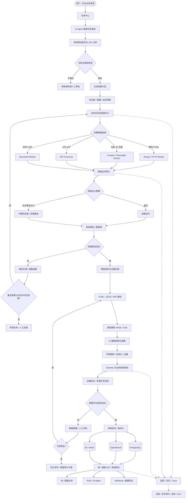
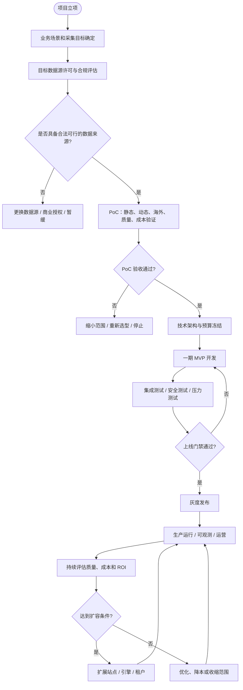

# AICrawl Enterprise 企业级 AI 智能分布式采集平台——整体项目流程图

> 适用：PRD V2.0 / SDD V1.0 / FSR V1.0。图示为目标逻辑流程，并不表示所有模块必须在一期同步上线。

## 一、平台端到端业务流程

## 二、公司项目建设与交付流程

## 三、主要落地约束

- **唯一任务真相源**：PostgreSQL 保存任务与执行状态；Redis/Celery 为派发与执行通道；通过事务 Outbox、幂等键、执行租约及心跳实现故障恢复。
- **访问与代理**：遵守适用法律、网站条款和访问政策；代理仅用于授权地域出口和网络稳定性，不用于绕过访问禁令、登录限制或验证码。
- **质量治理**：抽取结果保存来源 URL、抓取时间、原文证据位置、规则版本、模型版本；低置信度字段不能直接发布。
- **失败重试**：429、403、robots 禁止和明确拒绝访问不是无条件换代理重试的信号；重试必须受站点许可、限速和预算控制。
- **交付节奏**：PoC 验证成功率和单条合格数据成本后，再决定 MVP 与大规模生产化的投入。
