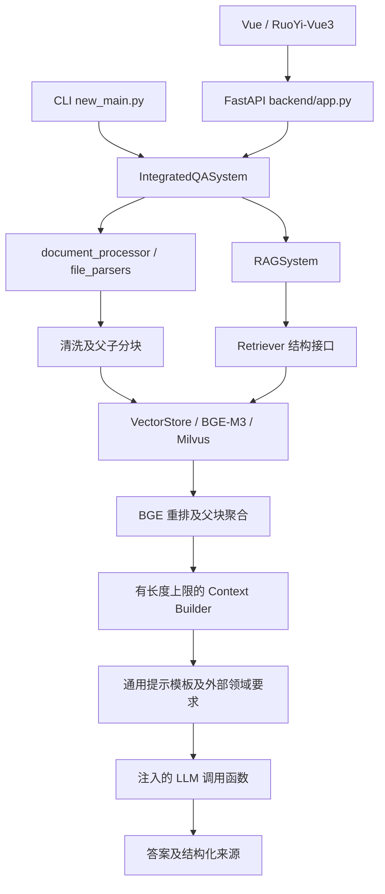

# 架构与调用链

`base/config.py` 读取公共配置、Collection 配置及环境覆盖。核心中没有金融/法律判断。领域名称和补充要求仅是输入数据。API 初始知识库由默认配置确定，已有知识库定义存储在外部 JSON 文件。

Embedding、Milvus 和重排序沿用原 VectorStore 实现。Pipeline 仅调用 Retriever 结构接口及注入的 LLM 函数，测试可替换这些组件。模型实例按路径组合复用，各 Collection 使用不同 Milvus 集合及文件锁。未创建空架构目录或接入新的 RAG 框架。

上下文按 UTF-8 字节预算截断，采用字节级 tokenizer 的保守 Token 上界，因此通常小于配置 Token 上限。只组装检索父块，来源列表仅对应实际加入上下文的片段。问答长度和历史也有限制，模型失败向调用方报错。默认重排阈值用于兼容已有行为，业务评测后可配置更严格阈值，无法保证自动检测所有无关问题。

索引清单作为原子提交边界，跨进程文件锁序列化同一 Collection 的写入与检索。失败的未提交向量不参与搜索。旧向量物理保留以支持最近一次清单回退。清单直接列举有效 ID，超大 Collection 需要进一步评估表达式大小及检索性能。

网页上传以文件名作为逻辑文档身份，文件原文以内容哈希存储。CLI 使用绝对源路径作为身份。两种入口都调用同一文档处理和索引逻辑。网页清单与 CLI 源路径清单暂时独立，应通过各自入口管理已导入文件。

重排序返回非有限分数时，系统记录日志并改用同一 Collection 的混合检索排序，同步接口的 `warnings` 和来源的 `warning` 字段会说明降级。正常数值的重排结果继续使用配置阈值。本机已观察到该数值问题。
